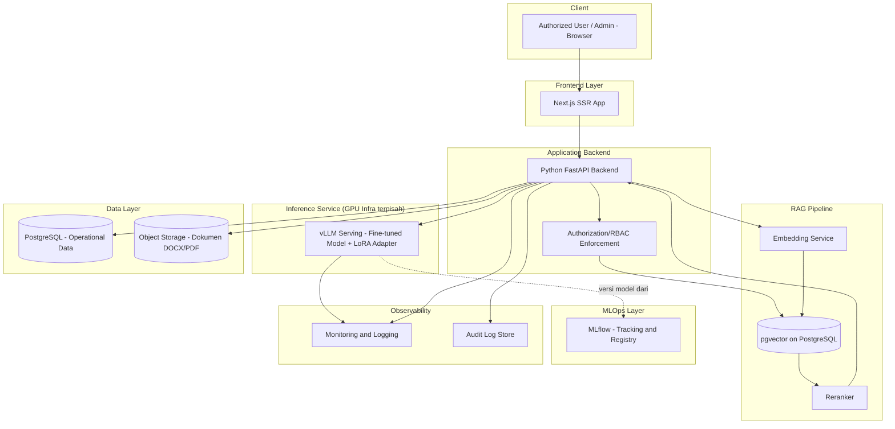

# ML Deployment Strategy — DocuGen AI

Status: Dokumen turunan dari `master_spec.md` (Single Source of Truth). Dokumen ini TIDAK boleh kontradiksi Decision Log §4, riset teknis §8, dan Hardware Reality §7 pada master spec. Semua angka benchmark, VRAM, dan harga GPU dikutip apa adanya dari master spec §8 — tidak ada angka baru yang dikarang di dokumen ini. Referensi anchor: `master_spec.md` §4 (Decision Log), §7 (Hardware Reality), §8 (Riset Teknis Terverifikasi), §9 (Security & Data Governance).

Audiens utama: AI/ML Engineer dan MLOps Engineer. Dokumen ini adalah strategi end-to-end dari pemilihan base model sampai production deployment untuk DocuGen AI — LLM Document Generator dengan fine-tuning (behavior) + RAG (knowledge dinamis), sesuai pembedaan fungsi di master spec §3.

---

## A. Model Strategy

### A.1 Foundation Model Selection

Sesuai master spec §4 (Decision Log), strategi model adalah **fine-tuning pretrained open-weight model**, bukan training from scratch. Kandidat dievaluasi dari riset teknis publik yang sudah diverifikasi di master spec §8.1 (retrieved Nov 2026, sumber: Qwen2.5 Technical Report arXiv:2412.15115, HF model cards):

| Model | License | Context | Catatan Benchmark |
|---|---|---|---|
| Qwen2.5-7B-Instruct | Apache 2.0 | 128K | MMLU-Pro 56.3 (vs Llama3.1-8B 48.3), HumanEval 84.8, GSM8K 91.6; IFEval strict-prompt 71.2 (lebih rendah dari Llama3.1-8B 75.9); IndoMMLU 56.4 (lebih baik dari Llama3.1-8B 53.9) |
| Llama-3.1-8B-Instruct | Llama 3.1 Community License (bukan Apache/MIT — ada batasan komersial skala besar, cek ketentuan resmi Meta sebelum deploy produksi) | 128K | IFEval strict-prompt tertinggi di kelas 7-9B (75.9); kalah di coding/math vs Qwen2.5-7B |
| Mistral-7B-Instruct-v0.3 | Apache 2.0 | — | MMLU 64.2 (vs Qwen2.5-7B base 74.2), lebih lemah di HumanEval; IndoMMLU **TBD**, belum ada data dari sumber yang ditemukan |

**Keputusan — bukan final**: Qwen2.5-7B-Instruct adalah **kandidat utama untuk diuji pertama**, sesuai rekomendasi master spec §8.1, karena kombinasi (a) lisensi Apache 2.0 paling permisif untuk enterprise closed deployment, (b) performa Bahasa Indonesia (IndoMMLU) paling kompetitif di antara ketiganya, (c) context length 128K yang mendukung dokumen panjang. Llama-3.1-8B-Instruct tetap dipertahankan sebagai kandidat kedua karena IFEval strict-prompt tertinggi (relevan untuk instruction-following presisi pada task document generation), dan Mistral-7B-Instruct-v0.3 sebagai kandidat ketiga/baseline Apache 2.0 alternatif.

**TBD — tidak boleh diputuskan di sini**: Model final HANYA boleh ditetapkan setelah benchmarking internal terhadap representative document-generation prompts milik DocuGen AI (lihat §E.1). Urutan eksperimen: Qwen2.5-7B-Instruct → Llama-3.1-8B-Instruct → Mistral-7B-Instruct-v0.3 (jika anggaran/waktu eksperimen masih tersedia setelah dua kandidat pertama).

### A.2 Benchmarking Table

Tabel benchmark publik di atas (§A.1) dipakai sebagai **basis seleksi awal kandidat untuk diuji**, bukan basis keputusan final — karena benchmark publik (MMLU-Pro, HumanEval, GSM8K, IFEval, IndoMMLU) mengukur kapabilitas umum, bukan kualitas document generation spesifik domain DocuGen AI (struktur heading/numbering, gaya formal Bahasa Indonesia perusahaan, kepatuhan template). Proses benchmarking internal didefinisikan di §E.1.

### A.3 Model Size Selection

Kelas ukuran yang dipilih: **7B–8B parameter**. Justifikasi:
- Sejalan dengan VRAM table master spec §8.2: QLoRA 7B/8B membutuhkan ~8-14GB VRAM, feasible pada 1x GPU 12-24GB (RTX 3090/4090/A100) — jalur realistis pertama sesuai keputusan "Colab/Kaggle dulu → GPU rental" (master spec §4, §7).
- Ukuran lebih besar (14B/32B/70B) membutuhkan VRAM QLoRA 14GB/28GB/52GB — melampaui kapasitas tier gratis/murah (Colab T4 16GB, Kaggle T4/P100) untuk eksperimen awal, sehingga **tidak dipilih untuk Phase 1**. Eskalasi ke 14B+ ditandai sebagai opsi Phase 2+ TBD jika hasil eval 7B/8B tidak memenuhi target kualitas.
- Full fine-tuning 7B (~88GB) **tidak direkomendasikan** untuk MVP — eksplisit sesuai kesimpulan master spec §8.2.

### A.4 Tokenizer

Menggunakan tokenizer bawaan masing-masing model kandidat (Qwen2.5 BPE tokenizer / Llama 3.1 tokenizer / Mistral tokenizer) — tidak melakukan retraining tokenizer. Pertimbangan Bahasa Indonesia: ketiga tokenizer adalah multilingual BPE generik (bukan tokenizer khusus Bahasa Indonesia); efisiensi token Bahasa Indonesia akan diukur sebagai bagian evaluasi internal (§E.6), bukan diasumsikan baik hanya dari skor IndoMMLU.

### A.5 Context Length

128K token (Qwen2.5-7B-Instruct dan Llama-3.1-8B-Instruct, per tabel §A.1). Context length production **tidak akan dipakai penuh 128K** — dibatasi secara praktis oleh:
- VRAM KV cache pada GPU inference produksi (lihat §F.2).
- Kebutuhan riil dokumen enterprise (SOP, kontrak, laporan) yang jarang melebihi puluhan ribu token.
- Context window efektif yang dialokasikan ke RAG (retrieved chunks) + histori percakapan + instruksi sistem + dokumen yang di-edit.

Batas context window produksi konkret adalah **TBD**, ditentukan saat load testing di §F.4, dengan rekomendasi awal 8K–32K token sebagai titik mulai yang realistis untuk GPU rental kelas 24GB.

### A.6 Architecture

Decoder-only transformer (arsitektur standar ketiga kandidat — Qwen2.5, Llama 3.1, Mistral semuanya decoder-only dengan grouped-query attention). Tidak ada modifikasi arsitektur model dilakukan oleh tim DocuGen AI — hanya fine-tuning (LoRA/QLoRA) di atas bobot pretrained, selaras dengan master spec §3 dan §4 ("bukan train from scratch").

### A.7 License

- Qwen2.5-7B-Instruct: Apache 2.0 — paling permisif, tidak ada batasan komersial khusus.
- Llama-3.1-8B-Instruct: Llama 3.1 Community License — **wajib** tim legal/compliance mengecek ketentuan resmi Meta sebelum deploy produksi, terutama batasan penggunaan komersial skala besar dan ketentuan turunan model (derivative naming requirement "Llama"). Ini bukan hambatan mutlak untuk enterprise internal, tapi wajib direview sebelum go-live jika kandidat ini yang akhirnya dipilih.
- Mistral-7B-Instruct-v0.3: Apache 2.0 — permisif, setara Qwen2.5 dari sisi lisensi.

### A.8 Deployment Strategy (Ringkasan, detail di §G–§J)

Self-hosted model serving di infrastruktur sendiri (cloud GPU rental atau on-prem), **bukan** API model eksternal — sesuai master spec §4 ("model self-hosted adalah default; API eksternal hanya opsi evaluatif bertanda TBD dengan guardrail data governance"). Alasan utama: data governance (dokumen internal tidak boleh dikirim ke pihak ketiga tanpa approval formal, master spec §9.7) dan kebutuhan fine-tuning behavior model yang hanya mungkin dengan akses bobot model (open-weight).

---

## B. Dataset Engineering

### B.1 Kategori Dataset dan Kebutuhannya

Fine-tuning mengubah **behavior** model (instruction-following, gaya, struktur) — bukan menyuntikkan fakta dinamis (itu tugas RAG, master spec §3). Oleh karena itu dataset SFT difokuskan pada kategori berikut:

1. **General language dataset** — korpus umum Bahasa Indonesia + Inggris untuk menjaga kemampuan bahasa umum model tidak terdegradasi (catastrophic forgetting) selama fine-tuning sempit pada domain dokumen. Sumber: public corpus (contoh: OSCAR Indonesian, Wikipedia ID).
2. **Instruction dataset** — pasangan instruksi-respons umum (ikut gaya chat asisten) agar model tetap kompeten sebagai conversational assistant general-purpose, sesuai master spec §2 (general-purpose LLM dengan document generation sebagai spesialisasi).
3. **Document generation dataset** — instruksi menghasilkan dokumen baru dari brief (misal: "buatkan surat permohonan cuti", "buat SOP onboarding karyawan baru") dengan output yang mengikuti struktur dokumen formal perusahaan.
4. **Document editing dataset** — instruksi mengedit/merevisi dokumen yang sudah ada (ubah nada, perbaiki bagian tertentu, tambah klausul) — berbeda dari generation karena input mengandung dokumen existing + instruksi edit.
5. **Document structure dataset** — contoh heading/numbering/format baku yang konsisten (template surat, SOP, memo, kontrak) agar model belajar pola struktural, terlepas dari isi/topik dokumen.
6. **Indonesian language dataset** — fokus kualitas Bahasa Indonesia formal/baku (EYD, gaya birokrasi/korporat), karena benchmark publik IndoMMLU hanya mengukur pemahaman, bukan kualitas generasi Bahasa Indonesia formal.
7. **Evaluation dataset** — held-out set terpisah dari training, dipakai khusus di §E, tidak pernah dicampur ke train/val SFT.

Sesuai master spec §4 ("Dataset awal: tidak ada dokumen perusahaan riil tersedia saat ini → dataset awal public + synthetic; pipeline tetap dirancang untuk menyerap dokumen historis perusahaan begitu tersedia"), kategori 3-5 pada Phase 1 akan diisi dataset **public + synthetic** (dibuat dengan template manual dan/atau dibantu model generatif untuk variasi, lalu direview manusia), dan pipeline (§C) dirancang agar dokumen historis approved perusahaan dapat diserap begitu tersedia (§B.3).

### B.2 Contoh JSONL untuk SFT (format instruction-response)

Tiga contoh realistis dari kategori berbeda (format: satu objek JSON per baris, kompatibel dengan pipeline SFT standar seperti Alpaca/ShareGPT style):

```json
{"id": "doc-gen-0001", "category": "document_generation", "language": "id", "instruction": "Buatkan surat permohonan cuti tahunan untuk karyawan bernama Siti Rahma, Staff Finance, selama 5 hari kerja mulai 2 Desember 2026, alasan keperluan keluarga.", "input": "", "output": "SURAT PERMOHONAN CUTI TAHUNAN\n\nKepada: Manajer Human Resources\nDari: Siti Rahma\nJabatan: Staff Finance\nTanggal: 20 November 2026\n\nDengan hormat,\n\nSaya yang bertanda tangan di bawah ini:\nNama: Siti Rahma\nJabatan: Staff Finance\n\nMengajukan permohonan cuti tahunan selama 5 (lima) hari kerja, terhitung mulai tanggal 2 Desember 2026 sampai dengan 8 Desember 2026, dengan alasan keperluan keluarga.\n\nSelama masa cuti, tugas dan tanggung jawab saya akan didelegasikan kepada rekan kerja terkait sesuai arahan atasan.\n\nDemikian permohonan ini saya sampaikan. Atas perhatian dan persetujuannya, saya ucapkan terima kasih.\n\nHormat saya,\nSiti Rahma", "source": "synthetic_template", "approved_by": "ai_ml_team_synthetic_batch_01"}
{"id": "doc-edit-0002", "category": "document_editing", "language": "id", "instruction": "Revisi paragraf penutup SOP berikut agar lebih formal dan tambahkan klausul tinjauan ulang tahunan.", "input": "Paragraf penutup saat ini: \"Demikian SOP ini dibuat, semoga bisa dipakai dengan baik oleh semua tim.\"", "output": "Paragraf penutup revisi: \"Standar Operasional Prosedur ini berlaku efektif sejak tanggal ditetapkan dan wajib dipatuhi oleh seluruh unit kerja terkait. Dokumen ini akan ditinjau ulang secara berkala setiap 12 (dua belas) bulan, atau lebih cepat apabila terdapat perubahan kebijakan yang relevan, untuk memastikan kesesuaiannya dengan kebutuhan operasional perusahaan.\"", "source": "synthetic_template", "approved_by": "ai_ml_team_synthetic_batch_01"}
{"id": "struct-0003", "category": "document_structure", "language": "id", "instruction": "Buatkan kerangka (outline) struktur dokumen Memo Internal sesuai format baku perusahaan, tanpa isi konten penuh.", "input": "", "output": "MEMO INTERNAL\n\n1. Nomor Memo: [diisi otomatis sistem]\n2. Tanggal: [tanggal]\n3. Kepada: [penerima]\n4. Dari: [pengirim]\n5. Perihal: [subjek singkat]\n6. Isi Memo:\n   6.1 Latar Belakang\n   6.2 Isi/Keterangan\n   6.3 Tindak Lanjut yang Diharapkan\n7. Lampiran (jika ada)\n8. Tanda Tangan Pengirim", "source": "synthetic_template", "approved_by": "ai_ml_team_synthetic_batch_01"}
```

### B.3 Konversi Dokumen Historis Approved → Instruction-Response Pairs

Prosedur (berlaku begitu dokumen historis perusahaan tersedia, sesuai master spec §4):
1. **Sumber**: hanya dokumen dengan status lifecycle final/approved (merujuk Document Control lifecycle di `PRD_Document_Control_SaaS.md` — status akhir seperti "Approved"/"Published", bukan Draft). Dokumen Draft/rejected TIDAK boleh dipakai sebagai training data berkualitas tinggi karena belum tervalidasi secara bisnis.
2. **Reverse-instruction generation**: untuk setiap dokumen approved, tim AI/ML (dibantu model LLM sebagai alat bantu, lalu direview manusia) membuat instruksi hipotetis yang masuk akal akan menghasilkan dokumen tersebut (misal dari metadata: jenis dokumen, departemen pemohon, tujuan) — dokumen final menjadi `output`, instruksi yang disusun menjadi `instruction`.
3. **Human review wajib**: setiap pair instruction-response hasil reverse-generation direview oleh AI/ML Team sebelum masuk kandidat dataset — konsisten dengan prinsip master spec §3 ("human review wajib untuk dokumen bisnis penting").
4. **PII pass**: setiap dokumen melalui PII detection & redaction (§B.5) sebelum dikonversi.
5. **Approval**: dataset hasil konversi tetap melalui proses approval training dataset (§B.6) sebelum dipakai di pipeline §C.

### B.4 Pemisahan Jenis Data (wajib, tidak boleh tercampur)

| Jenis Data | Fungsi | Lokasi/Lifecycle |
|---|---|---|
| **Operational data** | Data transaksional aplikasi berjalan — percakapan user, dokumen upload, log aktivitas | Database PostgreSQL aplikasi; **tidak otomatis** jadi training data (master spec §9.1, §9.2) |
| **RAG knowledge data** | Dokumen referensi dinamis (SOP, kebijakan, template aktif) yang diindeks ke vector DB untuk retrieval saat inference | Vector DB (pgvector/Qdrant, §H); selalu up-to-date, tidak melalui fine-tuning |
| **Fine-tuning training data** | Pasangan instruction-response untuk SFT — public + synthetic (Phase 1), dokumen historis approved terkonversi (begitu tersedia) | Dataset versioned terpisah (§C.9), butuh approval eksplisit sebelum training |
| **Evaluation data** | Held-out set untuk mengukur performa model — tidak pernah overlap dengan training data | Dataset versioned terpisah, locked setelah dibuat (anti data leakage) |

Pemisahan ini wajib ditegakkan secara teknis (folder/skema terpisah, kontrol akses berbeda), bukan hanya konvensi penamaan — agar tidak terjadi kebocoran operational data user ke training set tanpa consent (melanggar master spec §9.1/§9.2).

### B.5 PII Detection & Redaction

- Tool: kombinasi rule-based regex (NIK, nomor telepon, email, nomor rekening format Indonesia) + model NER (contoh: spaCy / Presidio dengan recognizer custom Bahasa Indonesia) untuk entitas nama orang, alamat.
- Proses: setiap dokumen sumber (baik untuk RAG maupun untuk training) WAJIB melalui tahap PII detection sebelum masuk pipeline lebih lanjut — ini adalah tahap eksplisit di §C (Data Preparation Pipeline), bukan opsional.
- Tindakan: PII terdeteksi di-redact (diganti placeholder, misal `[NAMA]`, `[NO_TELEPON]`) pada dataset training; untuk RAG knowledge data, PII yang memang bagian legitimate dari dokumen operasional (misal data karyawan di SOP) ditangani lewat kontrol akses (ACL §H.8), bukan redaksi destruktif yang merusak isi dokumen.
- Output: setiap dokumen yang diproses mendapat flag `pii_checked: true/false` dan log hasil deteksi untuk audit (selaras master spec §9.6, audit trail akses sensitif).

### B.6 Approval Dataset (Business Process)

Sesuai master spec §9.3 ("Dataset training butuh approval eksplisit, lihat Business Process §Model Training Approval"): setiap dataset kandidat untuk fine-tuning (baik public+synthetic batch maupun hasil konversi dokumen historis) WAJIB melalui proses approval formal yang didefinisikan di `business_process.md` §Model Training Approval sebelum berpindah status menjadi "Approved Dataset" di pipeline §C.9. Dokumen ini hanya merujuk proses tersebut sebagai anchor traceability (master spec §10) — detail proses approval (siapa approver, kriteria, SLA) ada di `business_process.md`, tidak diduplikasi di sini.

---

## C. Data Preparation Pipeline

Pipeline linear dengan gate approval di akhir, dirancang agar bisa jalan di local dev (CPU, master spec §7) untuk dataset kecil-menengah, dan discale ke Colab/Kaggle/GPU rental bila volume data bertambah besar.

| Tahap | Deskripsi | Tools |
|---|---|---|
| 1. Raw Data Collection | Mengumpulkan sumber: public corpus (OSCAR ID, Wikipedia ID), dokumen historis approved perusahaan (begitu tersedia), hasil synthetic generation | `requests`/`datasets` (HF), export dari sistem Document Control |
| 2. Source Validation | Verifikasi lisensi sumber public data, verifikasi status lifecycle "Approved" untuk dokumen historis (lihat §B.3), cek duplikat sumber | Script Python manual + checklist lisensi |
| 3. Data Cleaning | Normalisasi encoding, hapus markup/boilerplate, normalisasi whitespace, filter dokumen terlalu pendek/rusak | `pandas`, `regex`, `clean-text` |
| 4. Deduplication | Hapus duplikat exact & near-duplicate (dokumen template yang sama dipakai berulang) | MinHash/`datasketch`, exact hash (`hashlib`) |
| 5. PII Detection | Deteksi NIK/telepon/email/nama/alamat, redaksi untuk training data (§B.5) | Presidio / spaCy NER + regex custom ID |
| 6. Data Annotation | Pelabelan kategori (§B.1: general/instruction/doc-gen/doc-edit/structure/eval), penyusunan instruction-response pair (manual + dibantu LLM untuk draft, direview manusia — §B.3) | Label Studio (lokal, CPU-friendly) atau spreadsheet terkontrol untuk volume kecil |
| 7. Quality Validation | Review manusia (AI/ML Team) atas sampel/seluruh pair baru, cek konsistensi format, cek bahasa formal, reject pair buruk | Manual review checklist + spot-check otomatis (panjang, bahasa terdeteksi) |
| 8. Train/Val/Test Split | Split per kategori (stratified), rasio awal rekomendasi 80/10/10, pastikan tidak ada kebocoran dokumen sumber yang sama antar split | `scikit-learn` `train_test_split` dengan grouping by source document |
| 9. Dataset Versioning | Snapshot dataset dengan versi (hash/tanggal), simpan metadata (jumlah sample per kategori, sumber, tanggal PII check) | DVC atau Git LFS + manifest JSON (pilihan konkret didetailkan di `ML_Pipeline.md`) |
| 10. Approved Dataset | Dataset versi tertentu mendapat status "Approved" setelah lolos proses approval §B.6 — baru dari titik ini dataset boleh dipakai untuk training (§D) | Tracking manual/registry (detail implementasi di `ML_Pipeline.md`) |

Catatan hardware: tahap 1-8 adalah CPU-bound dan **feasible** di local dev machine (Ryzen 3 3250U, 8GB RAM, master spec §7) untuk dataset kecil-menengah; tidak membutuhkan GPU.

---

## D. Model Training

### D.1 Metode

Sesuai master spec §4: evaluasi **LoRA vs QLoRA berbasis benchmark**, bukan diasumsikan. Full fine-tuning tidak direkomendasikan untuk model 7B/8B (VRAM ~88GB, master spec §8.2) — tidak realistis untuk MVP.

- **QLoRA (4-bit)**: jalur utama eksperimen awal — VRAM minimum ~8-14GB untuk 7B/8B, feasible di Colab/Kaggle free tier (T4 16GB) dan GPU rental murah (RTX 3090/4090 24GB).
- **LoRA (16-bit)**: dicoba sebagai pembanding kualitas jika QLoRA menunjukkan degradasi akibat kuantisasi — butuh VRAM lebih besar (~19-20GB), masih feasible di RTX 3090/4090/A100 sesuai tabel VRAM §8.2, tapi tidak lagi feasible di Colab free tier T4 16GB.
- **Full FT**: tidak dipakai di Phase 1 (eksplisit tidak direkomendasikan, master spec §8.2).

Keputusan final LoRA vs QLoRA: **TBD**, ditentukan berdasarkan hasil benchmark kualitas vs biaya komputasi pada §E, bukan diasumsikan di muka.

### D.2 Konfigurasi Eksperimen Awal (Starting Point, BUKAN parameter final universal)

Konfigurasi berikut adalah **titik mulai eksperimen** untuk kandidat Qwen2.5-7B-Instruct dengan QLoRA, berdasarkan praktik umum fine-tuning model kelas 7B — **bukan hasil hyperparameter search internal** dan **bukan parameter final**:

| Parameter | Nilai awal (starting point) |
|---|---|
| Metode | QLoRA, 4-bit NF4 quantization |
| LoRA rank (r) | 16 |
| LoRA alpha | 32 |
| LoRA dropout | 0.05 |
| Target modules | q_proj, k_proj, v_proj, o_proj (attention projections) |
| Learning rate | 2e-4 (dengan cosine scheduler + warmup) |
| Batch size (per device) | 4, dengan gradient accumulation steps 4 (effective batch 16) |
| Epoch | 3 (awal), dipantau early stopping berdasarkan val loss |
| Max sequence length | 2048 token (titik mulai, bukan context length penuh 128K model) |
| Precision | bf16 compute, 4-bit NF4 storage (QLoRA standar) |
| Checkpointing | Simpan checkpoint tiap epoch + checkpoint terbaik berdasarkan val loss; gradient checkpointing diaktifkan untuk menghemat VRAM |
| Optimizer | paged_adamw_8bit (standar QLoRA, hemat memory) |

**Catatan wajib**: setiap parameter di atas adalah hipotesis awal untuk eksperimen pertama pada GPU Colab/Kaggle, dan WAJIB disesuaikan berdasarkan hasil observasi (loss curve, overfitting, VRAM actual usage) — tidak boleh dianggap sebagai konfigurasi final/universal untuk semua kandidat model atau semua kategori dataset.

### D.3 Lingkungan Eksekusi

Sesuai master spec §7: training/fine-tuning GPU-berat **wajib** dieksekusi di Google Colab Pro / Kaggle (free/low-cost tier) dahulu untuk iterasi awal, baru eskalasi ke GPU rental on-demand (RunPod/Vast.ai/Lambda) bila butuh scale atau durasi lebih panjang. Local dev machine HANYA dipakai untuk menulis/menguji script training secara sintaksis (tanpa eksekusi penuh) — tidak untuk eksekusi training aktual.

---

## E. Model Evaluation

### E.1 Dimensi Evaluasi

| Dimensi | Deskripsi | Metode |
|---|---|---|
| Instruction following | Apakah model mengikuti instruksi spesifik (panjang, format, poin yang diminta) | Automated (rule-based check) + human rating |
| Document completeness | Apakah seluruh bagian dokumen yang diminta ada (tidak ada section hilang) | Automated (checklist structural) + human review |
| Structural consistency | Konsistensi heading/numbering/format dengan template baku | Automated (regex/structure parser) |
| Factual accuracy | Akurasi fakta dalam output (relevan utamanya untuk mode +RAG) | Human review + automated fact-check vs source (untuk RAG) |
| Hallucination | Klaim yang tidak didukung instruksi/sumber | Human review; automated groundedness check untuk RAG (§E.9) |
| Bahasa Indonesia eval | Kualitas bahasa formal/baku, tata bahasa, EYD | Human review (linguist/reviewer internal) + automated grammar check |
| Format compliance | Output sesuai format target (DOCX/PDF export structure, markdown heading level, dst) | Automated validation terhadap schema template |
| RAG faithfulness | Jawaban +RAG konsisten dengan dokumen yang diretrieve, tidak menyimpang | Automated (contoh pendekatan RAGAS-style faithfulness score) + human spot-check |
| Latency | Waktu respons end-to-end (time-to-first-token, total generation time) | Automated load test (§F.4) |
| Security eval | Resistensi terhadap prompt injection, kebocoran data lintas permission (RAG ACL bypass), jailbreak dasar | Manual red-teaming + automated adversarial prompt suite |

### E.2 Pemisahan Evaluasi: Base Model vs Fine-tuned vs +RAG

Evaluasi dilakukan berjenjang dan **tidak dicampur**, agar kontribusi masing-masing komponen jelas:
1. **Base model (pretrained, tanpa fine-tuning, tanpa RAG)** — baseline murni untuk setiap kandidat (Qwen2.5-7B-Instruct, Llama-3.1-8B-Instruct, Mistral-7B-Instruct-v0.3) pada representative document-generation prompts internal DocuGen AI. Ini adalah benchmarking internal yang disebut di §A.1 sebagai prasyarat keputusan final model.
2. **Fine-tuned (SFT/LoRA/QLoRA, tanpa RAG)** — mengukur delta kualitas murni dari fine-tuning behavior (gaya, struktur, instruction-following) dibanding base model, pada dataset evaluasi §B.1 kategori 7 (held-out, tidak pernah dipakai training).
3. **Fine-tuned + RAG** — mengukur kualitas end-to-end sistem produksi penuh, termasuk RAG faithfulness dan factual accuracy terhadap knowledge base — ini adalah konfigurasi yang akan dideploy ke production.

Perbandingan 3 jenjang ini wajib didokumentasikan sebagai bagian keputusan final model (menjawab §A.1 TBD) — bukan hanya memilih skor tertinggi di salah satu jenjang tanpa melihat komponen lain.

### E.3 Automated vs Human Evaluation

- **Automated**: structural consistency, format compliance, latency, RAG faithfulness (skor otomatis), security eval (adversarial prompt suite otomatis) — murah, scalable, dijalankan tiap eksperimen/checkpoint.
- **Human**: instruction following kualitatif, Bahasa Indonesia eval, factual accuracy pada kasus ambigu, hallucination judgement, security red-teaming manual — lebih mahal, dijalankan pada kandidat finalis sebelum keputusan model final dan sebelum rilis production.

### E.4 Lingkungan Eksekusi Evaluasi GPU-berat

Sama seperti training (§D.3), evaluasi yang membutuhkan inference model 7B/8B penuh wajib dijalankan di Colab/Kaggle dahulu, lalu GPU rental bila volume test case besar — selaras master spec §7.

---

## F. Model Optimization

- **Quantization**: model produksi disajikan dalam kuantisasi (contoh: 4-bit AWQ/GPTQ atau 8-bit) untuk mengurangi VRAM footprint dan meningkatkan throughput inference — pilihan skema kuantisasi spesifik (AWQ vs GPTQ vs bitsandbytes 4-bit) adalah **TBD**, ditentukan di tahap serving (§G) berdasarkan kompatibilitas serving engine terpilih.
- **KV cache**: pengelolaan KV cache (termasuk teknik seperti PagedAttention bila serving engine mendukung, lihat §G.1) untuk efisiensi memory saat banyak request concurrent dan sequence panjang.
- **Batch inference**: continuous batching untuk melayani beberapa request concurrent secara efisien di satu GPU, dibanding static batching yang memboroskan GPU idle time.
- **Memory & GPU utilization**: monitoring VRAM usage actual production (bukan hanya estimasi tabel §8.2) untuk menentukan jumlah concurrent request aman per GPU — baseline dari tabel VRAM §8.2 dipakai sebagai estimasi awal sizing (§J/§K), bukan jaminan final karena overhead KV cache dan batching belum terhitung di tabel itu.
- **Concurrent requests**: target jumlah concurrent user yang dilayani 1 GPU inference adalah **TBD**, diukur lewat load testing aktual pada konfigurasi serving terpilih (§G), bukan diasumsikan dari spesifikasi teoretis.

---

## G. Model Serving

### G.1 Perbandingan Serving Engine

| Engine | Kelebihan | Kekurangan |
|---|---|---|
| **HF Transformers (native)** | Paling fleksibel untuk eksperimen/debug, dukungan model terluas, mudah dipakai di Colab/notebook | Throughput production rendah, tidak ada continuous batching bawaan, tidak dioptimalkan untuk serving multi-user |
| **vLLM** | Continuous batching + PagedAttention untuk throughput tinggi, dukungan quantization (AWQ/GPTQ), OpenAI-compatible API server bawaan, dukungan luas untuk Qwen2.5/Llama/Mistral | Setup lebih kompleks dari native Transformers, butuh GPU dengan compute capability memadai |
| **TGI (Text Generation Inference)** | Juga continuous batching, production-grade dari Hugging Face, dukungan streaming, quantization | Historisnya lebih berorientasi ke infra HF (Docker image besar), fitur flexibility kadang di belakang vLLM untuk model terbaru |

**Rekomendasi**: **vLLM** untuk production serving, dengan justifikasi: (a) OpenAI-compatible API memudahkan integrasi dengan backend FastAPI (master spec §4 — backend Python FastAPI terpisah dari inference service), (b) continuous batching + PagedAttention relevan langsung untuk kebutuhan concurrent request multi-user enterprise (§F), (c) dukungan quantization matang untuk model kelas 7B/8B kandidat §A.1, (d) komunitas dan update rilis aktif untuk model-model Qwen/Llama/Mistral terbaru. HF Transformers tetap dipakai di tahap eksperimen/training/evaluasi notebook (Colab/Kaggid), bukan untuk serving production.

### G.2 Karakteristik Serving yang Wajib

- **API**: OpenAI-compatible REST endpoint dari vLLM, dikonsumsi backend FastAPI aplikasi (arsitektur terpisah sesuai master spec §4).
- **Streaming**: wajib didukung (Server-Sent Events/chunked response) untuk UX ChatGPT-like (master spec §4 — UI paradigm conversational).
- **Queue**: request queue di level serving engine (vLLM internal scheduler) + opsional queue tambahan di backend untuk rate limiting per user/department (Phase 2 saat ACL granular).
- **Token limit**: enforce max token per request (input+output) di level backend API sebelum diteruskan ke inference service — nilai konkret TBD, diturunkan dari context window production §A.5.
- **Health check**: endpoint `/health` di inference service dicek oleh orchestrator (lihat §J) untuk readiness/liveness probe sebelum traffic diarahkan.
- **Versioning**: setiap model/LoRA adapter yang dideploy diberi versi eksplisit (lihat Model Registry §I.3) agar bisa dirollback (§I.5) tanpa downtime penuh.

---

## H. RAG Architecture

### H.1 Ingestion

Dokumen sumber (SOP, kebijakan, template aktif, dokumen referensi) masuk melalui upload admin/authorized user atau batch import dari sistem Document Control. Setiap dokumen diberi metadata: klasifikasi sensitivitas (Public/Internal/Confidential/Restricted, master spec §9.5), ACL (siapa/role/department yang boleh akses), dan versi.

### H.2 Text Extraction

Ekstraksi teks dari format sumber: DOCX (python-docx), PDF (pdfplumber/PyMuPDF untuk PDF berbasis teks).

### H.3 OCR

Untuk dokumen PDF hasil scan/gambar (tidak ada text layer): OCR engine (contoh: Tesseract dengan bahasa Indonesia, atau layanan OCR lain) dijalankan sebagai fallback ketika ekstraksi teks langsung gagal/kosong.

### H.4 Chunking

Dokumen dipecah menjadi chunk dengan strategi yang menghormati struktur dokumen (per section/heading, bukan sembarang potong per N karakter) agar konteks structural (§A, §B.1 kategori 5) tidak rusak saat retrieval — ukuran chunk konkret dan overlap adalah detail implementasi di `ML_Pipeline.md`.

### H.5 Embedding

Model embedding multilingual yang mendukung Bahasa Indonesia dipakai untuk mengubah chunk menjadi vector — pemilihan model embedding spesifik adalah **TBD**, ditentukan di `ML_Pipeline.md` berdasarkan benchmark retrieval quality vs cost, bukan diasumsikan di dokumen strategi ini.

### H.6 Vector DB: pgvector vs Qdrant

| Aspek | pgvector | Qdrant |
|---|---|---|
| Moving parts | Minim — extension di PostgreSQL yang sudah jadi database utama aplikasi (master spec §4) | Tambahan service terpisah yang harus dioperasikan, dimonitor, di-backup sendiri |
| Fitur retrieval lanjutan | Dasar (cosine/L2/inner product similarity search) | Lebih kaya: filtering kompleks, payload indexing, hybrid search, scalability horizontal yang lebih matang untuk volume sangat besar |
| Kecocokan Phase saat ini | Cocok untuk MVP — volume dokumen awal relatif kecil (belum ada dokumen perusahaan riil, master spec §4) | Lebih relevan saat volume knowledge base besar/butuh fitur retrieval lanjutan (Phase 2+) |

**Rekomendasi (menjawab master spec §4 yang mendelegasikan keputusan final ke dokumen ini)**: **pgvector untuk MVP**, dengan justifikasi utama minimalisasi moving parts — tidak perlu infrastruktur database tambahan, operasional/backup/monitoring menyatu dengan PostgreSQL yang sudah jadi keputusan database utama. **Qdrant dipertimbangkan untuk Phase 2** jika volume dokumen/kompleksitas retrieval (hybrid search, filtering ACL kompleks skala besar) melampaui kapasitas praktis pgvector — migrasi ini ditandai sebagai **TBD terkondisi**, dipantau lewat monitoring skala knowledge base di §I.6, bukan direncanakan tanpa trigger konkret.

### H.7 Retrieval, Reranking, Context Construction, Generation

- **Retrieval**: top-k similarity search dari vector DB berdasarkan query embedding user.
- **Reranking**: hasil top-k awal (lebih besar, misal top-20) di-rerank dengan model reranker (cross-encoder) untuk menyaring top-k final (misal top-5) yang paling relevan — mengurangi noise sebelum masuk context.
- **Context construction**: chunk terpilih disusun ke prompt dengan metadata sumber (judul dokumen, section) agar model bisa melakukan source citation.
- **Generation**: model fine-tuned (§D) menghasilkan jawaban berbasis context yang disusun, mengikuti instruksi untuk selalu menyertakan sitasi sumber.
- **Source citation**: setiap klaim/jawaban dari mode RAG wajib menyertakan referensi dokumen sumber (nama dokumen + section) sehingga user bisa verifikasi — ini juga basis untuk evaluasi RAG faithfulness (§E.9).

### H.8 Permission-Aware Retrieval — Mekanisme Konkret

Sesuai master spec §9.4 ("RAG retrieval WAJIB permission-aware — filter berbasis ACL dokumen sebelum masuk context, bukan hanya system prompt"), mekanisme konkret yang mencegah user mengakses dokumen yang tidak diizinkan:

1. Setiap chunk di vector DB disimpan dengan **payload ACL** (metadata): `allowed_roles`, `allowed_departments` (saat Phase 2 ACL granular aktif), `classification` (Public/Internal/Confidential/Restricted).
2. Saat user mengajukan query RAG, backend FastAPI mengambil **permission context user yang sudah terautentikasi** (role, department) dari session/token — bukan dari input user (tidak bisa dipalsukan dari sisi client).
3. Query ke vector DB disusun dengan **filter ACL sebagai bagian dari query itu sendiri** (contoh pgvector: klausa `WHERE` pada kolom metadata ACL dikombinasikan dengan operator similarity search; contoh Qdrant: payload filter pada request search) — filter diterapkan **sebelum atau bersamaan dengan** similarity search dieksekusi di level database, sehingga chunk yang tidak diizinkan **tidak pernah ikut diambil**, bukan diambil lalu disaring belakangan di aplikasi (yang rawan bug kebocoran).
4. Karena enforcement terjadi di level query database (backend API layer), bukan di system prompt atau instruksi ke model, maka tidak ada cara bagi user memanipulasi prompt untuk "membujuk" model mengakses dokumen yang filternya sudah menghilangkan chunk tersebut dari hasil retrieval — selaras master spec §9.8 ("Authorization ditegakkan di backend, bukan hanya UI/system prompt").
5. Setiap akses retrieval ke dokumen berklasifikasi Confidential/Restricted tercatat di audit log (master spec §9.6).

---

## I. MLOps

- **Experiment tracking**: MLflow untuk mencatat setiap run eksperimen fine-tuning (§D) — parameter (§D.2), metrik training (loss curve), metrik evaluasi (§E), dan artefak model/adapter. Dijalankan baik di Colab/Kaggle (logging ke MLflow server remote) maupun GPU rental.
- **Dataset versioning**: setiap dataset "Approved" (§C.10) di-versioning (hash/tag) dan tercatat keterkaitannya dengan run eksperimen MLflow mana yang memakainya — traceability dataset-ke-model wajib bisa ditelusuri.
- **Model registry**: adapter LoRA/QLoRA dan konfigurasi quantization yang lolos evaluasi (§E) didaftarkan ke model registry (MLflow Model Registry) dengan status (Staging/Production/Archived) dan versi eksplisit.
- **CI/CD**: pipeline otomatis untuk (a) validasi kualitas dataset baru (automated check §E.3) sebelum approval, (b) build image serving vLLM dengan model/adapter versi tertentu, (c) deployment ke staging sebelum production.
- **Canary release**: model/adapter versi baru dirilis ke sebagian kecil traffic produksi (atau sebagian kecil user internal) dahulu, dibandingkan metrik (latency, user feedback, error rate) dengan versi lama sebelum full rollout.
- **Rollback**: karena model registry menyimpan versi sebelumnya (status Production lama tidak langsung dihapus, hanya diturunkan ke Archived setelah periode observasi aman), rollback dilakukan dengan mengarahkan ulang serving ke versi model/adapter sebelumnya tanpa perlu retraining darurat.
- **Monitoring**: metrik operasional inference (latency, error rate, token throughput, VRAM usage) dipantau terus-menerus (§F.4, §J); dashboard terhubung ke sistem monitoring aplikasi secara keseluruhan.
- **Drift**: pemantauan distribusi input user (jenis dokumen yang diminta, panjang prompt) dan kualitas output dari waktu ke waktu untuk mendeteksi pergeseran kebutuhan yang mungkin membuat model fine-tuned mulai kurang relevan — trigger untuk re-evaluasi/retraining periodik adalah **TBD**, didefinisikan setelah ada data operasional produksi riil.
- **Feedback loop**: feedback eksplisit dari Authorized User (rating/flag pada output AI) dan review Admin/Document Control dikumpulkan sebagai sinyal — namun **tidak otomatis** menjadi training data (menegakkan master spec §9.1/§9.2); feedback masuk sebagai kandidat dataset yang tetap melalui proses approval §B.6 sebelum dipakai retraining.

---

## J. Production Deployment

### J.1 Diagram Deployment



### J.2 Komponen

- **Backend**: Python FastAPI (master spec §4), terpisah dari inference service — berkomunikasi ke vLLM lewat OpenAI-compatible API (§G.2).
- **Inference server**: vLLM (§G.1), dideploy di infrastruktur GPU terpisah dari backend aplikasi.
- **DB**: PostgreSQL (master spec §4) untuk operational data (§B.4).
- **Vector DB**: pgvector sebagai extension PostgreSQL yang sama (§H.6) untuk MVP.
- **Object storage**: untuk file dokumen (DOCX/PDF hasil export, dokumen upload) — pilihan konkret (S3-compatible / MinIO self-hosted) adalah TBD di `ML_Pipeline.md`, prinsip: terpisah dari database relasional, bukan disimpan sebagai blob di PostgreSQL.
- **GPU infra**: cloud GPU rental persisten (RunPod dkk., §K) untuk production MVP; on-prem GPU dipertimbangkan hanya bila sudah ada traksi nyata (master spec §7).
- **Containerization**: setiap komponen (backend, vLLM serving, embedding service) dikemas sebagai container Docker terpisah untuk deployment dan rollback konsisten; orkestrasi (Docker Compose untuk MVP, Kubernetes untuk Phase 2+ bila skala bertambah) — detail konkret di `ML_Pipeline.md`.
- **Security**: authorization ditegakkan di backend API layer (§H.8, master spec §9.8), data internal tidak dikirim ke API eksternal pihak ketiga tanpa approval (master spec §9.7), klasifikasi dokumen (§H.1) dan audit log (master spec §9.6) berjalan di layer backend+DB.
- **Monitoring**: metrik aplikasi (latency, error rate) dan metrik inference (VRAM, throughput, §F) terkumpul di sistem monitoring terpusat; alerting untuk anomali (lonjakan error rate, GPU OOM).
- **Backup**: PostgreSQL (termasuk pgvector) di-backup rutin (snapshot terjadwal); model artifact dan dataset versioned tersimpan di MLflow registry + object storage, bukan hanya di disk lokal mesin eksperimen.
- **DR (Disaster Recovery)**: strategi DR konkret (RPO/RTO target, multi-region/multi-provider failover) adalah **TBD** untuk MVP — direkomendasikan minimal backup terjadwal + dokumentasi recovery manual sebagai titik mulai, eskalasi ke strategi DR formal di Phase 2 seiring traksi produksi.

---

## K. Cost & Resource Planning

Seluruh harga di bawah dikutip identik dari master spec §8.3 (sumber: RunPod pricing page, UsagePricing.com, Northflank blog, retrieved Nov 2026 — harga berubah, **wajib dicek ulang di halaman resmi provider sebelum eksekusi budget riil**, tidak ada angka baru dikarang di sini).

### K.1 Tabel Harga GPU Rental

| GPU | VRAM | RunPod Secure Cloud | RunPod Community Cloud |
|---|---|---|---|
| RTX 3090 | 24GB | $0.50/hr | $0.22/hr |
| RTX 4090 | 24GB | $0.74/hr | $0.34/hr |
| A100 PCIe | 80GB | $1.59/hr | $1.19/hr |
| A100 SXM | 80GB | $1.59/hr | $1.39/hr |
| H100 PCIe | 80GB | $2.89/hr | $1.99/hr |

Google Colab Pro (~$9.99/bulan) dan Kaggle (gratis, GPU T4/P100 kuota jam mingguan terbatas) adalah titik masuk eksperimen awal sebelum commit ke GPU rental berbayar per jam (master spec §8.3).

### K.2 Biaya Eksperimen (Phase 1 — benchmarking & fine-tuning awal)

- **Tahap Colab/Kaggle (wajib dilalui dulu, master spec §7)**: biaya minimal — Kaggle gratis (kuota jam GPU T4/P100 mingguan), Colab Pro ~$9.99/bulan. Dipakai untuk eksperimen QLoRA pada kandidat model §A.1, iterasi konfigurasi §D.2, dan evaluasi awal §E.
- **Eskalasi ke GPU rental** (bila kuota Colab/Kaggle tidak cukup untuk durasi/ukuran eksperimen): GPU kelas 24GB (RTX 3090/4090) paling relevan untuk QLoRA 7B/8B sesuai VRAM table §8.2 — pada RunPod Community Cloud, RTX 3090 $0.22/jam atau RTX 4090 $0.34/jam adalah opsi termurah untuk sesi eksperimen per jam. Estimasi total jam eksperimen (berapa jam training+eval per kandidat model, berapa kandidat diuji) adalah **TBD**, bergantung hasil iterasi aktual §D/§E — tidak bisa diestimasikan akurat tanpa data eksperimen riil pertama.

### K.3 Biaya Production (inference serving berkelanjutan)

- Production inference membutuhkan GPU persisten (bukan sesi eksperimen sesaat) — kelas GPU minimum bergantung pada model final + skema quantization terpilih (§F), dengan estimasi awal kebutuhan VRAM sekitar kelas 24GB (RTX 3090/4090) untuk model 7B/8B terkuantisasi melayani beberapa concurrent request, atau kelas A100 80GB bila concurrency/context window production (§A.5) ternyata jauh lebih besar dari estimasi awal.
- Mode kontrak RunPod untuk production berkelanjutan sebaiknya memakai Secure Cloud (SLA lebih terjamin dibanding Community Cloud yang bersifat spot/best-effort) — misal RTX 4090 Secure Cloud $0.74/jam ≈ estimasi kasar $533/bulan bila berjalan 24/7 tanpa auto-scaling, atau A100 PCIe Secure Cloud $1.59/jam ≈ $1.145/bulan bila butuh kapasitas lebih besar. Angka bulanan ini adalah **perhitungan sederhana jam×tarif dari tabel §K.1**, bukan proyeksi biaya resmi — belum memperhitungkan auto-scaling/idle shutdown, egress, storage, atau diskon komitmen jangka panjang yang bisa menurunkan biaya riil.
- **TBD**: keputusan on-demand 24/7 vs scheduled (nyala saat jam kerja saja) vs auto-scaling berbasis traffic — bergantung pola penggunaan aktual Authorized User yang baru bisa diukur setelah MVP live, bukan diasumsikan di tahap perencanaan ini.

### K.4 Pemisahan Anggaran

Prinsip wajib: anggaran eksperimen (Colab/Kaggle + GPU rental sesi pendek untuk benchmarking/fine-tuning/eval, §K.2) dipisahkan secara eksplisit dari anggaran production (GPU rental persisten untuk serving, §K.3) — karena karakteristik biaya berbeda (sesaat/iteratif vs berkelanjutan/SLA-sensitive), dan tim AI/ML Team (eksperimen) berbeda tanggung jawab anggaran dengan operasional production (MLOps/infra).

---

## Ringkasan Keputusan TBD (wajib ditindaklanjuti, bukan diasumsikan selesai)

| # | Topik | Opsi | Rekomendasi awal | Penentu final |
|---|---|---|---|---|
| 1 | Model final (§A.1) | Qwen2.5-7B-Instruct / Llama-3.1-8B-Instruct / Mistral-7B-Instruct-v0.3 | Qwen2.5-7B-Instruct diuji pertama | Benchmark internal §E.2 (base vs fine-tuned vs +RAG) |
| 2 | LoRA vs QLoRA (§D.1) | LoRA / QLoRA | QLoRA sebagai jalur utama awal | Hasil kualitas vs biaya §E |
| 3 | Context window production (§A.5) | 8K–128K | 8K–32K titik mulai | Load testing §F.4 |
| 4 | Skema quantization serving (§F) | AWQ / GPTQ / bitsandbytes 4-bit / 8-bit | — | Kompatibilitas vLLM + hasil benchmark latency/kualitas |
| 5 | pgvector → Qdrant migration (§H.6) | Tetap pgvector / migrasi Qdrant | pgvector untuk MVP | Trigger skala knowledge base, dipantau §I.6 |
| 6 | Model embedding RAG (§H.5) | Beberapa model multilingual ID-capable | — | Benchmark retrieval quality, didetailkan `ML_Pipeline.md` |
| 7 | Object storage (§J.2) | S3-compatible / MinIO self-hosted | — | `ML_Pipeline.md` |
| 8 | Strategi DR formal (§J.2) | Backup terjadwal saja (MVP) / DR formal RPO-RTO (Phase 2) | Backup terjadwal untuk MVP | Traksi produksi |
| 9 | Pola scaling GPU production (§K.3) | 24/7 on-demand / scheduled / auto-scaling | — | Data pola penggunaan pasca-MVP live |
| 10 | Eskalasi model size 14B+ (§A.3) | Tetap 7B/8B / eskalasi 14B+ | Tetap 7B/8B Phase 1 | Hasil eval §E tidak memenuhi target kualitas |
