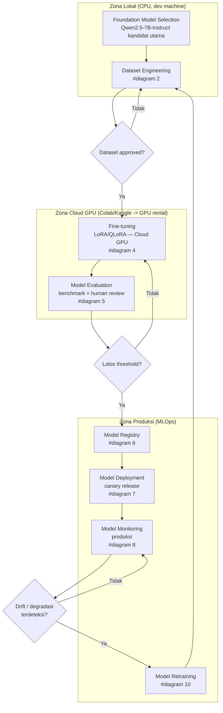
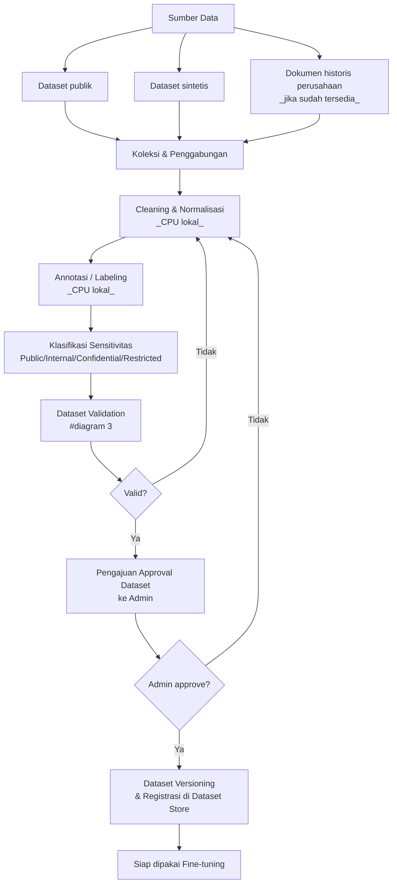
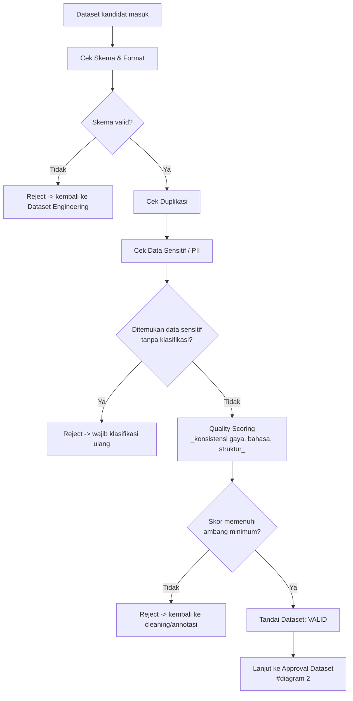
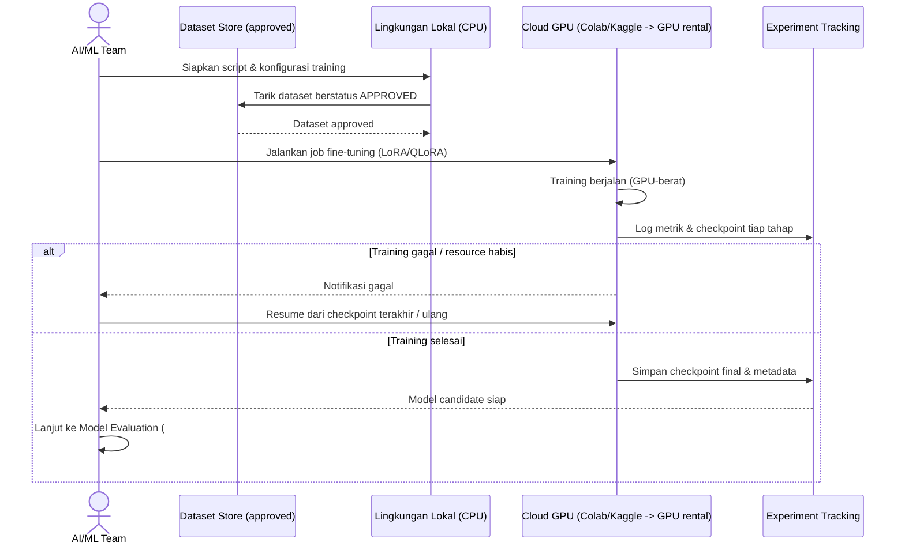
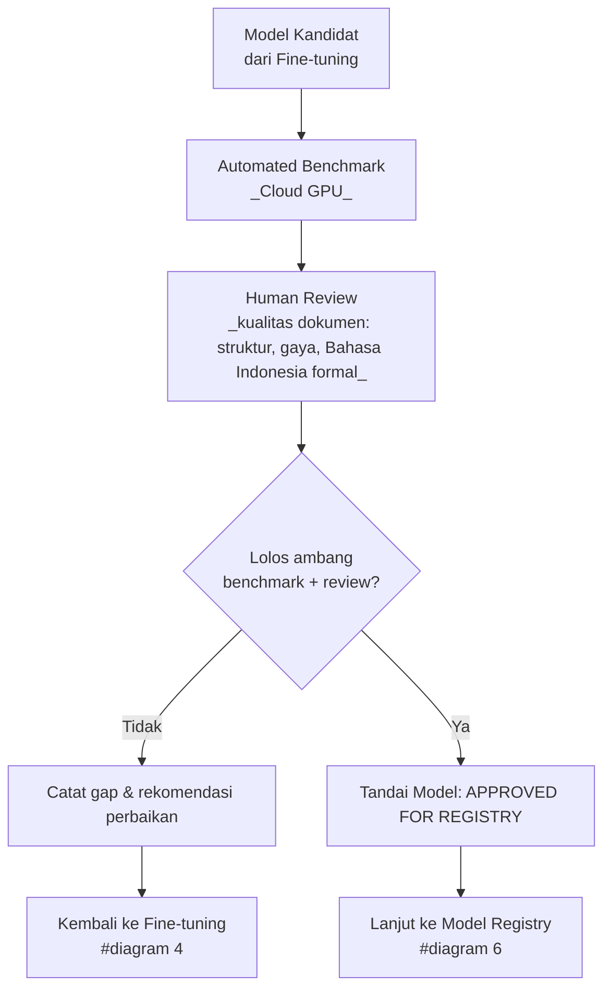
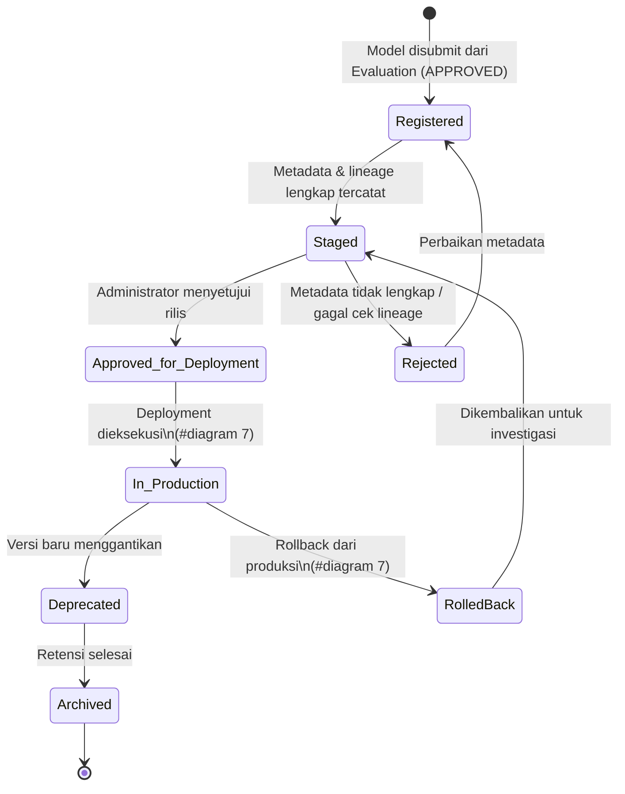
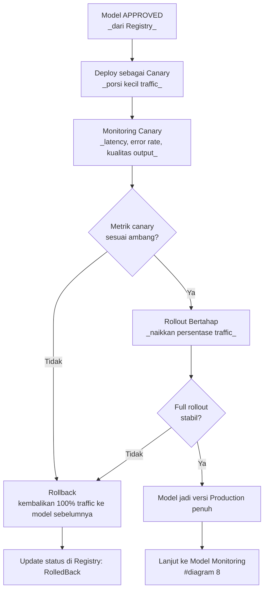
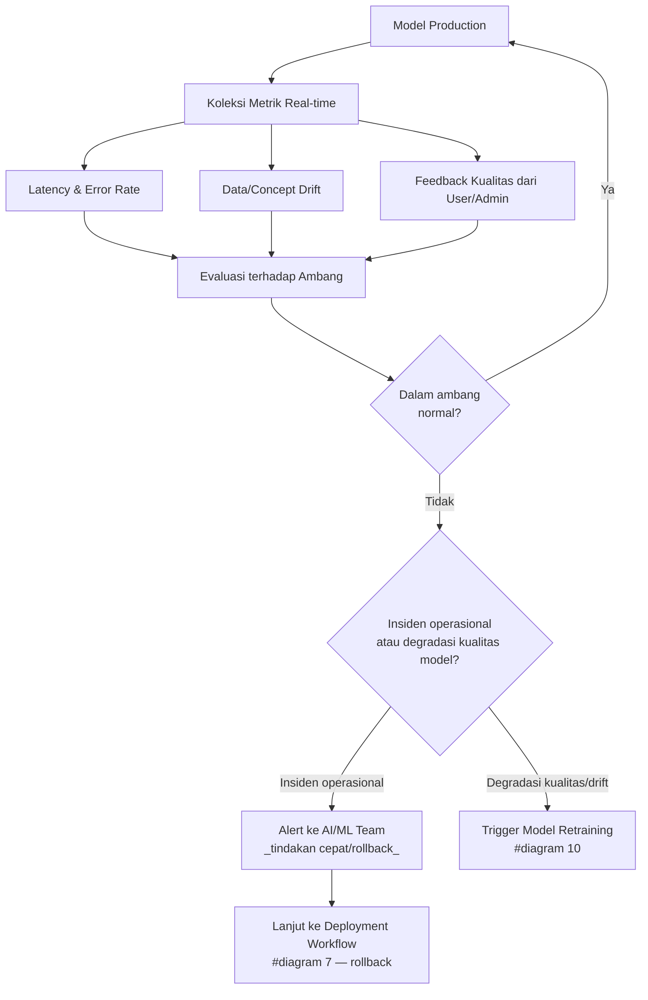
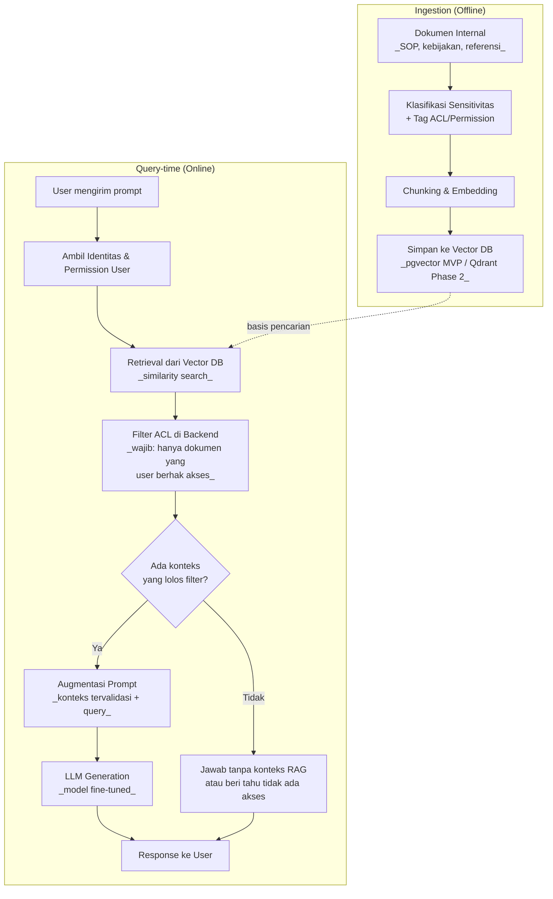
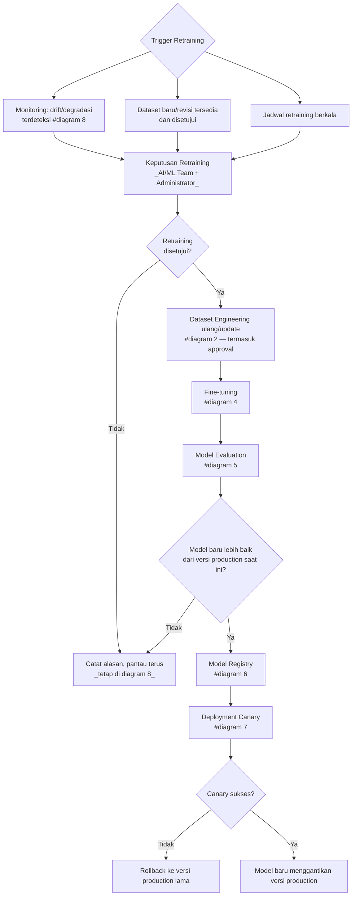

# ML_Flow_Diagram.md — DocuGen AI

**Dokumen turunan #5** dari `master_spec.md` (single source of truth). Dokumen ini adalah **visual level "apa yang terjadi"** untuk seluruh alur ML/MLOps DocuGen AI, menggunakan diagram Mermaid. Detail implementasi teknis (tools, config, folder structure, script) **TIDAK** dibahas di sini — itu domain `ML_Pipeline.md` ("bagaimana caranya"). Nama tool disebut singkat hanya jika perlu untuk konteks alur (misal "Colab/Kaggle", "pgvector/Qdrant"), tanpa detail konfigurasi.

Referensi keputusan yang mengikat seluruh diagram di dokumen ini (lihat `master_spec.md`):
- RAG wajib **permission-aware** — filter ACL dokumen terjadi di backend sebelum masuk context, bukan di system prompt (§9.4, §9.8).
- Dataset training **wajib approval eksplisit** sebelum dipakai fine-tuning (§9.3, §4 Decision Log).
- **Admin merangkap fungsi Document Control** di MVP — tidak ada role Document Control terpisah (§4, §6).
- **Hardware lokal terbatas** (CPU-only, 8GB RAM) — dataset prep/cleaning/annotation & kode training/eval jalan lokal, tapi **eksekusi training/evaluasi GPU-berat wajib di cloud GPU terpisah** (Colab/Kaggle dulu → GPU rental bila perlu scale) (§7).
- **Model registry, canary release, dan rollback** adalah bagian dari MLOps dan wajib ada sebelum model menyentuh traffic produksi penuh (§6, Out of scope section tidak mengecualikan ini).
- Dataset upload/percakapan user **tidak otomatis** jadi training data (§9.1–9.2).

---

## 1. End-to-End ML Lifecycle

Alur besar dari pemilihan foundation model sampai model berjalan di produksi dan siklus retraining-nya, menunjukkan pemisahan tegas antara **zona lokal (CPU)** dan **zona cloud GPU**.

### Input
Kandidat foundation model open-weight (hasil riset §8 master_spec), kebutuhan bisnis dokumen generation (gaya, format, bahasa).

### Process
Seleksi model → rekayasa dataset → fine-tuning di cloud GPU → evaluasi → registrasi model → deployment bertahap (canary) → monitoring berkelanjutan → retraining saat terdeteksi penurunan performa.

### Output
Model fine-tuned yang terverifikasi, teregistrasi, dan berjalan stabil di produksi dengan jalur retraining yang terdefinisi.

### Actor
AI/ML Team (eksekusi teknis), Administrator (approval dataset & model, karena merangkap Document Control di MVP), System/AI Model (non-approval).

### Dependencies
Hasil setiap diagram turunan (2–10); ketersediaan hardware cloud GPU; dataset yang sudah disetujui.

### Decision Points
- Dataset disetujui atau tidak (gate approval).
- Model lolos threshold evaluasi atau tidak.
- Drift/degradasi performa terdeteksi di monitoring atau tidak → trigger retraining.

### Failure Handling
Dataset ditolak → kembali ke rekayasa dataset. Model gagal evaluasi → kembali ke fine-tuning dengan dataset/hyperparameter revisi. Degradasi di produksi → retraining loop, dengan model lama tetap serving (lihat rollback di diagram 7).

---

## 2. Dataset Engineering Flow

### Input
Dokumen publik, data sintetis hasil generasi/template, dokumen historis perusahaan (bila ada), hasil feedback dari retraining loop.

### Process
Koleksi dari berbagai sumber → cleaning/normalisasi → anotasi → klasifikasi sensitivitas → validasi kualitas → pengajuan approval formal ke Admin → versioning dataset yang disetujui.

### Output
Dataset bersih, terklasifikasi, tervalidasi, dan **berstatus approved** dengan versi tercatat, siap dikonsumsi pipeline fine-tuning.

### Actor
AI/ML Team (eksekusi engineering dataset), Administrator (approval — merangkap fungsi Document Control di MVP).

### Dependencies
Diagram 3 (Data Validation Flow) sebagai gate wajib sebelum approval; kebijakan klasifikasi sensitivitas dokumen (§9.5 master_spec).

### Decision Points
- Apakah dataset lolos validasi kualitas/kepatuhan.
- Apakah Admin menyetujui dataset untuk dipakai training (gate wajib, §9.3 master_spec — tidak boleh dilewati).

### Failure Handling
Dataset gagal validasi → kembali ke cleaning/annotasi. Dataset ditolak Admin → revisi atau dikembalikan ke sumber data; dataset tidak pernah masuk ke fine-tuning tanpa approval eksplisit tercatat.

---

## 3. Data Validation Flow

### Input
Dataset mentah hasil cleaning/annotasi dari Dataset Engineering Flow.

### Process
Validasi skema/format → deduplikasi → pemindaian data sensitif/PII → scoring kualitas (konsistensi bahasa, struktur, gaya) → penandaan status valid/tidak valid.

### Output
Dataset dengan status **VALID** (siap diajukan approval) atau **REJECTED** (dengan alasan tercatat) yang dikembalikan ke tahap sebelumnya.

### Actor
AI/ML Team (menjalankan dan meninjau hasil validasi), Administrator (menerima notifikasi bila ditemukan data sensitif tak terklasifikasi, karena merangkap Document Control).

### Dependencies
Kebijakan klasifikasi sensitivitas dokumen (§9.5); hasil cleaning/annotasi dari diagram 2.

### Decision Points
- Validitas skema/format.
- Keberadaan data sensitif tanpa klasifikasi yang benar.
- Pemenuhan ambang skor kualitas minimum.

### Failure Handling
Setiap kegagalan pada titik keputusan mengembalikan dataset ke tahap Dataset Engineering (cleaning/annotasi/klasifikasi ulang) — dataset tidak pernah lanjut ke approval dalam status tidak valid.

---

## 4. Fine-tuning Workflow

### Input
Dataset berstatus APPROVED dari Dataset Store, foundation model terpilih, konfigurasi hyperparameter (LoRA vs QLoRA sesuai evaluasi benchmark, bukan asumsi).

### Process
Persiapan job training di lokal → eksekusi training (fine-tuning) di cloud GPU → logging metrik dan checkpoint ke experiment tracking → penyimpanan model kandidat.

### Output
Model kandidat (checkpoint adapter LoRA/QLoRA) beserta metadata eksperimen, siap untuk evaluasi.

### Actor
AI/ML Team (penuh eksekusi), System (proses training otomatis di cloud GPU).

### Dependencies
Dataset Engineering & Validation (hanya dataset approved yang boleh ditarik); ketersediaan kuota/kredit cloud GPU; hasil riset benchmark LoRA vs QLoRA (§8 master_spec).

### Decision Points
- Pilihan metode: LoRA vs QLoRA (ditentukan oleh hasil benchmark, bukan di dalam flow ini — hanya dieksekusi).
- Resume dari checkpoint vs mulai ulang saat training gagal/terputus.

### Failure Handling
Job gagal/resource habis di tengah jalan → resume dari checkpoint terakhir yang tersimpan di tracker, atau ulangi dengan konfigurasi lebih kecil (Colab/Kaggle free-tier limit) sebelum eskalasi ke GPU rental berbayar.

---

## 5. Model Evaluation Workflow

### Input
Model kandidat (checkpoint) dari Fine-tuning Workflow, benchmark set representatif (prompt document-generation), kriteria ambang kelulusan.

### Process
Jalankan automated benchmark di cloud GPU → human review kualitas output terkait kepatuhan format/gaya/Bahasa Indonesia formal → keputusan lolos/tidak.

### Output
Status model: **APPROVED FOR REGISTRY** (lanjut) atau **REJECTED** (kembali ke fine-tuning dengan catatan gap).

### Actor
AI/ML Team (menjalankan benchmark & memimpin review), Administrator (terlibat pada review kualitas dokumen final jika relevan dengan kepatuhan bisnis).

### Dependencies
Model kandidat dari diagram 4; benchmark set & ambang kelulusan yang ditetapkan tim; hasil riset model pembanding (§8 master_spec) sebagai acuan konteks, bukan keputusan final.

### Decision Points
- Apakah model lolos ambang benchmark otomatis **dan** human review kualitas dokumen.

### Failure Handling
Gagal lolos → gap dicatat (misal konsistensi heading, akurasi instruksi) dan dikembalikan ke fine-tuning untuk iterasi (dataset/hyperparameter revisi) — model tidak pernah masuk registry tanpa lolos kedua kriteria.

---

## 6. Model Registry Workflow

### Input
Model APPROVED FOR REGISTRY dari Evaluation Workflow, beserta metadata (dataset version, hyperparameter, metrik evaluasi, lineage).

### Process
Registrasi versi model → verifikasi kelengkapan metadata/lineage → approval rilis oleh Administrator → transisi status sepanjang siklus hidup model (staged → production → deprecated/rolled back → archived).

### Output
Model versi tercatat dengan status jelas dan histori lineage lengkap, menjadi rujukan tunggal untuk deployment dan audit.

### Actor
Administrator (approval rilis — bagian dari fungsi Document Control yang dirangkap di MVP, diperluas ke governance model), AI/ML Team (registrasi & pelengkapan metadata).

### Dependencies
Model Evaluation Workflow (diagram 5); Deployment Workflow (diagram 7) untuk transisi ke produksi/rollback.

### Decision Points
- Kelengkapan metadata/lineage sebelum status Staged → Approved.
- Approval rilis oleh Administrator.

### Failure Handling
Metadata/lineage tidak lengkap → status dikembalikan ke Registered untuk perbaikan sebelum lanjut, model tidak bisa mencapai status Approved for Deployment tanpa lineage lengkap.

---

## 7. Model Deployment Workflow

### Input
Model berstatus Approved for Deployment dari Model Registry.

### Process
Rilis canary ke sebagian kecil traffic → observasi metrik → keputusan lanjut rollout bertahap atau rollback → status final production penuh.

### Output
Model berjalan sebagai versi production (full rollout) atau rollback sukses ke versi sebelumnya tanpa gangguan layanan signifikan.

### Actor
AI/ML Team (eksekusi deployment teknis), Administrator (approval rilis skala penuh), System (monitoring otomatis metrik canary).

### Dependencies
Model Registry Workflow (diagram 6); Model Monitoring Workflow (diagram 8) untuk metrik produksi berkelanjutan.

### Decision Points
- Apakah metrik canary memenuhi ambang sebelum rollout diperluas.
- Apakah full rollout stabil sebelum ditetapkan sebagai versi production utama.

### Failure Handling
Metrik canary atau rollout tidak memenuhi ambang pada tahap apa pun → rollback otomatis ke versi model sebelumnya yang masih serving, status model baru diubah menjadi RolledBack di registry untuk investigasi — tidak ada periode tanpa layanan.

---

## 8. Model Monitoring Workflow

### Input
Trafik inference produksi, log latency/error, sinyal drift data/konsep, feedback kualitas dari pengguna/Administrator.

### Process
Koleksi metrik berkelanjutan → evaluasi terhadap ambang yang ditetapkan → klasifikasi anomali (insiden operasional vs degradasi kualitas model) → routing ke tindakan yang sesuai.

### Output
Status kesehatan model terkini; trigger otomatis ke rollback (insiden operasional) atau ke retraining (degradasi kualitas/drift).

### Actor
System (koleksi & evaluasi metrik otomatis), AI/ML Team (menindaklanjuti alert), Administrator (menerima laporan degradasi kualitas terkait kepatuhan dokumen).

### Dependencies
Model Deployment Workflow (diagram 7) sebagai sumber model yang dimonitor; Model Retraining Workflow (diagram 10) sebagai tujuan trigger.

### Decision Points
- Apakah metrik berada dalam ambang normal.
- Jika tidak, apakah ini insiden operasional (rollback) atau degradasi kualitas/drift model (retraining).

### Failure Handling
Insiden operasional → rollback cepat via diagram 7. Drift/degradasi kualitas bertahap → tidak langsung rollback, melainkan trigger siklus retraining terkontrol (diagram 10) agar tidak mengganggu layanan yang masih berjalan.

---

## 9. RAG Pipeline

### Input
Dokumen internal terklasifikasi dengan metadata ACL, query/prompt dari Authorized User beserta identitas & hak aksesnya.

### Process
**Offline**: klasifikasi sensitivitas dan penandaan ACL dokumen → chunking & embedding → penyimpanan di vector DB. **Online**: retrieval kandidat konteks berdasarkan similarity → **filter ACL di backend** (bukan hanya system prompt) → augmentasi prompt dengan konteks yang lolos filter → generasi jawaban oleh model fine-tuned.

### Output
Jawaban yang disusun berdasarkan konteks yang memang berhak diakses user, atau jawaban tanpa konteks RAG bila tidak ada dokumen yang lolos filter izin.

### Actor
Authorized User (pengguna query), Administrator (mengelola klasifikasi & hak akses dokumen), System/AI Model (retrieval & generation).

### Dependencies
Knowledge base yang sudah terklasifikasi dan diindeks; mekanisme RBAC/ACL backend (§9.4, §9.8 master_spec); model fine-tuned yang sudah production.

### Decision Points
- Apakah ada konteks yang lolos filter ACL setelah retrieval — menentukan apakah jawaban memakai augmentasi RAG atau tidak.

### Failure Handling
Tidak ada dokumen relevan yang lolos filter izin → sistem tetap menjawab tanpa konteks RAG (fallback ke pengetahuan umum model) atau secara eksplisit memberi tahu user bahwa tidak ada dokumen yang dapat diakses — **tidak pernah** meloloskan dokumen di luar hak akses user hanya karena relevan secara semantik.

---

## 10. Model Retraining Workflow

### Input
Sinyal trigger (drift/degradasi dari monitoring, dataset baru yang sudah disetujui, atau jadwal retraining berkala), model production saat ini sebagai baseline pembanding.

### Process
Evaluasi kelayakan retraining → (bila disetujui) ulangi siklus Dataset Engineering → Fine-tuning → Evaluation → bandingkan dengan model production saat ini → jika lebih baik, lanjut ke Registry dan Deployment canary.

### Output
Model production baru yang terbukti lebih baik dari versi sebelumnya, atau keputusan untuk menunda retraining dengan versi production lama tetap berjalan.

### Actor
AI/ML Team (eksekusi siklus retraining), Administrator (approval dataset & keputusan retraining, approval rilis).

### Dependencies
Model Monitoring Workflow (diagram 8) sebagai sumber trigger utama; seluruh siklus diagram 2, 4, 5, 6, 7 dijalankan ulang di sini.

### Decision Points
- Apakah retraining disetujui untuk dijalankan.
- Apakah model baru hasil retraining lebih baik dari model production saat ini.
- Apakah canary deployment model baru sukses.

### Failure Handling
Retraining tidak disetujui atau model baru tidak lebih baik → versi production lama tetap berjalan tanpa gangguan, alasan dicatat untuk evaluasi berikutnya. Canary model baru gagal → rollback ke versi production lama (konsisten dengan diagram 7) — model lama tidak pernah digantikan tanpa bukti model baru lebih baik dan stabil di canary.

---

## Ringkasan Keterkaitan Antar-Diagram

| Diagram | Menerima dari | Mengirim ke |
|---|---|---|
| 1. End-to-End ML Lifecycle | — (overview) | Semua diagram 2–10 |
| 2. Dataset Engineering | 10 (retraining loop) | 3, 4 |
| 3. Data Validation | 2 | 2 (approval gate) |
| 4. Fine-tuning | 2 (dataset approved) | 5 |
| 5. Model Evaluation | 4 | 4 (reject) / 6 (approve) |
| 6. Model Registry | 5 | 7 |
| 7. Model Deployment | 6 | 8; rollback balik ke registry (6) |
| 8. Model Monitoring | 7 | 7 (insiden) / 10 (drift) |
| 9. RAG Pipeline | KB internal (independen dari siklus training) | Response ke user (runtime aplikasi) |
| 10. Model Retraining | 8 (trigger) | 2, lalu ulang 4–7 |

**Catatan traceability**: dokumen ini merujuk keputusan di `master_spec.md` §4 (Decision Log), §7 (Hardware Reality), §8 (Riset Teknis), dan §9 (Security & Data Governance). Detail implementasi teknis (tools, konfigurasi, struktur folder, perintah eksekusi) didokumentasikan di `ML_Pipeline.md` agar tidak terjadi duplikasi.
