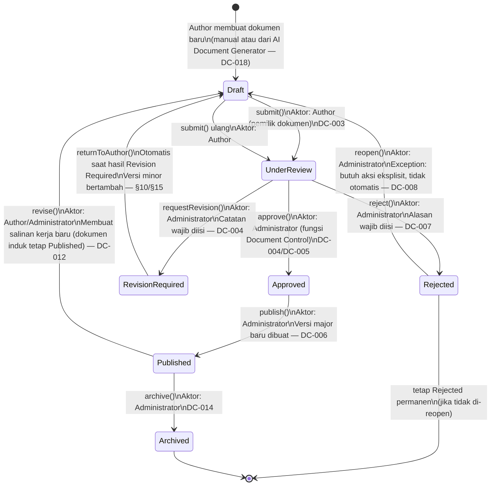

# PRD — Document Control System (DocuGen AI)

**Dokumen:** `PRD_Document_Control_SaaS.md` (Document 2 dari 7 dokumen turunan)
**Proyek Induk:** DocuGen AI — LLM Document Generator (Private Enterprise AI Application)
**Sumber Acuan Tunggal:** `master_spec.md` — dokumen ini TIDAK mengubah atau mengontradiksi keputusan apa pun di dalamnya.
**Status:** Draft untuk review internal

> **Catatan traceability:** Seluruh requirement ID pada dokumen ini menggunakan prefix `DC-xxx` (Document Control), sesuai alokasi penamaan di `master_spec.md` §10. ID ini tidak diduplikasi di dokumen lain — `Project_Requirements.md` hanya MERUJUK ID yang sudah ada di sini. Status lifecycle dokumen (Draft → ... → Archived) yang didefinisikan pada dokumen ini menjadi acuan yang DIRUJUK oleh `PRD_LLM_Document_Generator.md` pada saat draft AI masuk ke dalam workflow dokumen resmi.

---

## 1. Product Overview

Document Control adalah **modul governance dan document lifecycle management** di dalam ekosistem DocuGen AI. Modul ini bertugas memastikan setiap dokumen — baik yang dibuat manual oleh user maupun yang berasal dari draft AI (DocuGen AI Document Generator) — melalui siklus hidup yang terkendali: registrasi, versi, review, approval, distribusi, revisi, pengarsipan, hingga retensi, dengan jejak audit penuh.

Document Control **bukan aplikasi berdiri sendiri**, melainkan layer governance yang terintegrasi langsung dengan kapabilitas generasi dokumen berbasis LLM (lihat §20). Modul ini menegakkan prinsip fundamental dari `master_spec.md`: **AI output bukan otomatis dokumen resmi** — setiap draft yang dihasilkan sistem AI wajib melalui proses review dan approval manusia sebelum berstatus "Published" dan dianggap sah secara organisasi.

## 2. Product Vision

Menjadikan setiap dokumen di dalam organisasi — baik hasil tulisan manusia maupun hasil generasi AI — memiliki **status yang jelas, versi yang terlacak, otorisasi yang sah, dan jejak audit yang lengkap**, sehingga organisasi dapat mempercayai dokumen yang beredar tanpa mengorbankan kecepatan yang ditawarkan oleh generative AI. Document Control adalah jembatan kepercayaan (*trust layer*) antara kecepatan AI dan akuntabilitas proses bisnis.

## 3. Business Objectives

| No | Objective | Rasional |
|---|---|---|
| 1 | Memastikan tidak ada dokumen resmi yang beredar tanpa proses review/approval yang terekam | Menegakkan baseline governance `master_spec.md` §9.3 dan §9.6 (audit atas semua akses sensitif) |
| 2 | Menyediakan satu sumber kebenaran (*single source of truth*) untuk versi dokumen terkini | Mencegah penggunaan dokumen usang/duplikat |
| 3 | Mengurangi waktu administratif proses approval dokumen melalui workflow terstruktur | Efisiensi operasional, tanpa mengorbankan kontrol |
| 4 | Menjamin akses dokumen sesuai klasifikasi sensitivitas dan permission yang berlaku | Menegakkan baseline keamanan `master_spec.md` §9.5 dan §9.4 (RAG permission-aware) |
| 5 | Menyediakan fondasi lifecycle yang dapat diadopsi langsung oleh output AI Document Generator | Integrasi end-to-end sesuai `master_spec.md` §10 (Document 2 ↔ Document 3) |
| 6 | Menyiapkan struktur yang dapat berevolusi ke role Document Control terpisah tanpa migrasi data besar-besaran | Readiness untuk Phase 2 sesuai `master_spec.md` §4 dan §6 |

## 4. Target Users

Sesuai `master_spec.md` §4 dan §5, DocuGen AI hanya mengenal dua actor aplikasi pada MVP: **Administrator** dan **Authorized User**, dengan akun yang dikelola admin (tidak ada registrasi publik).

> **PENTING — Klarifikasi MVP vs Phase 2:**
> Pada **MVP, belum ada role atau departemen "Document Controller" yang terpisah**. Fungsi Document Control (approval, publikasi, retensi, arsip) **dirangkap oleh Administrator**. Role Document Control sebagai entitas terpisah (dengan kemungkinan department-based access) adalah **item Phase 2**, sejalan dengan keputusan Decision Log `master_spec.md` §4 baris "Document Control role" dan §6. Dokumen ini TIDAK berasumsi bahwa role "Document Controller" sudah tersedia sejak MVP — seluruh requirement dan permission matrix di bawah mencerminkan kondisi ini secara eksplisit.

Pengguna target modul ini pada MVP:

| Target User | Kebutuhan terhadap Document Control |
|---|---|
| Administrator (merangkap fungsi Document Control) | Mengelola seluruh lifecycle dokumen: review, approve, publish, revisi, arsip, retensi, audit |
| Authorized User (pembuat/kontributor dokumen) | Membuat/mengupload dokumen, submit untuk review, melihat status dokumennya, mengakses dokumen published sesuai permission |
| Authorized User (pembaca/konsumen dokumen) | Mencari dan membaca dokumen published yang relevan dengan aksesnya |
| AI/ML Team (internal engineering) | Tidak berinteraksi langsung dengan modul Document Control; relevan hanya pada level audit log sistem secara umum |

## 5. User Roles

Mengikuti strategi otorisasi `master_spec.md` §4 (RBAC pada MVP → Department-Based Access Control + Resource-Level Permission pada Phase 2):

| Role | Status Ketersediaan | Deskripsi Kewenangan Document Control |
|---|---|---|
| **Administrator** | MVP | Role tunggal dengan kewenangan penuh atas seluruh fungsi Document Control: registrasi, review, approval, publikasi, revisi, arsip, retensi, konfigurasi klasifikasi, audit trail. Merangkap peran yang pada Phase 2 akan dipecah menjadi role "Document Controller". |
| **Authorized User — Author/Contributor** | MVP | Dapat membuat dokumen baru (manual atau via AI Document Generator), mengedit draft miliknya, submit draft untuk review, melihat riwayat status dokumennya sendiri. **Tidak punya kewenangan approval/publikasi.** |
| **Authorized User — Reader** | MVP | Dapat mencari dan membaca dokumen berstatus "Published" sesuai klasifikasi dan permission yang diberikan admin. **Tidak dapat mengedit atau mengubah status dokumen.** |
| **Document Controller** *(role terpisah)* | **Phase 2 — belum ada di MVP** | Role dedicated yang akan memisahkan fungsi governance dari Administrator umum; kemungkinan dikombinasikan dengan Department-Based Access Control. Ditandai sebagai *future*, bukan asumsi implementasi saat ini. |
| **Reviewer** *(role granular)* | **Phase 2 — belum ada di MVP** | Pada MVP, fungsi review dilakukan oleh Administrator yang sama dengan approver; pemisahan reviewer vs approver sebagai role berbeda adalah pengembangan lanjutan. |

## 6. Permission Matrix

Matriks berikut mencerminkan kondisi RBAC MVP (dua role aplikasi: Administrator dan Authorized User). Kolom "Authorized User" dipecah menjadi dua sub-kapasitas (Author dan Reader) untuk kejelasan, namun secara teknis MVP keduanya adalah satu role aplikasi yang sama — pembedaan kapasitas dilakukan melalui kepemilikan dokumen (*ownership*), bukan role terpisah.

| Fungsi / Aksi | Administrator (fungsi Document Control) | Authorized User — Author (pemilik dokumen) | Authorized User — Reader |
|---|---|---|---|
| Registrasi dokumen baru | ✅ | ✅ (dokumen miliknya) | ❌ |
| Edit dokumen status Draft | ✅ | ✅ (dokumen miliknya) | ❌ |
| Submit draft ke Review | ✅ | ✅ (dokumen miliknya) | ❌ |
| Melakukan Review | ✅ | ❌ | ❌ |
| Meminta Revisi (Revision Required) | ✅ | ❌ | ❌ |
| Approve dokumen | ✅ | ❌ | ❌ |
| Reject dokumen | ✅ | ❌ | ❌ |
| Publish dokumen | ✅ | ❌ | ❌ |
| Melihat dokumen Published (sesuai klasifikasi & akses) | ✅ | ✅ | ✅ |
| Melihat dokumen Draft/Under Review/Revision Required | ✅ (semua) | ✅ (miliknya saja) | ❌ |
| Mengarsipkan dokumen | ✅ | ❌ | ❌ |
| Mengatur retensi/disposisi dokumen | ✅ | ❌ | ❌ |
| Mengubah klasifikasi dokumen | ✅ | ❌ (dapat mengusulkan saat submit) | ❌ |
| Mengatur daftar distribusi/akses dokumen | ✅ | ❌ | ❌ |
| Melihat audit trail dokumen | ✅ (semua) | ✅ (dokumen miliknya) | ❌ |
| Pencarian dokumen | ✅ | ✅ (sesuai akses) | ✅ (sesuai akses) |
| Konfigurasi sistem Document Control (kategori, klasifikasi, retensi default) | ✅ | ❌ | ❌ |

> Catatan: Pada Phase 2, matriks ini akan diperluas dengan role **Document Controller** dan **Reviewer** terpisah dari Administrator, serta ditambah dimensi Department-Based Access Control dan Resource-Level Permission, sesuai `master_spec.md` §4 dan §6.

## 7. Document Lifecycle

Siklus hidup dokumen pada DocuGen AI terdiri dari 7 status formal: **Draft → Under Review → Revision Required → Approved → Published → Archived**, dengan status terminal alternatif **Rejected**. Diagram status lengkap beserta aturan otorisasi transisi dijabarkan pada §26 (Workflow Diagram).

Ringkasan tahapan:

1. **Draft** — dokumen baru dibuat (manual atau hasil AI Document Generator), masih dapat diedit bebas oleh pemiliknya.
2. **Under Review** — dokumen disubmit untuk ditinjau oleh Administrator (fungsi Document Control pada MVP).
3. **Revision Required** — reviewer menolak sementara dan meminta perbaikan; dokumen kembali ke tangan author.
4. **Approved** — dokumen dinyatakan layak secara isi/format, menunggu publikasi resmi.
5. **Published** — dokumen resmi, dapat diakses oleh user sesuai klasifikasi dan permission.
6. **Archived** — dokumen tidak lagi aktif digunakan namun tetap disimpan sesuai kebijakan retensi.
7. **Rejected** — dokumen ditolak permanen pada tahap review/approval; dapat dibuka kembali ke Draft jika author ingin mengajukan ulang dari awal (lihat §26 untuk aturan eksak).

## 8. Document Classification

Mengikuti security baseline wajib `master_spec.md` §9.5, setiap dokumen **wajib** memiliki satu dari empat klasifikasi berikut sejak registrasi (default: Internal jika tidak dipilih eksplisit saat draft dibuat):

| Klasifikasi | Deskripsi | Contoh Implikasi Akses |
|---|---|---|
| **Public** | Dapat diakses siapa pun yang punya akun di sistem (tidak ada registrasi publik eksternal sesuai `master_spec.md` §1, sehingga "public" di sini berarti seluruh Authorized User internal) | Semua role aplikasi dapat melihat setelah Published |
| **Internal** | Dokumen operasional umum perusahaan, dapat diakses seluruh Authorized User kecuali dibatasi eksplisit | Default klasifikasi dokumen baru |
| **Confidential** | Dokumen sensitif bisnis (strategi, data finansial, data personal non-publik), akses dibatasi ke daftar user/role tertentu | Memerlukan permission eksplisit dari Administrator |
| **Restricted** | Dokumen paling sensitif (hukum, kontrak, data regulasi), akses sangat terbatas dan setiap pembacaan tercatat di audit trail dengan detail lebih tinggi | Memerlukan approval akses per-user; semua akses otomatis dicatat (`master_spec.md` §9.6) |

Perubahan klasifikasi hanya dapat dilakukan oleh Administrator dan setiap perubahan klasifikasi tercatat di audit trail (§18).

## 9. Document Registration

Setiap dokumen, saat pertama dibuat (baik manual maupun hasil draft AI), wajib didaftarkan ke dalam registry Document Control dengan metadata minimum:

- Document ID (unik, auto-generated)
- Judul dokumen
- Kategori/tipe dokumen (mis. SOP, kebijakan, memo, kontrak — daftar kategori dikonfigurasi Admin)
- Klasifikasi (§8)
- Pemilik/author (user ID)
- Sumber pembuatan: `manual` atau `ai-generated` (menyimpan referensi ke sesi/prompt generator jika `ai-generated`, lihat §20)
- Tanggal pembuatan
- Status awal: **Draft**
- Nomor versi awal: v0.1 (lihat §10)

Dokumen yang belum diregistrasi tidak dianggap sebagai entitas governed dan tidak muncul di pencarian/daftar dokumen resmi.

## 10. Document Version Control

- Setiap penyimpanan perubahan pada dokumen berstatus Draft atau Revision Required menghasilkan **minor version** baru (contoh: v0.1 → v0.2).
- Transisi dari Approved ke Published menghasilkan **major version** resmi pertama (v1.0).
- Revisi terhadap dokumen Published yang sudah dipublikasikan sebelumnya (lihat §15) menghasilkan major version baru (v2.0, v3.0, dst.) setelah melalui ulang siklus review-approval-publish.
- Sistem menyimpan **seluruh riwayat versi** (tidak overwrite) sehingga versi sebelumnya tetap dapat ditelusuri untuk keperluan audit, meskipun hanya versi terbaru yang Published yang ditampilkan sebagai "versi aktif" ke Reader.
- Setiap versi menyimpan: isi dokumen, metadata, status pada saat itu, dan user yang melakukan perubahan.

## 11. Document Review

- Review dipicu saat Author submit dokumen dari status Draft ke **Under Review**.
- Pada MVP, review dilakukan oleh **Administrator** (karena belum ada role Reviewer terpisah — lihat §5).
- Reviewer memeriksa kesesuaian isi, format, dan kepatuhan terhadap kebijakan sebelum memutuskan salah satu dari tiga hasil: lanjut ke **Approved**, kembali ke **Revision Required** (dengan catatan/feedback wajib diisi), atau **Rejected** (penolakan permanen dengan alasan wajib diisi).
- Setiap aktivitas review (siapa, kapan, hasil, catatan) tercatat di audit trail.
- Dokumen hasil AI Document Generator **tidak mendapat jalur review yang dipersingkat** — tetap melalui proses review yang sama seperti dokumen manual (menegakkan `master_spec.md` §9 bahwa AI output bukan otomatis dokumen resmi).

## 12. Document Approval

- Approval adalah keputusan formal untuk meloloskan dokumen dari status **Approved** menuju **Published**, atau merupakan bagian dari keputusan review (lihat §11) yang menyatakan dokumen Approved.
- Pada MVP, approval dilakukan oleh **Administrator** yang sama dengan reviewer — tidak ada pemisahan segregation-of-duties antara reviewer dan approver pada MVP. Ini adalah batasan yang disadari dan didokumentasikan secara eksplisit sebagai technical debt governance yang akan diselesaikan di Phase 2 ketika role Document Controller/Reviewer terpisah tersedia.
- Approval wajib menyertakan: nama approver, timestamp, dan opsional catatan approval.
- Dokumen yang telah di-Approve tidak dapat diedit; perubahan isi memerlukan kembali ke Draft (lihat §15 Revisi).

## 13. Document Distribution

- Setelah berstatus **Published**, dokumen didistribusikan secara otomatis ke dalam index pencarian dan knowledge base RAG (lihat §20) sesuai klasifikasi dan permission yang berlaku.
- Distribusi diatur oleh Administrator melalui pengaturan: siapa/role mana yang dapat melihat dokumen ini (relevan khususnya untuk klasifikasi Confidential/Restricted).
- Tidak ada mekanisme broadcast/notifikasi email pada MVP (di luar scope aplikasi chat-first DocuGen AI); notifikasi dalam-aplikasi (in-app) atas perubahan status dokumen adalah fitur minimum yang disediakan (lihat DC-013).
- Distribusi ke sistem eksternal (API pihak ketiga) tunduk pada baseline `master_spec.md` §9.7 — default deny tanpa approval formal.

## 14. Document Access Control

- Akses baca terhadap dokumen Published ditentukan oleh kombinasi: **klasifikasi dokumen** (§8) dan **permission yang diberikan Administrator** ke masing-masing Authorized User.
- Akses terhadap dokumen non-Published (Draft, Under Review, Revision Required, Approved) terbatas untuk Author pemilik dokumen dan Administrator saja (lihat Permission Matrix §6).
- Sesuai `master_spec.md` §9.4 dan §9.8, access control untuk RAG retrieval dan untuk endpoint API Document Control **ditegakkan di backend** — tidak pernah hanya di UI atau system prompt.
- Pada MVP, granularity access control adalah RBAC sederhana (role + ownership); Department-Based Access Control dan Resource-Level Permission granular adalah Phase 2 (`master_spec.md` §4, §6).

## 15. Document Revision

- Dokumen berstatus **Revision Required** (hasil review yang menolak sementara) kembali ke tangan Author untuk diperbaiki, lalu disubmit ulang ke Under Review. Versi minor bertambah (§10).
- Dokumen yang sudah **Published** dan memerlukan perubahan substantif tidak diedit langsung — harus dibuatkan **revisi baru** (salinan kerja berstatus Draft yang mereferensikan dokumen Published sebelumnya sebagai "versi induk"), melalui ulang siklus lengkap Draft → ... → Published, menghasilkan major version baru.
- Dokumen Published versi lama otomatis berpindah menjadi "superseded" (tidak Archived secara otomatis — pengarsipan tetap keputusan eksplisit, lihat §16) begitu versi baru berstatus Published.

## 16. Document Archiving

- Dokumen dapat dipindahkan ke status **Archived** oleh Administrator, baik karena: (a) sudah digantikan versi baru (superseded), (b) tidak relevan lagi secara bisnis, atau (c) mencapai jadwal retensi tertentu (lihat §17).
- Dokumen Archived tidak muncul di hasil pencarian/RAG default, tetapi tetap dapat diakses oleh Administrator untuk keperluan audit/kepatuhan.
- Pengarsipan tidak menghapus data — hanya mengubah status dan visibilitas.

## 17. Document Retention

> **TBD — Periode retensi belum ditetapkan secara pasti.** `master_spec.md` tidak menyebutkan angka retensi definitif, sehingga dokumen ini **tidak mengarang angka pasti**. Keputusan final periode retensi harus ditetapkan melalui kebijakan kepatuhan/legal organisasi sebelum go-live produksi.

Opsi periode retensi yang perlu dievaluasi dan diputuskan oleh pemangku kebijakan (legal/compliance) sebelum implementasi:

| Opsi | Deskripsi | Kapan Relevan |
|---|---|---|
| Retensi berbasis kategori dokumen | Periode berbeda per tipe dokumen (mis. SOP vs kontrak vs memo internal) | Jika organisasi punya kebijakan arsip terdiferensiasi per jenis dokumen |
| Retensi tetap organisasi-wide (mis. 3/5/7/10 tahun — **angka ilustratif, belum final**) | Satu angka retensi berlaku untuk semua dokumen non-regulasi | Jika organisasi belum punya kebijakan granular dan ingin aturan sederhana |
| Retensi mengikuti regulasi eksternal (jika berlaku) | Periode ditentukan oleh regulasi industri/pajak/hukum yang relevan | Jika organisasi tunduk pada regulasi sektor tertentu |
| Retensi permanen (tanpa disposisi) | Dokumen tidak pernah dihapus, hanya diarsipkan | Untuk dokumen legal/kontrak kritikal |

Sistem Document Control **wajib menyediakan field retensi yang dapat dikonfigurasi** (bukan hard-coded), sehingga nilai final dapat diisi kapan pun kebijakan ditetapkan tanpa perubahan arsitektur (lihat DC-016).

## 18. Document Audit Trail

Sesuai `master_spec.md` §9.6 ("Semua akses sensitif Admin tercatat di audit log — tidak ada akses tanpa jejak"), Document Control wajib mencatat minimum:

- Setiap transisi status (dari/ke, user/role pelaku, timestamp, catatan jika ada)
- Setiap perubahan klasifikasi dokumen
- Setiap perubahan permission/distribusi akses
- Setiap akses baca terhadap dokumen berklasifikasi Confidential/Restricted
- Setiap tindakan pengarsipan/disposisi retensi

Audit trail bersifat **append-only** (tidak dapat diedit/dihapus oleh user manapun termasuk Administrator melalui antarmuka aplikasi normal) dan dapat diekspor untuk keperluan kepatuhan.

## 19. Document Search

- Pencarian dokumen tersedia untuk seluruh Authorized User, dengan hasil difilter otomatis berdasarkan klasifikasi dan permission akses (menegakkan permission-aware filtering yang sama dengan prinsip RAG di `master_spec.md` §9.4).
- Pencarian mendukung filter: kategori dokumen, status (Published sebagai default untuk Reader), klasifikasi (hanya terlihat untuk level akses yang sesuai), rentang tanggal, dan pemilik/author.
- Hasil pencarian untuk Author/Administrator dapat mencakup dokumen non-Published yang menjadi haknya untuk dilihat (sesuai Permission Matrix §6).
- Pencarian dokumen Published juga menjadi basis bagi retrieval RAG di dalam Document Generator (lihat §20) — index pencarian dan index retrieval RAG berbagi prinsip filtering permission yang identik.

## 20. Integration with LLM Document Generator

Document Control terintegrasi langsung dengan kapabilitas Document Generator DocuGen AI (`PRD_LLM_Document_Generator.md`) melalui aturan berikut:

1. **Tidak ada jalur pintas untuk AI output.** Setiap dokumen yang dihasilkan oleh AI Document Generator — baik dari percakapan chat, template, atau upload-dan-edit berbantuan AI — otomatis diregistrasi ke Document Control dengan status awal **Draft** (lihat §9), dengan sumber pembuatan ditandai `ai-generated` dan menyimpan referensi ke sesi generasi (prompt/conversation ID) untuk traceability.
2. **AI output BUKAN otomatis dokumen resmi.** Draft hasil AI wajib melalui seluruh lifecycle yang sama dengan dokumen manual: submit ke Under Review → (Revision Required jika perlu) → Approved → Published, oleh Administrator (fungsi Document Control pada MVP). Tidak ada auto-approval berbasis skor kepercayaan model atau mekanisme bypass apa pun — menegakkan `master_spec.md` §9 ("Human review wajib untuk dokumen bisnis penting; AI output BUKAN otomatis dokumen resmi").
3. **Hanya dokumen Published yang masuk basis pengetahuan RAG.** Knowledge base RAG milik Document Generator (`master_spec.md` §3) hanya mengindeks dokumen berstatus **Published**, difilter oleh klasifikasi dan permission yang sama dengan §19 — dokumen Draft/Under Review/Revision Required/Rejected tidak pernah masuk context retrieval, mencegah draft yang belum tervalidasi "mengajari" jawaban AI ke user lain.
4. **Author tetap manusia yang bertanggung jawab.** Sistem AI (System/AI Model, aktor non-manusia di `master_spec.md` §5) tidak pernah tercatat sebagai "approver" atau "reviewer" pada audit trail (§18) — hanya sebagai sumber pembuatan draft (metadata `ai-generated`). Tanggung jawab approval tetap melekat pada Administrator yang menjalankan fungsi Document Control.
5. **Edit pasca-generate tetap dalam status Draft.** Ketika Author mengedit hasil draft AI di dalam document editor DocuGen AI, dokumen tetap berstatus Draft dan versi minor bertambah (§10) sampai disubmit untuk review.

## 21. Functional Requirements

| Requirement ID | Name | Description | Priority | Actor | Preconditions | Expected Result | Acceptance Criteria |
|---|---|---|---|---|---|---|---|
| DC-001 | Registrasi Dokumen Baru | Sistem mendaftarkan dokumen baru (manual/AI-generated) ke registry Document Control | Must | Author, Administrator | User memiliki akses pembuatan dokumen | Dokumen tercatat dengan metadata lengkap §9, status Draft, versi v0.1 | Dokumen baru muncul di registry dengan Document ID unik dan status "Draft" dalam ≤2 detik setelah submit |
| DC-002 | Edit Dokumen Draft | Author dapat mengedit isi dokumen selama status Draft/Revision Required | Must | Author | Dokumen berstatus Draft atau Revision Required, user adalah pemilik | Perubahan disimpan sebagai versi minor baru | Setiap simpan menghasilkan versi baru yang tercatat dengan timestamp dan diff dapat ditelusuri |
| DC-003 | Submit Dokumen untuk Review | Author mengajukan dokumen Draft untuk ditinjau | Must | Author | Dokumen berstatus Draft, semua field wajib (judul, kategori, klasifikasi) terisi | Status berubah ke Under Review, notifikasi muncul untuk Administrator | Status berubah dalam satu transaksi dan tercatat di audit trail |
| DC-004 | Review Dokumen | Administrator meninjau dokumen Under Review dan menetapkan hasil | Must | Administrator | Dokumen berstatus Under Review | Status berubah ke Approved, Revision Required, atau Rejected sesuai keputusan reviewer | Keputusan review wajib menyertakan catatan jika hasil bukan Approved; tercatat di audit trail |
| DC-005 | Approve Dokumen | Administrator menyetujui dokumen untuk dipublikasikan | Must | Administrator | Dokumen berstatus Approved (hasil review) | Dokumen siap dipublikasikan, tidak dapat diedit lagi | Dokumen Approved terkunci dari edit langsung; perubahan isi memerlukan revisi baru (§15) |
| DC-006 | Publish Dokumen | Administrator mempublikasikan dokumen Approved menjadi resmi | Must | Administrator | Dokumen berstatus Approved | Status menjadi Published, versi major baru dibuat, dokumen masuk index pencarian & RAG | Dokumen muncul di hasil pencarian Reader sesuai klasifikasi dalam ≤5 menit (indexing) |
| DC-007 | Reject Dokumen | Administrator menolak dokumen secara permanen pada tahap review | Must | Administrator | Dokumen berstatus Under Review | Status menjadi Rejected, alasan wajib tercatat | Author menerima notifikasi alasan penolakan; dokumen tidak dapat diedit tanpa dibuka kembali ke Draft secara eksplisit |
| DC-008 | Buka Kembali Dokumen Rejected ke Draft | Administrator (atau Author dengan izin Administrator) membuka kembali dokumen Rejected untuk diajukan ulang | Should | Administrator | Dokumen berstatus Rejected | Status berubah ke Draft, versi minor baru, riwayat Rejected tetap tersimpan sebagai riwayat | Transisi tercatat di audit trail dengan referensi ke record Rejected sebelumnya |
| DC-009 | Klasifikasi Dokumen | Sistem mewajibkan klasifikasi (Public/Internal/Confidential/Restricted) saat registrasi dan memungkinkan perubahan oleh Administrator | Must | Author (usul awal), Administrator (final) | Dokumen dalam proses registrasi atau sudah teregistrasi | Setiap dokumen memiliki tepat satu klasifikasi aktif pada satu waktu | Dokumen tanpa klasifikasi tidak dapat disubmit ke Under Review; perubahan klasifikasi tercatat di audit trail |
| DC-010 | Kontrol Akses Baca Berbasis Klasifikasi & Permission | Sistem memfilter visibilitas dokumen berdasarkan klasifikasi dan permission user, ditegakkan di backend | Must | System (backend) | User melakukan request baca/pencarian dokumen | User hanya melihat dokumen yang permission-nya sesuai | Request terhadap dokumen di luar akses user mengembalikan 403/hasil kosong, tidak ada data leakage melalui UI atau respons AI |
| DC-011 | Riwayat Versi Dokumen | Sistem menyimpan seluruh riwayat versi dokumen tanpa overwrite | Must | System | Dokumen memiliki ≥1 perubahan tersimpan | Seluruh versi historis dapat ditelusuri dan dibandingkan | Minimal metadata (versi, pelaku, timestamp, status saat itu) tersedia untuk tiap versi |
| DC-012 | Revisi Dokumen Published | Author/Administrator membuat revisi baru dari dokumen Published tanpa mengedit langsung versi resmi | Must | Author, Administrator | Dokumen berstatus Published | Dokumen Published tetap utuh; salinan kerja baru dibuat berstatus Draft dengan referensi ke dokumen induk | Dokumen Published lama tetap dapat diakses Reader sampai versi baru resmi Published (superseded) |
| DC-013 | Notifikasi In-App Perubahan Status | Sistem mengirim notifikasi dalam aplikasi saat status dokumen berubah ke pihak relevan (Author/Administrator) | Should | System | Transisi status terjadi | Pihak relevan menerima notifikasi dalam antarmuka aplikasi | Notifikasi muncul di dalam ≤1 menit dari perubahan status |
| DC-014 | Pengarsipan Dokumen | Administrator mengarsipkan dokumen yang tidak lagi aktif digunakan | Must | Administrator | Dokumen berstatus Published (umumnya superseded) | Status menjadi Archived, dokumen hilang dari index pencarian/RAG default namun tetap dapat diakses Administrator | Dokumen Archived tidak muncul pada pencarian Reader namun masih dapat ditemukan melalui pencarian khusus Administrator |
| DC-015 | Audit Trail Lengkap | Sistem mencatat seluruh transisi status, perubahan klasifikasi, perubahan akses, dan akses terhadap dokumen Confidential/Restricted | Must | System | Setiap aksi governance terjadi | Entri audit log tercipta secara otomatis dan append-only | Log tidak dapat diedit/dihapus melalui antarmuka aplikasi normal; dapat diekspor untuk audit eksternal |
| DC-016 | Konfigurasi Field Retensi | Sistem menyediakan field periode retensi yang dapat dikonfigurasi per kategori dokumen, tanpa nilai default yang hard-coded secara final | Must | Administrator | Kebijakan retensi final belum ditetapkan (§17) | Administrator dapat mengatur/menyesuaikan nilai retensi kapan pun kebijakan final tersedia | Sistem berfungsi dengan field retensi kosong/TBD tanpa error, dan dapat diisi di kemudian hari tanpa migrasi skema |
| DC-017 | Pencarian Dokumen Permission-Aware | Sistem menyediakan pencarian dokumen dengan hasil terfilter sesuai akses user | Must | Authorized User, Administrator | User melakukan query pencarian | Hasil pencarian hanya memuat dokumen yang user berhak lihat | Query yang sama oleh dua user dengan akses berbeda menghasilkan hasil yang berbeda secara konsisten dengan permission masing-masing |
| DC-018 | Registrasi Otomatis Draft AI-Generated | Setiap output Document Generator otomatis diregistrasi sebagai dokumen Draft dengan metadata sumber `ai-generated` | Must | System (Document Generator), Administrator | User menghasilkan dokumen melalui AI Document Generator | Dokumen baru muncul di registry Document Control berstatus Draft, tertaut ke sesi generasi | Tidak ada output Document Generator yang langsung berstatus Published atau terlewat dari registrasi |
| DC-019 | Pengecualian Indexing RAG untuk Dokumen Non-Published | Sistem memastikan hanya dokumen Published yang masuk index retrieval RAG Document Generator | Must | System | Proses indexing RAG berjalan | Dokumen Draft/Under Review/Revision Required/Rejected/Archived tidak muncul dalam hasil retrieval RAG | Uji retrieval terhadap query yang relevan dengan dokumen non-Published tidak mengembalikan konten dokumen tersebut |
| DC-020 | Perbandingan Antar Versi Dokumen | Administrator/Author dapat membandingkan dua versi dokumen yang sama | Could | Administrator, Author | Dokumen memiliki ≥2 versi tersimpan | Sistem menampilkan perbedaan (diff) antara dua versi yang dipilih | Diff menyoroti perubahan konten secara jelas (tambahan/penghapusan/perubahan) |

## 22. Non-Functional Requirements

| ID | Kategori | Requirement |
|---|---|---|
| NFR-DC-01 | Performance | Perubahan status dokumen (transisi lifecycle) harus tercermin di database dan audit log dalam ≤2 detik dari aksi user |
| NFR-DC-02 | Performance | Indexing dokumen Published ke basis pencarian/RAG harus selesai dalam ≤5 menit setelah publikasi (selaras DC-006) |
| NFR-DC-03 | Scalability | Skema registry dokumen harus mendukung pertumbuhan jumlah dokumen dan versi tanpa degradasi performa pencarian signifikan pada volume operasional awal (ditinjau ulang saat volume riil terukur — belum ada angka target pasti) |
| NFR-DC-04 | Reliability | Audit trail tidak boleh hilang; setiap transisi status wajib tercatat dalam transaksi yang sama dengan perubahan status (atomic) |
| NFR-DC-05 | Usability | Status dan riwayat dokumen harus terlihat jelas bagi Author tanpa perlu meminta informasi ke Administrator secara manual |
| NFR-DC-06 | Maintainability | Daftar kategori dokumen, klasifikasi, dan field retensi harus dapat dikonfigurasi oleh Administrator tanpa perubahan kode (config-driven, bukan hard-coded) |
| NFR-DC-07 | Auditability | Seluruh data audit trail harus dapat diekspor (mis. CSV) untuk kebutuhan audit kepatuhan eksternal |
| NFR-DC-08 | Consistency | Backend Python FastAPI (`master_spec.md` §4) menjadi satu-satunya penegak aturan lifecycle/status — tidak ada logika transisi status yang hanya ditegakkan di frontend |

## 23. Security Requirements

Mengacu langsung pada `master_spec.md` §9 (Security & Data Governance Baseline), ditegaskan ulang dalam konteks Document Control:

| ID | Requirement |
|---|---|
| SEC-DC-01 | Setiap dokumen wajib memiliki klasifikasi (Public/Internal/Confidential/Restricted) sebelum dapat disubmit ke Under Review (§8, §21 DC-009) |
| SEC-DC-02 | Otorisasi akses dokumen (baca, edit, review, approve, publish, archive) ditegakkan di API layer backend, bukan hanya di UI (`master_spec.md` §9.8) |
| SEC-DC-03 | Retrieval RAG terhadap knowledge base dokumen wajib permission-aware — filter ACL dilakukan sebelum konten masuk context LLM, bukan sekadar instruksi system prompt (`master_spec.md` §9.4, §20 poin 3) |
| SEC-DC-04 | Seluruh akses terhadap dokumen berklasifikasi Confidential/Restricted tercatat di audit log tanpa kecuali, termasuk akses oleh Administrator (`master_spec.md` §9.6) |
| SEC-DC-05 | Dokumen upload/hasil generate tidak otomatis menjadi training data model tanpa approval eksplisit terpisah (`master_spec.md` §9.2, §9.3) — Document Control hanya mengatur lifecycle dokumen sebagai artefak bisnis, bukan sebagai sumber training data |
| SEC-DC-06 | Data dokumen internal tidak boleh dikirim ke API eksternal pihak ketiga (mis. untuk fitur tambahan) tanpa persetujuan kebijakan formal — default deny (`master_spec.md` §9.7) |
| SEC-DC-07 | Audit log bersifat append-only; tidak ada endpoint atau antarmuka yang mengizinkan edit/hapus entri log oleh role manapun |

## 24. Database Requirements

Database utama: **PostgreSQL** sesuai `master_spec.md` §4. Kebutuhan skema inti Document Control (level konseptual, detail implementasi ada di luar scope PRD ini):

- **Tabel `documents`**: Document ID, judul, kategori, klasifikasi, status terkini, pemilik, sumber pembuatan (`manual`/`ai-generated`), referensi sesi generasi AI (nullable), referensi dokumen induk (untuk revisi, nullable), timestamp dibuat/diubah.
- **Tabel `document_versions`**: version ID, Document ID (FK), nomor versi, isi/konten snapshot atau pointer ke storage, status pada saat versi dibuat, pelaku perubahan, timestamp.
- **Tabel `document_status_history`**: entry ID, Document ID (FK), status asal, status tujuan, pelaku (user/role), catatan, timestamp — basis audit trail transisi lifecycle.
- **Tabel `document_access_log`**: entry ID, Document ID (FK), user yang mengakses, jenis akses (baca/edit/review/approve/dll.), timestamp — khusus wajib untuk dokumen Confidential/Restricted (SEC-DC-04), direkomendasikan untuk semua klasifikasi.
- **Tabel `document_permissions`**: Document ID (FK) atau kategori, user/role yang diberi akses, jenis akses yang diizinkan — mendukung permission-aware filtering (§14, §19).
- **Tabel `document_retention_policy`**: kategori dokumen, nilai retensi (nullable/TBD sesuai §17), unit (hari/bulan/tahun), status (final/draft kebijakan).
- Seluruh tabel audit (`document_status_history`, `document_access_log`) harus append-only secara desain (tidak ada operasi UPDATE/DELETE yang diekspos ke aplikasi; hanya INSERT).
- Index pencarian dokumen Published terintegrasi dengan vector DB untuk kebutuhan RAG, mengikuti evaluasi pgvector (default MVP) vs Qdrant (Phase 2) yang diputuskan di `ML_Deployment_Strategy.md` — Document Control tidak menduplikasi keputusan ini, hanya mengonsumsinya.

## 25. API Requirements

Backend aplikasi menggunakan **Python FastAPI**, terpisah dari inference service (`master_spec.md` §4). Kebutuhan endpoint inti (level konseptual):

| Endpoint (ilustratif) | Fungsi | Terkait Requirement |
|---|---|---|
| `POST /documents` | Registrasi dokumen baru (manual/AI-generated) | DC-001, DC-018 |
| `PUT /documents/{id}` | Edit dokumen pada status Draft/Revision Required | DC-002 |
| `POST /documents/{id}/submit` | Submit ke Under Review | DC-003 |
| `POST /documents/{id}/review` | Catat hasil review (Approve/Revision Required/Reject) | DC-004, DC-005, DC-007 |
| `POST /documents/{id}/publish` | Publikasikan dokumen Approved | DC-006 |
| `POST /documents/{id}/reopen` | Buka kembali dokumen Rejected ke Draft | DC-008 |
| `POST /documents/{id}/archive` | Arsipkan dokumen | DC-014 |
| `GET /documents/{id}/versions` | Ambil riwayat versi | DC-011, DC-020 |
| `POST /documents/{id}/revise` | Buat revisi baru dari dokumen Published | DC-012 |
| `GET /documents/search` | Pencarian permission-aware | DC-017, §19 |
| `GET /documents/{id}/audit-log` | Ambil audit trail dokumen (akses terbatas role) | DC-015 |
| `PUT /documents/{id}/classification` | Ubah klasifikasi (Administrator only) | DC-009 |
| `PUT /documents/{id}/permissions` | Atur distribusi/akses dokumen (Administrator only) | §13, §14 |

Seluruh endpoint di atas **wajib menegakkan otorisasi di sisi backend** (SEC-DC-02) dan mencatat ke audit log untuk endpoint yang relevan (DC-015). Autentikasi/manajemen sesi mengikuti mekanisme umum aplikasi DocuGen AI yang dijabarkan di `PRD_LLM_Document_Generator.md` — tidak diduplikasi di sini.

## 26. Workflow Diagram

Diagram status berikut mendefinisikan **seluruh transisi yang sah** beserta role yang berwenang memicunya. Pada MVP, satu-satunya role yang berwenang melakukan transisi governance (review/approve/reject/publish/archive/reopen) adalah **Administrator**; Author hanya berwenang memicu transisi `submit` dan `revise`.

**Aturan eksplisit transisi (ringkasan tekstual sesuai permintaan kejelasan otorisasi):**

| Dari | Ke | Dipicu Oleh (Role) | Syarat/Catatan |
|---|---|---|---|
| *(baru)* | Draft | Author (atau System/AI Document Generator atas nama Author) | Metadata wajib terisi (§9); jika sumber AI, status tetap Draft (DC-018) |
| Draft | Under Review | Author (pemilik dokumen) | Field wajib lengkap termasuk klasifikasi (SEC-DC-01) |
| Under Review | Approved | Administrator | Hasil review positif; pada MVP review dan approval dilakukan role yang sama (§12) |
| Under Review | Revision Required | Administrator | Catatan/feedback wajib diisi |
| Under Review | Rejected | Administrator | Alasan wajib diisi; status permanen kecuali di-reopen |
| Revision Required | Draft | Sistem (otomatis mengikuti keputusan Administrator) | Author kemudian mengedit dan submit ulang (loop ke Under Review) |
| Approved | Published | Administrator | Membentuk versi major baru; mengindeks ke pencarian/RAG (DC-006, §20) |
| Published | Archived | Administrator | Dokumen tidak aktif/superseded/retensi tercapai (§16, §17) |
| Published | Draft (revisi baru) | Author atau Administrator | **Exception path**: tidak mengubah dokumen Published yang sudah ada — membuat salinan kerja baru (§15, DC-012) |
| Rejected | Draft | Administrator | **Exception path**: harus aksi eksplisit `reopen()`, tidak terjadi otomatis (DC-008); riwayat Rejected tetap tersimpan |

## 27. Acceptance Criteria

Modul Document Control dianggap memenuhi kriteria penerimaan MVP apabila:

1. Seluruh 20 functional requirement (DC-001 s.d. DC-020) ber-status "implemented & tested" dengan bukti test case per Acceptance Criteria pada §21.
2. Tidak ada jalur di aplikasi (UI maupun API) yang memungkinkan dokumen berpindah status langsung dari Draft/Under Review ke Published tanpa melalui Approved (menegakkan §20 poin 2).
3. Tidak ada output AI Document Generator yang muncul di hasil pencarian/RAG kecuali telah berstatus Published (DC-019 terverifikasi via test retrieval).
4. Setiap transisi status pada data uji menghasilkan entri audit log yang sesuai (DC-015), dan entri tersebut tidak dapat diedit/dihapus melalui antarmuka aplikasi.
5. Permission Matrix (§6) terverifikasi melalui test akses: Reader tidak dapat melihat dokumen non-Published; Author hanya dapat mengelola dokumen miliknya sendiri; hanya Administrator yang dapat melakukan approve/publish/archive/reopen.
6. Field retensi (§17) tersedia dan dapat dikonfigurasi tanpa nilai hard-coded, dan sistem tidak error ketika nilai retensi masih kosong/TBD (DC-016).
7. Klasifikasi dokumen (§8) wajib terisi sebelum submit, dan perubahan klasifikasi hanya dapat dilakukan Administrator serta tercatat di audit trail.
8. Workflow diagram §26 tervalidasi sesuai implementasi — tidak ada transisi tersembunyi di kode yang tidak tercermin di diagram ini.

## 28. MVP Scope

**Termasuk dalam MVP:**
- 7 status lifecycle penuh (Draft, Under Review, Revision Required, Approved, Published, Archived, Rejected) dengan transisi sesuai §26.
- Fungsi Document Control dijalankan oleh Administrator (tidak ada role Document Controller terpisah — §4, §5).
- Klasifikasi dokumen 4 tingkat (Public/Internal/Confidential/Restricted) wajib sejak registrasi.
- Version control lengkap (minor/major) dengan riwayat tidak terhapus.
- Audit trail append-only untuk seluruh transisi status, perubahan klasifikasi, dan akses dokumen Confidential/Restricted.
- Integrasi penuh dengan Document Generator: registrasi otomatis draft AI, pengecualian indexing RAG untuk dokumen non-Published.
- Pencarian dokumen permission-aware.
- Pengarsipan manual oleh Administrator.
- Field retensi yang dapat dikonfigurasi, namun **nilai retensi final belum ditetapkan** (TBD, §17) — bukan blocker untuk go-live MVP karena field tetap fungsional dalam keadaan kosong.

**Tidak termasuk dalam MVP (lihat §29):**
- Role Document Controller/Reviewer terpisah dari Administrator.
- Department-Based Access Control dan Resource-Level Permission granular.
- Notifikasi eksternal (email/SMS) — hanya notifikasi in-app (Should-priority, DC-013).
- Workflow approval multi-tahap/multi-approver (segregation of duties reviewer vs approver).
- Automasi disposisi dokumen berbasis retensi (penghapusan otomatis) — retensi pada MVP bersifat informatif/manual.
- Perbandingan versi (diff viewer) terperinci — ditandai Could-priority (DC-020), dapat ditunda bila kapasitas pengembangan MVP terbatas.

## 29. Future Development

Selaras dengan `master_spec.md` §4 dan §6 mengenai evolusi RBAC → Department-Based Access Control + Resource-Level Permission, rencana pengembangan lanjutan Document Control:

1. **Role Document Controller terpisah** — memisahkan fungsi governance dari Administrator umum, termasuk kemungkinan beberapa Document Controller per departemen.
2. **Pemisahan Reviewer dan Approver** — segregation of duties formal sehingga reviewer dan approver tidak boleh orang/role yang sama untuk dokumen kritikal.
3. **Department-Based Access Control** — klasifikasi akses dokumen berdasarkan struktur departemen, bukan hanya role global.
4. **Resource-Level Permission granular** — kontrol akses per-dokumen yang lebih halus dari sekadar klasifikasi+role.
5. **Finalisasi kebijakan retensi** — angka retensi final per kategori dokumen setelah mendapat keputusan legal/compliance (menutup TBD di §17), plus kemungkinan automasi disposisi (soft-delete terjadwal dengan approval).
6. **Multi-level approval workflow** — mendukung approval berjenjang untuk dokumen dengan dampak bisnis tinggi (mis. kontrak, kebijakan strategis).
7. **Diff/version comparison viewer** yang lebih kaya (visual diff, bukan hanya metadata) jika tidak sempat masuk MVP.
8. **Notifikasi eksternal** (email) untuk perubahan status dokumen, melengkapi notifikasi in-app MVP.
9. **Integrasi retensi dengan kebijakan hukum/regulasi eksternal** jika organisasi beroperasi di sektor teregulasi.

---

*Dokumen ini adalah Document 2 dari 7 dokumen turunan DocuGen AI dan wajib dirujuk oleh `PRD_LLM_Document_Generator.md` (Document 3) saat menjelaskan bagaimana output AI Document Generator masuk ke dalam lifecycle status yang didefinisikan di §7 dan §26 di atas. Seluruh requirement ID (DC-xxx) pada dokumen ini final dan tidak diduplikasi di dokumen turunan lain — `Project_Requirements.md` (Document 7) hanya merujuk ID yang sama melalui Requirement Traceability Matrix.*
