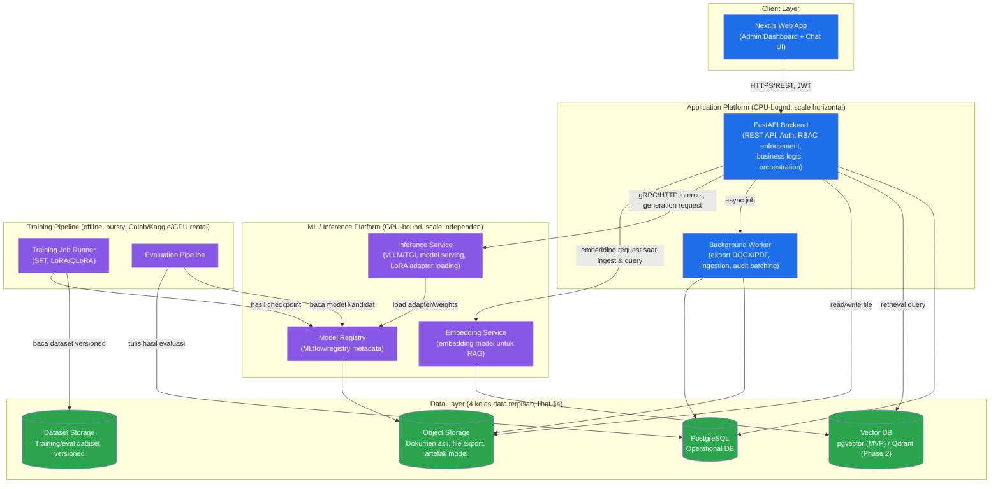
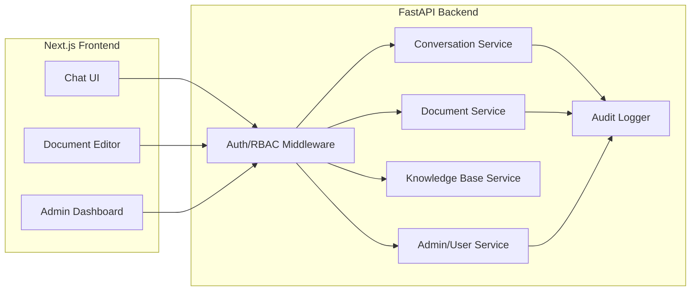
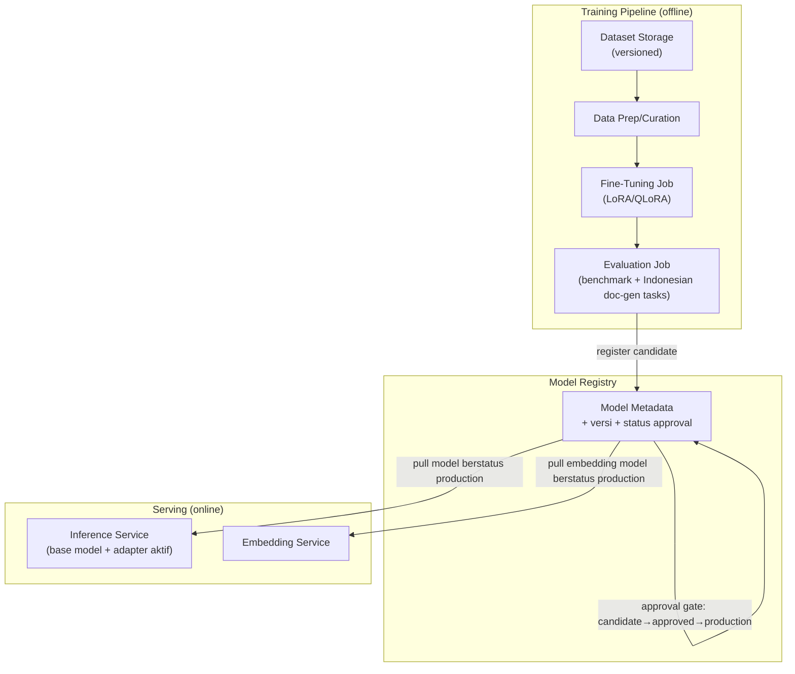
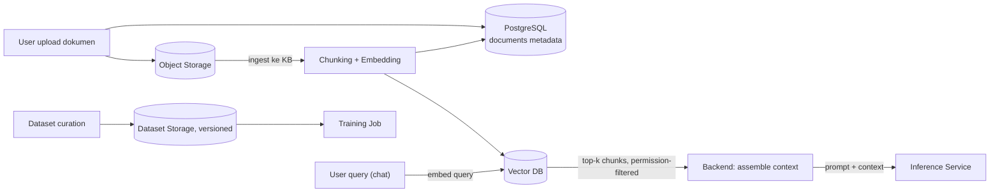
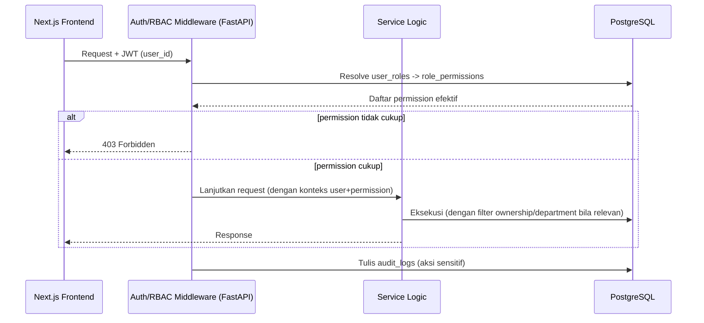
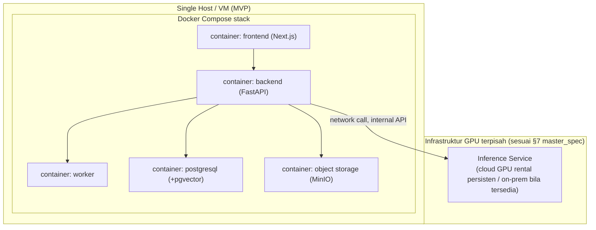
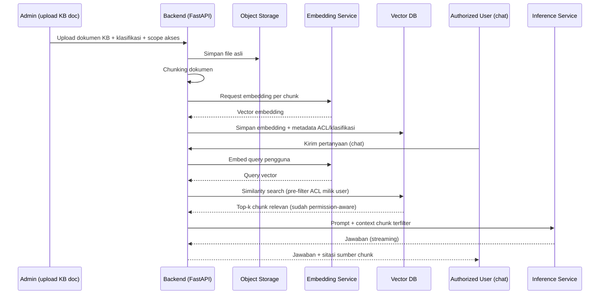
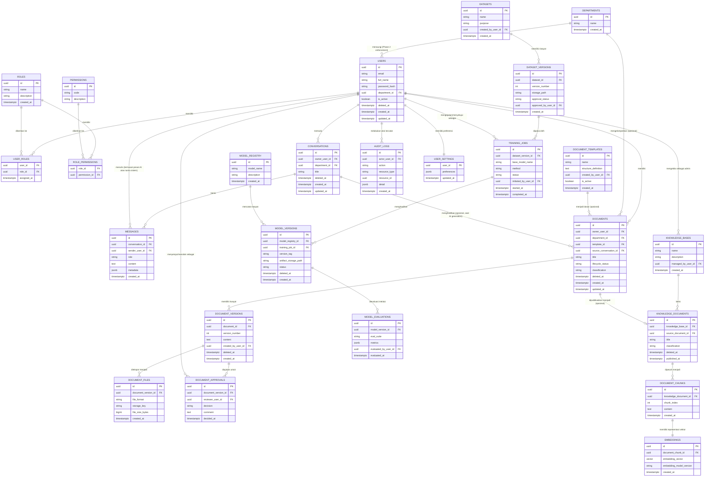

# System Architecture & Data Model — DocuGen AI

> **Status dokumen**: Dokumen REFERENSI PENDUKUNG, bukan satu dari 7 deliverable utama yang terdaftar di `master_spec.md` §10. Dokumen ini disiapkan untuk dirujuk oleh subagent lain saat menyusun `Project_Requirements.md` dan dokumen turunan lain (terutama `PRD_LLM_Document_Generator.md`, `ML_Deployment_Strategy.md`, `ML_Pipeline.md`).
>
> **Sumber kebenaran**: Seluruh keputusan di dokumen ini WAJIB konsisten dengan `master_spec.md` (Decision Log §4, Security Baseline §9, Hardware Reality §7). Jika terjadi ketidaksesuaian, `master_spec.md` menang.
>
> **Referensi cepat ke master_spec.md**: Private Enterprise Application (§1) · Fine-tuning vs RAG (§3) · Backend FastAPI terpisah dari inference service (§4) · PostgreSQL (§4) · Vector DB pgvector (MVP) vs Qdrant (Phase 2, final di ML Deployment Strategy) (§4) · Next.js frontend (§4) · RBAC MVP → DBAC + Resource-Level Phase 2 (§4) · Security & Data Governance Baseline (§9).

---

## Daftar Isi

1. High-Level Architecture
2. Application Architecture
3. ML Architecture
4. Data Architecture
5. Security Architecture
6. Deployment Architecture
7. Integration Architecture
8. Entity Relationship Diagram (ERD) & Katalog Entitas

---

## 1. High-Level Architecture

Diagram berikut menggambarkan seluruh ekosistem DocuGen AI pada level tertinggi: tiga lapisan utama (Client, Application Platform, ML Platform) plus lapisan data yang dipisah menurut kelasnya (lihat §4).

**Poin kunci dari diagram**:
- Garis batas tegas antara *Application Platform* (CPU, selalu nyala, melayani request pengguna real-time) dan *ML/Inference Platform* (GPU, mahal, dioptimalkan untuk throughput inference) dan *Training Pipeline* (offline, bursty, dijalankan di Colab/Kaggle/GPU rental sesuai `master_spec.md` §7).
- `Model Registry` adalah satu-satunya jembatan resmi antara Training Pipeline dan Inference Service — tidak ada jalur langsung training → serving tanpa registry (lihat §3).
- Keempat kelas data (§4) dipisah secara eksplisit karena karakteristik akses, pola scaling, dan kebutuhan governance yang berbeda.

---

## 2. Application Architecture

### 2.1 Tiga komponen aplikasi

| Komponen | Teknologi | Peran |
|---|---|---|
| Frontend | Next.js (React, SSR) | Chat UI, admin dashboard, document editor UI, rendering hasil. Tidak menyimpan state otoritatif apa pun — semua state tervalidasi di backend. |
| Backend aplikasi | Python FastAPI | REST API, autentikasi/autorisasi (RBAC enforcement), business logic (dokumen, approval, KB, user/role management), orkestrasi panggilan ke Inference Service, audit logging. |
| Database relasional | PostgreSQL | Operational data (lihat §4). |

### 2.2 Mengapa Inference Service dipisah dari Backend App — justifikasi wajib

`master_spec.md` §4 menetapkan backend FastAPI "terpisah dari inference service". Alasan teknis:

1. **Scaling independen GPU vs CPU**
   Backend FastAPI adalah workload CPU-bound, I/O-bound (DB query, orkestrasi, validasi) — pola traffic-nya proporsional terhadap jumlah pengguna aktif dan di-scale horizontal dengan menambah replica container biasa (murah, elastis per detik).
   Inference Service adalah workload GPU-bound — unit scaling-nya adalah *GPU instance*, jauh lebih mahal, lebih lambat untuk di-provision/deprovision, dan sering perlu batching request untuk efisiensi (continuous batching pada vLLM/TGI). Menyatukan keduanya dalam satu proses/container berarti setiap scale-out backend (murah) memaksa scale-out GPU (mahal) secara ikut-ikutan, atau sebaliknya GPU idle menahan biaya backend tidak bisa di-scale independen. Memisahkan keduanya memungkinkan backend di-scale sesuai beban concurrent user, sementara Inference Service di-scale (atau tetap 1 instance) sesuai throughput token yang dibutuhkan dan budget GPU yang tersedia — relevan khususnya pada fase MVP dengan constraint hardware (`master_spec.md` §7) di mana GPU produksi disediakan terpisah dan terbatas.

2. **Siklus deployment berbeda**
   Backend app di-deploy setiap kali ada perubahan logic bisnis (fitur baru, bugfix, perubahan RBAC) — frekuensi tinggi, deployment ringan (container restart detik).
   Inference Service di-deploy/di-reload setiap kali ada model/adapter baru lolos evaluasi dan approval (lihat §3) — frekuensi jauh lebih rendah, proses lebih berat (loading weight ke VRAM bisa memakan waktu, butuh health-check sebelum menerima traffic produksi, dan idealnya pakai strategi blue-green/rolling agar tidak mengganggu sesi chat yang sedang berjalan). Menggabungkan dua siklus ini berarti setiap bugfix kecil di backend berisiko memicu reload model yang mahal, atau sebaliknya rilis model baru terblokir oleh antrian rilis fitur backend yang tidak berkaitan.

3. **Isolasi kegagalan**: jika Inference Service down/overload, backend tetap bisa melayani fitur non-generative (riwayat chat, manajemen dokumen, admin dashboard) dan memberi respons degradasi yang jelas ke pengguna, bukan crash total.

4. **Kontrak API yang stabil**: komunikasi backend ↔ inference service melalui kontrak internal (REST/gRPC) membuat Inference Service bisa diganti implementasinya (vLLM → TGI, model A → model B) tanpa menyentuh kode backend, selama kontrak dipertahankan — relevan dengan evaluasi model kandidat berulang di `master_spec.md` §8.1.

### 2.3 Diagram komponen aplikasi

Semua request dari frontend WAJIB melewati `Auth/RBAC Middleware` di backend sebelum mencapai service logic apa pun — lihat detail di §5.

---

## 3. ML Architecture

### 3.1 Pemisahan Training Pipeline vs Serving (Inference Service)

Training (SFT/LoRA/QLoRA, lihat `master_spec.md` §8.2) dan Serving adalah dua sistem dengan kebutuhan infrastruktur, frekuensi eksekusi, dan SLA yang sepenuhnya berbeda:

| Aspek | Training Pipeline | Serving (Inference Service) |
|---|---|---|
| Pola eksekusi | Bursty, dijadwalkan/manual, durasi jam–hari | Selalu nyala (always-on), latensi rendah per request |
| Lokasi eksekusi | Colab/Kaggle (free tier dulu) → GPU rental on-demand (`master_spec.md` §7) | Infrastruktur produksi GPU terdedikasi/persisten |
| SLA | Tidak ada SLA real-time; boleh gagal & diulang | Harus responsif untuk chat interaktif |
| Output | Checkpoint/adapter weight + metrik evaluasi | Jawaban/generasi token streaming ke user |

Keduanya **tidak terhubung langsung**. Penghubung resmi satu-satunya adalah **Model Registry**: training pipeline mendaftarkan checkpoint + metadata evaluasi ke registry; proses approval (lihat Security & Governance, `master_spec.md` §9.3 dan `business_process.md`) menentukan status model (`candidate` → `approved` → `production`); Inference Service hanya menarik model/adapter yang berstatus `production` dari registry. Desain ini mencegah model yang belum lolos evaluasi/approval tiba-tiba melayani traffic pengguna nyata.

### 3.2 Diagram ML Architecture

### 3.3 Fine-tuning vs RAG di level arsitektur

Sesuai `master_spec.md` §3 (final, tidak boleh dikontradiksi): Fine-tuning mengubah *behavior* model (gaya tulisan, kepatuhan format) dan bersifat statis antar siklus retraining; ia **tidak pernah** menjadi tempat penyimpanan knowledge dinamis. Secara arsitektural ini berarti:
- Fine-tuned weights/adapter hidup di **Model Registry → Inference Service** (jalur ML Architecture di atas).
- Dokumen/SOP/kebijakan yang sering berubah hidup di **Knowledge Base → Vector DB** (jalur RAG, lihat §4 dan §7), diambil saat inference time, bukan dibakukan ke dalam weight model.

---

## 4. Data Architecture

Empat kelas data dipisah karena pola akses, model konsistensi, dan kebutuhan skala yang berbeda secara fundamental:

| Kelas Data | Teknologi | Karakteristik Akses | Contoh Isi |
|---|---|---|---|
| **Operational DB** | PostgreSQL (`master_spec.md` §4) | Transaksional, relasional, konsistensi kuat (ACID), query terstruktur dengan join, row-level kecil-menengah | users, roles, conversations, messages, document metadata, audit_logs |
| **Vector DB** | pgvector (MVP, extension di PostgreSQL) → Qdrant (Phase 2, final di `ML_Deployment_Strategy.md` §A) | Similarity search (ANN) berdimensi tinggi, baca-berat saat retrieval RAG, write saat ingestion dokumen KB | embeddings dari document_chunks |
| **Object Storage** | S3-compatible (MinIO self-hosted untuk MVP, atau S3/GCS kompatibel) | Binary besar, append-mostly, diakses via URL/key, tidak perlu query terstruktur | file dokumen asli (upload), hasil export DOCX/PDF, checkpoint/artefak model |
| **Dataset Storage** | Object storage/filesystem terversi (atau DVC-style) + metadata tercatat di PostgreSQL (`datasets`, `dataset_versions`) | Append/version-heavy, dibaca batch besar saat training, immutable per versi | dataset training/eval (public + synthetic, sesuai `master_spec.md` §4 Dataset awal) |

**Mengapa dipisah, bukan semuanya di PostgreSQL**:
- Menyimpan binary besar (file dokumen, model checkpoint berukuran ratusan MB–GB) langsung di PostgreSQL akan membengkakkan storage DB operasional, memperlambat backup/restore, dan tidak efisien dibandingkan object storage yang didesain untuk itu — PostgreSQL hanya menyimpan **metadata/pointer** (path/key) ke object storage.
- Vector similarity search pada skala besar punya pola indexing (HNSW/IVFFlat) dan kebutuhan scaling baca yang berbeda dari OLTP biasa; pgvector cukup untuk MVP (volume KB masih kecil, minim moving parts sesuai filosofi MVP), tapi dipisahkan secara logis sejak awal (schema/skema akses terpisah) agar migrasi ke Qdrant di Phase 2 tidak memaksa refactor besar pada data operasional lain.
- Dataset training perlu *versioning* yang immutable (dataset versi 3 tidak boleh berubah diam-diam setelah dipakai untuk training run tertentu, demi reproducibility) — pola ini berbeda dari data operasional yang terus di-update (mutable).

### 4.1 Diagram aliran data lintas kelas

---

## 5. Security Architecture

### 5.1 Prinsip inti (mengikat, dari `master_spec.md` §9)

> "Authorization ditegakkan di backend (API layer), bukan hanya UI/system prompt. System prompt TIDAK PERNAH jadi pengganti backend authorization." — §9.8

Konsekuensi desain:
- Setiap endpoint FastAPI melewati middleware/dependency yang memverifikasi identitas (JWT/session) **dan** permission atas resource spesifik sebelum logic bisnis dieksekusi — bukan sekadar menyembunyikan tombol di UI Next.js (hiding di frontend hanya UX, bukan kontrol keamanan).
- Frontend boleh menyembunyikan menu yang tidak relevan untuk role tertentu demi UX, tetapi backend WAJIB menolak request tersebut secara independen meski frontend "lolos" karena bug/manipulasi client.
- LLM system prompt boleh diberi instruksi kontekstual ("kamu adalah asisten untuk departemen X"), tetapi ini **tidak pernah** dianggap sebagai kontrol akses — model bisa "dibujuk" (prompt injection) untuk mengabaikan instruksi semacam itu; kontrol akses nyata terjadi sebelum data masuk ke prompt (lihat §5.2).

### 5.2 RBAC enforcement flow

### 5.3 Permission-aware RAG retrieval

Sesuai `master_spec.md` §9.4: "RAG retrieval WAJIB permission-aware (filter berbasis ACL dokumen sebelum masuk context, bukan hanya system prompt)." Implikasi arsitektural:

1. Setiap `knowledge_documents` (dan turunan `document_chunks`/`embeddings`) membawa metadata akses (minimal: klasifikasi sensitivitas §9.5, dan di Phase 2 department/resource-level ACL).
2. Saat backend menyusun similarity search ke Vector DB, filter ACL **wajib** diterapkan sebagai bagian dari query (pre-filter), bukan di-filter setelah hasil didapat dan bukan sekadar diberi tahu ke model lewat prompt ("jangan tampilkan dokumen rahasia"). Jika vector DB tidak mendukung pre-filtering dengan efisien untuk skala tertentu, alternatifnya adalah membatasi kandidat dokumen sebelum similarity search dijalankan (restrict-then-search), bukan search-then-trust-model-to-filter.
3. Chunk yang lolos filter ACL baru dirangkai menjadi context yang dikirim ke Inference Service. Dengan desain ini, meskipun prompt pengguna "memaksa" model menampilkan sesuatu, dokumen yang tidak berhak diakses pengguna itu tidak pernah ada secara fisik di dalam context — tidak ada yang bisa "dibocorkan" oleh model karena datanya tidak pernah dikirim.

### 5.4 Klasifikasi dokumen & audit

- Setiap dokumen (baik upload pengguna maupun entri knowledge base) wajib memiliki klasifikasi sensitivitas: `Public` / `Internal` / `Confidential` / `Restricted` (§9.5), disimpan sebagai kolom pada entitas dokumen terkait.
- Semua akses sensitif oleh Admin (termasuk melihat dokumen Confidential/Restricted milik pengguna lain, mengubah role, akses dataset training) tercatat di `audit_logs` — tidak ada akses tanpa jejak (§9.6).
- Pengiriman data internal ke API eksternal pihak ketiga default **deny**; override membutuhkan approval formal tercatat (§9.7) — pada level arsitektur ini berarti setiap jalur keluar (egress) ke layanan LLM eksternal (jika suatu saat dievaluasi sebagai opsi TBD) harus melewati gate konfigurasi yang eksplisit, auditable, dan bukan default aktif.

---

## 6. Deployment Architecture

### 6.1 Prinsip: evaluasi kebutuhan, jangan default ke Kubernetes

Untuk skala MVP (admin-managed, pengguna internal terbatas, infrastruktur awal mengikuti realita hardware di `master_spec.md` §7), **Docker Compose cukup** untuk orkestrasi Application Platform. Kubernetes membawa overhead operasional signifikan (cluster management, networking, observability tambahan, learning curve) yang baru terbayar ketika ada kebutuhan konkret yang tidak bisa dipenuhi Compose:

| Kriteria | Docker Compose cukup bila... | Kubernetes mulai dibutuhkan bila... |
|---|---|---|
| Jumlah node | Single-host (atau sedikit host dikelola manual) | Multi-node dengan kebutuhan scheduling otomatis lintas node |
| Scaling | Manual/jarang, beban prediktif | Autoscaling horizontal berdasarkan metrik real-time, beban fluktuatif signifikan |
| High availability | Downtime singkat saat deploy/reload dapat ditoleransi (sesuai SLA internal MVP) | Butuh zero-downtime rolling update lintas banyak replica & self-healing otomatis |
| Tim operasional | Tim kecil, belum punya kapasitas SRE/platform engineering khusus | Ada kapasitas untuk mengelola kompleksitas K8s secara berkelanjutan |
| GPU scheduling | 1 instance Inference Service yang dikelola manual/tetap | Perlu scheduling dinamis multi-GPU multi-tenant dengan bin-packing otomatis |

**Rekomendasi MVP**: Docker Compose, dengan service terpisah per container (frontend, backend, PostgreSQL, Inference Service, embedding service) agar pemisahan arsitektur di §2–§3 tetap terjaga secara fisik, bukan hanya logis. Migrasi ke Kubernetes dievaluasi ulang di `ML_Deployment_Strategy.md` ketika traksi pengguna/beban nyata sudah terukur — bukan diputuskan di muka sebagai "best practice" generik.

### 6.2 Diagram deployment MVP (Docker Compose)

Catatan: Inference Service digambar di luar host Compose MVP karena kebutuhan GPU terdedikasi berbeda dari host CPU yang menjalankan Compose stack — ini konsisten dengan pemisahan di §2.2 meskipun pada skala MVP Inference Service mungkin berupa 1 instance GPU rental yang dikelola manual, bukan cluster.

---

## 7. Integration Architecture

### 7.1 Backend App ↔ Inference Service

- **Protokol**: HTTP/REST (atau gRPC bila dibutuhkan streaming token dengan overhead lebih rendah) atas jaringan internal/private — tidak diekspos langsung ke internet publik.
- **Pola panggilan**: Backend mengirim request generasi berisi prompt yang sudah disusun lengkap (termasuk context RAG yang sudah difilter ACL, lihat §5.3) ke Inference Service; respons di-stream kembali ke backend lalu di-relay (streaming) ke frontend via SSE/WebSocket agar UX chat terasa real-time.
- **Timeout & fallback**: Backend wajib menerapkan timeout dan circuit breaker — jika Inference Service tidak responsif, backend mengembalikan error yang jelas ke pengguna, bukan hang tanpa batas, dan fitur non-generatif aplikasi tetap berjalan normal (lihat §2.2 poin isolasi kegagalan).
- **Autentikasi internal**: panggilan backend → inference service menggunakan credential/service-token internal terpisah dari sesi pengguna — pengguna akhir tidak pernah memanggil Inference Service secara langsung.

### 7.2 RAG Pipeline ↔ Vector DB ↔ Object Storage

Alur ingestion dan retrieval:

- Object Storage menyimpan **file asli** (untuk audit/tampil ulang/sitasi sumber dokumen), sedangkan Vector DB menyimpan **representasi numerik chunk** untuk retrieval — dua kelas data yang sengaja tidak digabung (lihat §4).
- Backend adalah satu-satunya pihak yang punya kredensial untuk memanggil Vector DB dan Object Storage secara langsung; frontend tidak pernah mengakses keduanya langsung, demi menjaga titik tunggal enforcement RBAC/ACL di backend (konsisten dengan §5.1).

---

## 8. Entity Relationship Diagram (ERD) & Katalog Entitas

### 8.1 Prinsip desain data model (dibaca sebelum ERD)

- **Soft delete selektif**: entitas yang punya implikasi hukum/audit/riwayat bisnis (users, documents, document_versions, conversations, messages, knowledge_documents, model_registry, model_versions) menggunakan soft delete (`deleted_at timestamptz null`) agar riwayat tetap bisa direkonstruksi untuk audit, bukan hilang permanen. Entitas lookup statis (roles, permissions) dan entitas log append-only (audit_logs) tidak memakai soft delete — permission/role tidak "dihapus lembut" (diubah jadi non-aktif via tabel relasi, bukan dihapus dari master), dan audit_logs sengaja immutable (tidak pernah di-update/delete sama sekali, hanya diarsipkan).
- **Document versioning sebagai entitas terpisah, bukan mutasi langsung**: `documents` adalah record identitas dokumen (metadata stabil: judul, owner, status lifecycle saat ini), sementara setiap perubahan konten signifikan dicatat sebagai baris baru di `document_versions`. Ini disengaja karena: (a) kebutuhan audit trail — regulasi/kepatuhan internal untuk dokumen bisnis penting mensyaratkan histori "siapa mengubah apa kapan" tetap utuh, bukan ditimpa; (b) approval workflow (`document_approvals`) butuh merujuk versi spesifik yang disetujui/ditolak, bukan "dokumen" secara umum yang kontennya bisa berubah lagi setelah approval; (c) kemampuan rollback ke versi sebelumnya tanpa rekonstruksi dari log. Mutasi langsung ke `documents.content` akan menghancurkan properti-properti ini.
- **Document file vs document version**: `document_files` dipisah dari `document_versions` karena satu versi dokumen bisa punya representasi biner ganda (hasil export DOCX dan PDF dari versi konten yang sama) — memisahkan keduanya menghindari duplikasi metadata versi untuk setiap format file.
- **Knowledge base sebagai lapisan terpisah dari document management**: `documents` (dokumen kerja yang dibuat/diupload pengguna, bisa draft/private) berbeda dari `knowledge_documents` (dokumen yang secara sadar dipublikasikan ke KB untuk keperluan RAG retrieval oleh banyak pengguna). Satu dokumen bisa "naik" dari `documents` menjadi entri di `knowledge_documents` melalui proses sadar (bukan otomatis — konsisten dengan `master_spec.md` §9.2 "dokumen upload tidak otomatis menjadi training data" dan filosofi yang sama berlaku untuk KB: publikasi ke KB adalah aksi eksplisit, bukan default).
- **Dataset vs dataset_versions mengikuti pola yang sama seperti documents/document_versions**, demi reproducibility training run (`master_spec.md` §9.3: "Dataset training butuh approval eksplisit").
- **Isolasi department**: MVP menggunakan RBAC murni (role global, bukan scoped per department) sesuai `master_spec.md` §4. Kolom `department_id` tetap disediakan di `users` dan opsional di `documents`/`conversations` sebagai **persiapan skema** untuk Department-Based Access Control di Phase 2, TAPI di MVP kolom ini bersifat informasional/organisasional saja (misal untuk reporting), **bukan** mekanisme enforcement akses — pembatasan akses aktual di MVP murni dari `role_permissions`, bukan `department_id`. Ini mencegah schema MVP harus di-redesign total saat Phase 2 mengaktifkan isolasi department sebagai enforcement sungguhan.
- **Data ownership**: setiap entitas yang dimiliki pengguna individual membawa `owner_user_id` (bukan diasumsikan dari foreign key lain) agar query "milik siapa" dan RBAC ownership-check (misal: pengguna hanya boleh edit dokumen miliknya sendiri kecuali admin) tidak perlu join berantai.
- **Retention/lifecycle**: `audit_logs` dirancang append-only dengan kebijakan archival terpisah (dipindah ke cold storage setelah periode retensi, bukan dihapus — kebutuhan compliance); `messages`/`conversations` mengikuti retensi sesuai kebijakan data governance (default: disimpan, soft-delete saat pengguna/admin menghapus); dataset dan model artifact tidak punya retensi otomatis (keduanya adalah aset yang disengaja disimpan permanen demi reproducibility, dibersihkan manual oleh Admin/AI-ML Team bila perlu).

### 8.2 ERD Mermaid

### 8.3 Katalog Entitas (detail per entitas)

Untuk setiap entitas: Primary Key (PK), Foreign Key (FK) & kardinalitas, indeks penting, constraint penting, soft delete, data ownership, isolasi department, lifecycle data.

#### users
- **PK**: `id` (uuid)
- **FK**: `department_id → departments.id` (nullable, many-to-one: banyak user per department)
- **Index**: unique index `email`; index `department_id` untuk query admin per-department.
- **Constraint**: `email` unique & not null; `password_hash` tidak pernah menyimpan plaintext.
- **Soft delete**: Ya, kolom `deleted_at` — akun admin-managed (`master_spec.md` §1: "admin-managed accounts only") butuh jejak riwayat siapa pernah punya akses, bahkan setelah dinonaktifkan.
- **Ownership**: diri sendiri (root dari seluruh ownership entitas lain).
- **Isolasi department**: kolom tersedia, TIDAK dipakai sebagai enforcement akses di MVP (lihat §8.1) — hanya metadata organisasional.
- **Lifecycle**: retensi mengikuti kebijakan HR/kepegawaian internal perusahaan (di luar scope teknis dokumen ini); soft delete dipakai saat offboarding, bukan hard delete, demi integritas FK historis (audit_logs, documents, dll).

#### roles
- **PK**: `id`. **FK**: tidak ada (master data).
- **Index**: unique `name`.
- **Constraint**: nama role unik (`admin`, `authorized_user`, dan role tambahan jika ada).
- **Soft delete**: Tidak — role adalah master data konfigurasi sistem, dinonaktifkan via proses admin terkontrol (bukan dihapus sembarangan karena berisiko merusak integrasi `user_roles`/`role_permissions` yang sedang aktif dipakai).
- **Ownership**: sistem (dikelola Admin).
- **Isolasi department**: tidak relevan — role bersifat global di MVP sesuai RBAC §4.
- **Lifecycle**: permanen, perubahan dikontrol melalui proses administrasi, bukan siklus retensi.

#### permissions
- **PK**: `id`. **FK**: tidak ada.
- **Index**: unique `code` (misal `document:read`, `kb:manage`, `user:manage`).
- **Constraint**: `code` unik, immutable setelah dipakai di `role_permissions` manapun (mengubah arti kode permission yang sudah dirujuk berisiko inkonsistensi otorisasi retroaktif).
- **Soft delete**: Tidak.
- **Ownership**: sistem.
- **Isolasi department**: tidak relevan.
- **Lifecycle**: permanen, dikelola bersamaan dengan rilis fitur baru yang menambah permission baru.

#### user_roles
- **PK**: composite `(user_id, role_id)`. **FK**: `user_id → users.id` (many-to-many junction, satu user bisa multi-role), `role_id → roles.id`.
- **Index**: index pada `role_id` untuk query "siapa saja pemegang role X" (dipakai admin dashboard).
- **Constraint**: unique composite PK mencegah duplikasi assignment.
- **Soft delete**: Tidak — pencabutan role adalah hard delete dari tabel relasi (reversible oleh admin dengan assignment ulang); riwayat "siapa pernah punya role apa" tidak di-track di sini, melainkan via `audit_logs` saat assignment/revoke terjadi (pemisahan tanggung jawab: tabel relasi = state saat ini, audit_logs = riwayat perubahan).
- **Ownership**: dikelola Admin atas user lain.
- **Isolasi department**: tidak relevan.
- **Lifecycle**: mengikuti lifecycle user & role induknya.

#### role_permissions
- **PK**: composite `(role_id, permission_id)`. **FK**: `role_id → roles.id`, `permission_id → permissions.id`.
- **Index**: index `permission_id` untuk audit "role apa saja yang punya permission X".
- **Constraint**: unique composite PK.
- **Soft delete**: Tidak, sama alasannya dengan `user_roles`.
- **Ownership**: dikelola Admin.
- **Isolasi department**: tidak relevan.
- **Lifecycle**: berubah hanya saat definisi role direvisi oleh Admin.

#### departments
- **PK**: `id`. **FK**: tidak ada.
- **Index**: unique `name`.
- **Constraint**: nama unik.
- **Soft delete**: Tidak dibutuhkan di MVP (jumlah department kecil, dikelola manual); dapat ditambahkan di Phase 2 bila department bisa dibubarkan sambil riwayat historisnya harus dipertahankan.
- **Ownership**: sistem/organisasi.
- **Isolasi department**: entitas ini adalah definisi unit isolasi itu sendiri (dipakai di Phase 2).
- **Lifecycle**: mengikuti struktur organisasi riil perusahaan, berubah jarang.

#### conversations
- **PK**: `id`. **FK**: `owner_user_id → users.id` (one-to-many: satu user banyak conversation), `department_id → departments.id` (nullable, informasional).
- **Index**: index `owner_user_id` (daftar riwayat chat per user, query paling sering); index `created_at` untuk sorting/pagination.
- **Constraint**: `title` boleh kosong (auto-generated dari pesan pertama bila belum diisi).
- **Soft delete**: Ya, `deleted_at` — pengguna bisa "menghapus" riwayat chat dari tampilannya, tetapi data dipertahankan untuk kebutuhan audit/compliance sesuai `master_spec.md` §9 (percakapan tidak otomatis dipakai training, tapi tetap perlu tersimpan untuk jejak).
- **Ownership**: `owner_user_id` eksplisit.
- **Isolasi department**: metadata saja di MVP, bukan filter akses.
- **Lifecycle**: retensi mengikuti kebijakan data governance perusahaan (di luar scope ini); soft delete di layer aplikasi, hard purge/archival hanya lewat proses data governance terkontrol, tidak lewat UI biasa.

#### messages
- **PK**: `id`. **FK**: `conversation_id → messages.conversation_id` (many-to-one: satu conversation banyak message), `sender_user_id → users.id` (nullable secara semantik untuk pesan dari AI — disarankan tetap merujuk ke user "system/AI" khusus atau kolom `role` membedakan `user`/`assistant`/`system`, bukan nullable FK, demi integritas referensial; lihat kolom `role`).
- **Index**: composite index `(conversation_id, created_at)` untuk pengambilan urutan pesan dalam satu percakapan (query paling sering dan paling sensitif latensi).
- **Constraint**: `role` enum terbatas (`user`, `assistant`, `system`); `content` not null.
- **Soft delete**: Tidak secara individual — penghapusan dilakukan di level `conversations` (hapus satu conversation menghapus/menyembunyikan seluruh message-nya secara cascade logis), karena menghapus satu message secara individual akan merusak koherensi riwayat percakapan yang harus utuh untuk konteks dan audit.
- **Ownership**: diturunkan dari `conversation_id` → `conversations.owner_user_id`.
- **Isolasi department**: tidak langsung, diwarisi dari conversation.
- **Lifecycle**: ikut lifecycle `conversations` induknya.

#### documents
- **PK**: `id`. **FK**: `owner_user_id → users.id` (one-to-many), `department_id → departments.id` (nullable), `template_id → document_templates.id` (nullable, many-to-one: satu template dipakai banyak dokumen), `source_conversation_id → conversations.id` (nullable, one-to-many: satu percakapan bisa menghasilkan beberapa dokumen draft).
- **Index**: index `owner_user_id`; index `lifecycle_status` (query dashboard "dokumen menunggu approval"); index `classification` (query kepatuhan/audit).
- **Constraint**: `lifecycle_status` merujuk status yang didefinisikan di `PRD_Document_Control_SaaS.md` (Draft→...→Archived, lihat `master_spec.md` §10.2) — enum harus identik dengan dokumen itu, tidak didefinisikan ulang berbeda di sini; `classification` enum `Public/Internal/Confidential/Restricted` (§9.5).
- **Soft delete**: Ya, `deleted_at` — dokumen bisnis penting tidak boleh hilang permanen tanpa jejak (human review wajib, §Decision Log "AI output bukan otomatis dokumen resmi" — riwayat harus bisa diaudit siapa membuat/menghapus apa).
- **Ownership**: `owner_user_id` eksplisit; `department_id` sebagai metadata pengelompokan tambahan.
- **Isolasi department**: metadata di MVP; di Phase 2 kolom ini menjadi basis filter DBAC.
- **Lifecycle**: mengikuti status lifecycle Document Control; archival (status `Archived`) tidak menghapus data, hanya mengubah status dan membatasi aksi edit lebih lanjut.

#### document_versions
- **PK**: `id`. **FK**: `document_id → documents.id` (many-to-one: satu dokumen banyak versi), `created_by_user_id → users.id`.
- **Index**: composite index `(document_id, version_number)` unique — menjamin urutan versi konsisten dan query "versi terbaru" efisien.
- **Constraint**: `version_number` increment per `document_id`, tidak boleh duplikat (unique composite); `content` immutable setelah dibuat (append-only versioning, lihat justifikasi §8.1).
- **Soft delete**: Ya — alasan sama dengan `documents`, ditambah kebutuhan rollback (versi yang "dihapus" dari tampilan tetap bisa direkonstruksi untuk audit approval yang sudah terjadi atasnya).
- **Ownership**: `created_by_user_id` (bisa berbeda dari `documents.owner_user_id` bila dokumen diedit kolaboratif/oleh Admin).
- **Isolasi department**: diwarisi dari `documents`.
- **Lifecycle**: setiap versi dipertahankan permanen (atau sesuai retensi khusus bila ditetapkan kebijakan); tidak ada auto-purge versi lama karena menjadi dasar approval history.

#### document_files
- **PK**: `id`. **FK**: `document_version_id → document_versions.id` (many-to-one: satu versi dokumen bisa punya beberapa file export — DOCX dan PDF).
- **Index**: index `document_version_id`.
- **Constraint**: `file_format` enum (`docx`, `pdf`); `storage_key` unique (pointer ke Object Storage, lihat §4) — tabel ini hanya metadata, binary aktual di Object Storage.
- **Soft delete**: Tidak perlu kolom sendiri — mengikuti penghapusan `document_versions` induknya (metadata file export tidak punya makna independen tanpa versi sumbernya); jika perlu hapus file fisik, dilakukan via proses terkontrol yang menghormati soft delete versi induk.
- **Ownership**: diwarisi dari `document_versions` → `documents`.
- **Isolasi department**: diwarisi.
- **Lifecycle**: file export bisa di-regenerate dari `content` versi kapan saja, sehingga secara teknis bersifat derivable/disposable — kebijakan retensi bisa lebih pendek dari `document_versions` itu sendiri (misal: file export lama di-purge dari object storage demi hemat storage, metadata versi konten tetap dipertahankan).

#### document_templates
- **PK**: `id`. **FK**: `created_by_user_id → users.id`.
- **Index**: index `is_active` (query template yang bisa dipilih user saat membuat dokumen baru).
- **Constraint**: `name` unique per template aktif.
- **Soft delete**: Tidak — menggunakan `is_active` boolean untuk nonaktifkan template dari pilihan baru tanpa merusak referensi `documents.template_id` historis (dokumen lama tetap merujuk template yang dipakai saat dibuat, meski template itu sudah tidak ditawarkan lagi untuk dokumen baru).
- **Ownership**: dikelola Admin (Document Control function di MVP, `master_spec.md` §4).
- **Isolasi department**: tidak relevan di MVP (template berlaku global); bisa discope per department di Phase 2.
- **Lifecycle**: permanen selama ada dokumen yang merujuknya (demi integritas referensial `documents.template_id`).

#### document_approvals
- **PK**: `id`. **FK**: `document_version_id → document_versions.id` (one-to-many: satu versi bisa diajukan ulang/direview lebih dari sekali, misal revisi setelah ditolak), `reviewer_user_id → users.id`.
- **Index**: index `(document_version_id, decided_at)` untuk riwayat approval berurutan.
- **Constraint**: `decision` enum (`approved`, `rejected`, `pending`); di MVP `reviewer_user_id` secara fungsional selalu Admin (Document Control merangkap Admin, `master_spec.md` §4) — tidak di-hardcode di schema, tetapi ditegakkan via RBAC permission check di backend (konsisten §5.1), sehingga schema tidak perlu diubah saat role Document Control dipisah di Phase 2.
- **Soft delete**: Tidak — keputusan approval adalah fakta historis yang tidak pernah dihapus/diubah (append-only per pengajuan); revisi baru membuat baris baru, bukan mengedit baris lama.
- **Ownership**: tindakan milik `reviewer_user_id`; subjek yang diajukan milik `document_version_id` → pemilik dokumen asal.
- **Isolasi department**: diwarisi dari dokumen terkait.
- **Lifecycle**: permanen, menjadi bagian tak terpisahkan dari audit trail dokumen.

#### knowledge_bases
- **PK**: `id`. **FK**: `managed_by_user_id → users.id` (Admin pengelola KB tertentu).
- **Index**: unique `name`.
- **Constraint**: nama KB unik.
- **Soft delete**: Tidak di level KB (jumlah KB kecil & terkelola manual di MVP); isi di dalamnya (`knowledge_documents`) yang soft delete.
- **Ownership**: dikelola Admin.
- **Isolasi department**: di MVP KB bisa diakses lintas user sesuai permission RBAC (bukan scoped department); Phase 2 bisa menambah kolom scoping bila dibutuhkan.
- **Lifecycle**: permanen selama dipakai, dinonaktifkan via proses admin.

#### knowledge_documents
- **PK**: `id`. **FK**: `knowledge_base_id → knowledge_bases.id` (many-to-one), `source_document_id → documents.id` (nullable, one-to-one opsional: KB entry bisa berasal dari dokumen kerja yang dipublikasikan, atau diupload langsung khusus untuk KB tanpa melalui `documents`).
- **Index**: index `knowledge_base_id`; index `classification` (dipakai filter ACL retrieval, §5.3 — ini index **kritis** untuk performa RAG permission-aware).
- **Constraint**: `classification` wajib diisi (not null) — tidak ada entri KB tanpa klasifikasi, menegakkan §9.5 di level schema.
- **Soft delete**: Ya, `deleted_at` — dokumen yang ditarik dari KB (misal SOP kedaluwarsa) tidak langsung dihapus permanen demi jejak audit "pernah ada knowledge apa", tapi langsung berhenti muncul di retrieval begitu `deleted_at` terisi (filter wajib di query retrieval).
- **Ownership**: `managed_by_user_id` di level KB induk; dokumen sumber tetap mencatat `owner_user_id` aslinya via `source_document_id`.
- **Isolasi department**: tidak di MVP (akses KB berbasis permission RBAC, bukan department) — kolom klasifikasi dan permission yang menjadi filter utama, bukan department.
- **Lifecycle**: `published_at` menandai kapan masuk KB; retensi mengikuti relevansi knowledge (ditarik manual oleh Admin saat kedaluwarsa, bukan otomatis).

#### document_chunks
- **PK**: `id`. **FK**: `knowledge_document_id → knowledge_documents.id` (many-to-one: satu dokumen KB dipecah jadi banyak chunk).
- **Index**: index `(knowledge_document_id, chunk_index)` unique — urutan chunk harus deterministik untuk rekonstruksi konteks dan sitasi sumber.
- **Constraint**: `chunk_index` sequential per dokumen, tidak boleh gap yang tidak disengaja (divalidasi di level ingestion pipeline, bukan DB constraint keras, karena re-chunking yang sah bisa mengubah total jumlah chunk).
- **Soft delete**: Tidak secara individual — mengikuti penghapusan `knowledge_documents` induknya (chunk tidak punya siklus hidup independen dari dokumen sumbernya); re-ingestion dokumen yang sama menghasilkan generasi chunk baru, bukan edit chunk lama (chunk bersifat immutable per generasi ingestion, demi konsistensi dengan embedding yang sudah dihasilkan darinya).
- **Ownership**: diwarisi dari `knowledge_documents`.
- **Isolasi department**: diwarisi.
- **Lifecycle**: mengikuti `knowledge_documents` induk; dihasilkan ulang (bukan diupdate) setiap kali dokumen sumber direvisi dan di-reingest.

#### embeddings
- **PK**: `id`. **FK**: `document_chunk_id → document_chunks.id` (one-to-one secara praktis per model embedding aktif — tapi didesain one-to-many untuk mengakomodasi kemungkinan multi-versi embedding model berjalan paralel saat migrasi model embedding, lihat `embedding_model_version`).
- **Index**: index vektor (HNSW/IVFFlat via pgvector di MVP) pada `embedding_vector` — index paling kritis untuk latensi retrieval RAG; index biasa pada `document_chunk_id`.
- **Constraint**: dimensi vektor tetap (ditentukan oleh model embedding yang dipakai) dan konsisten per `embedding_model_version`; tidak boleh mencampur embedding dari model berbeda dalam satu similarity search tanpa penanganan khusus.
- **Soft delete**: Tidak — mengikuti lifecycle `document_chunks` induk (dihapus/digenerate ulang bersamaan, karena embedding tanpa chunk sumber tidak bermakna).
- **Ownership**: diwarisi.
- **Isolasi department**: diwarisi (filter ACL retrieval sesungguhnya dilakukan di level `knowledge_documents.classification`/permission, dijoinkan saat query, bukan disimpan duplikat di tabel embeddings — menghindari data denormalized yang bisa basi bila permission dokumen berubah).
- **Lifecycle**: regenerasi penuh diperlukan saat model embedding di-upgrade (semua embedding lama idealnya di-reindex, bukan tercampur dengan versi baru secara diam-diam).

#### datasets
- **PK**: `id`. **FK**: `created_by_user_id → users.id`.
- **Index**: index `purpose` (misal filter dataset untuk SFT vs evaluasi).
- **Constraint**: `name` unik per `purpose`.
- **Soft delete**: Tidak di level induk (dataset sebagai konsep tidak dihapus selama ada versi aktif yang masih dirujuk training job historis).
- **Ownership**: AI/ML Team (dicatat via `created_by_user_id`, meski secara organisasi AI/ML Team adalah aktor internal non-role-aplikasi per `master_spec.md` §5).
- **Isolasi department**: tidak relevan.
- **Lifecycle**: permanen sebagai induk; detail versi di `dataset_versions`.

#### dataset_versions
- **PK**: `id`. **FK**: `dataset_id → datasets.id` (many-to-one), `approved_by_user_id → users.id` (nullable sampai disetujui).
- **Index**: composite unique `(dataset_id, version_number)`.
- **Constraint**: `approval_status` enum (`pending`, `approved`, `rejected`) — menegakkan `master_spec.md` §9.3 "dataset training butuh approval eksplisit" di level schema: `training_jobs` seharusnya hanya merujuk `dataset_version_id` yang `approval_status = approved` (ditegakkan di application logic, didukung oleh kolom ini sebagai sumber kebenaran status).
- **Soft delete**: Tidak — immutable by design (lihat §8.1); versi yang sudah pernah dipakai training tidak boleh berubah, "penarikan" dataset versi bermasalah dilakukan dengan menandai status, bukan menghapus, demi reproducibility training run historis yang mungkin perlu diaudit ulang.
- **Ownership**: diwarisi dari `datasets`, dengan jejak approval eksplisit via `approved_by_user_id`.
- **Isolasi department**: tidak relevan.
- **Lifecycle**: permanen (immutable storage path di Dataset Storage, §4), tidak ada purge otomatis.

#### training_jobs
- **PK**: `id`. **FK**: `dataset_version_id → dataset_versions.id` (many-to-one: satu dataset version bisa dipakai banyak training run dengan konfigurasi berbeda), `initiated_by_user_id → users.id`.
- **Index**: index `status` (monitoring job aktif); index `dataset_version_id`.
- **Constraint**: `method` enum (`full_ft`, `lora`, `qlora`) — konsisten dengan evaluasi di `master_spec.md` §8.2; `status` enum (`queued`, `running`, `completed`, `failed`).
- **Soft delete**: Tidak — log eksekusi training bersifat historis/immutable (append-only record kejadian), tidak dihapus bahkan jika gagal (justru job yang gagal penting untuk analisis).
- **Ownership**: `initiated_by_user_id` (AI/ML Team).
- **Isolasi department**: tidak relevan.
- **Lifecycle**: permanen sebagai riwayat eksperimen; artefak besar (checkpoint) hidup di Object Storage dengan pointer di `model_versions`, bukan di tabel ini.

#### model_registry
- **PK**: `id`. **FK**: tidak ada (induk konseptual, grup logis dari semua versi satu "model" dalam pengertian produk, misal "DocuGen-SFT-Model").
- **Index**: unique `model_name`.
- **Constraint**: `model_name` unik.
- **Soft delete**: Tidak — entri registry bertahan sebagai induk katalog; versi individualnya yang bisa soft-delete.
- **Ownership**: AI/ML Team.
- **Isolasi department**: tidak relevan.
- **Lifecycle**: permanen.

#### model_versions
- **PK**: `id`. **FK**: `model_registry_id → model_registry.id` (many-to-one), `training_job_id → training_jobs.id` (many-to-one: satu training job menghasilkan satu model version — relasi digambar many-to-one dari sisi model_versions karena memungkinkan beberapa checkpoint intermediate dari satu run yang sama didaftarkan sebagai versi berbeda untuk dibandingkan).
- **Index**: index `status` (query cepat "mana model yang berstatus production" — dipakai Inference Service saat startup/reload, lihat §3.1); unique composite `(model_registry_id, version_tag)`.
- **Constraint**: `status` enum (`candidate`, `approved`, `production`, `retired`) — jalur approval gate yang mengikat §3.1 dan `master_spec.md` §9.3 secara analog untuk model (bukan hanya dataset).
- **Soft delete**: Ya, `deleted_at` — model version yang ditarik/dipensiunkan tetap perlu dilacak (misal untuk investigasi insiden kualitas output lampau), bukan dihapus fisik dari metadata meski artefak besarnya bisa di-purge dari Object Storage terpisah.
- **Ownership**: AI/ML Team, dengan jejak approval melekat ke `model_evaluations`.
- **Isolasi department**: tidak relevan.
- **Lifecycle**: `status = retired` menandai akhir masa pakai produksi; artefak fisik (`artifact_storage_path`) bisa punya retensi berbeda dari metadata (metadata dipertahankan lebih lama untuk audit, artefak besar bisa diarsipkan/dipindah ke cold storage).

#### model_evaluations
- **PK**: `id`. **FK**: `model_version_id → model_versions.id` (many-to-one: satu model version dievaluasi berkali-kali dengan suite berbeda), `evaluated_by_user_id → users.id`.
- **Index**: index `model_version_id`.
- **Constraint**: `metrics` jsonb untuk fleksibilitas lintas benchmark (MMLU-Pro, HumanEval, IndoMMLU, evaluasi internal doc-generation sesuai `master_spec.md` §8.1) tanpa perlu migrasi schema setiap kali ada metrik baru.
- **Soft delete**: Tidak — hasil evaluasi adalah fakta historis immutable, menjadi bukti pendukung keputusan approval model version terkait.
- **Ownership**: AI/ML Team.
- **Isolasi department**: tidak relevan.
- **Lifecycle**: permanen sebagai bukti audit keputusan model.

#### audit_logs
- **PK**: `id`. **FK**: `actor_user_id → users.id` (many-to-one: satu user banyak aksi tercatat); `resource_id` disengaja **tidak** diberi FK constraint formal ke tabel spesifik (karena `resource_type` bisa merujuk tabel mana pun — users, documents, model_versions, dll.) — pola polymorphic reference, divalidasi di application logic, bukan di level DB constraint.
- **Index**: index `(actor_user_id, created_at)`; index `(resource_type, resource_id)` untuk query "riwayat perubahan resource X".
- **Constraint**: `action` dan `resource_type` sebaiknya enum/controlled vocabulary di application layer (bukan free text) demi konsistensi query/reporting.
- **Soft delete**: **Tidak pernah** — audit_logs bersifat append-only, tidak boleh diubah atau dihapus oleh siapa pun melalui jalur aplikasi normal (bahkan Admin), demi menegakkan `master_spec.md` §9.6 "tidak ada akses tanpa jejak" secara kredibel (log yang bisa dihapus oleh pihak yang diawasinya bukan log yang bisa dipercaya).
- **Ownership**: bukan dimiliki siapa pun dalam arti bisa dihapus pemiliknya — `actor_user_id` hanya menandai pelaku.
- **Isolasi department**: tidak relevan (log lintas seluruh sistem).
- **Lifecycle**: retensi panjang sesuai kebutuhan compliance; strategi archival (pindah ke cold storage/partisi tabel berdasarkan waktu) direkomendasikan untuk menjaga performa tabel operasional tanpa pernah menghapus data (partisi lama dipindah, tidak dibuang).

#### user_settings
- **PK**: `user_id` (uuid, sekaligus FK one-to-one ke `users.id` — satu user tepat satu baris settings, dibuat otomatis saat user dibuat).
- **FK**: `user_id → users.id`.
- **Index**: PK sudah cukup (akses selalu by `user_id`).
- **Constraint**: `preferences` jsonb untuk fleksibilitas (tema UI, bahasa, notifikasi) tanpa migrasi schema berulang untuk setiap preferensi baru.
- **Soft delete**: Tidak — dihapus mengikuti hard/soft delete `users` induk (settings tidak bermakna independen dari user-nya; bila user di-nonaktifkan via soft delete, settings cukup ikut tidak terpakai, tidak perlu kolom `deleted_at` sendiri).
- **Ownership**: `user_id` itu sendiri (ownership 1:1 penuh).
- **Isolasi department**: tidak relevan.
- **Lifecycle**: mengikuti lifecycle `users` induk sepenuhnya.

---

## Ringkasan Kepatuhan terhadap master_spec.md

| Ketentuan master_spec.md | Bagaimana dipenuhi di dokumen ini |
|---|---|
| §4 Backend FastAPI terpisah dari inference service | §2.2 (justifikasi lengkap), §6.2 (diagram deployment) |
| §4 PostgreSQL, Vector DB pgvector (MVP)/Qdrant (Phase 2, final di ML_Deployment_Strategy) | §4, ditandai sebagai keputusan sementara yang final-nya di dokumen lain |
| §4 Next.js frontend | §2.1, §2.3 |
| §3 Fine-tuning vs RAG | §3.3 |
| §9.1–9.3 Governance data training/upload | §8.1 (prinsip knowledge base publikasi eksplisit), §8.3 dataset_versions/model_versions approval gate |
| §9.4 RAG permission-aware | §5.3, §7.2 |
| §9.5 Klasifikasi dokumen | §5.4, kolom `classification` di `documents`/`knowledge_documents` |
| §9.6 Audit log tanpa kecuali | §5.4, §8.3 `audit_logs` (append-only) |
| §9.7 Default deny ke API eksternal | §5.4 |
| §9.8 Authorization di backend, bukan system prompt | §5.1, §5.2 |
| §7 Hardware reality, Colab/Kaggle → GPU rental | §3, §6.2 |
| §10 Dokumen tidak menduplikasi ID requirement | Dokumen ini tidak mendefinisikan FR-xxx/NFR-xxx/BR-xxx/DC-xxx baru — murni referensi arsitektur/data model |
