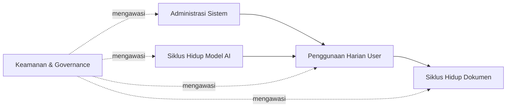
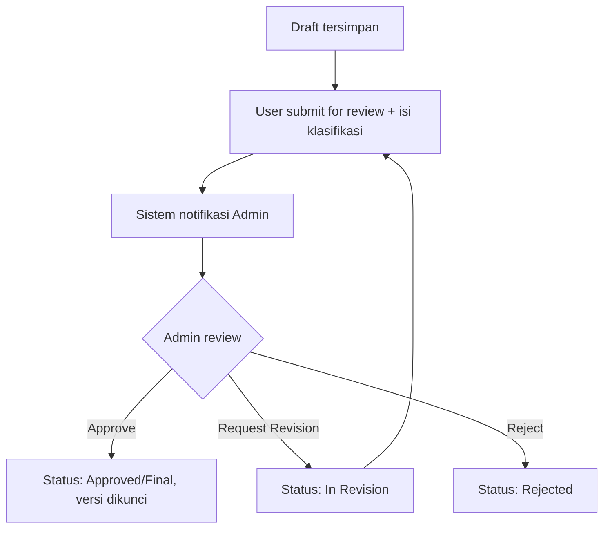
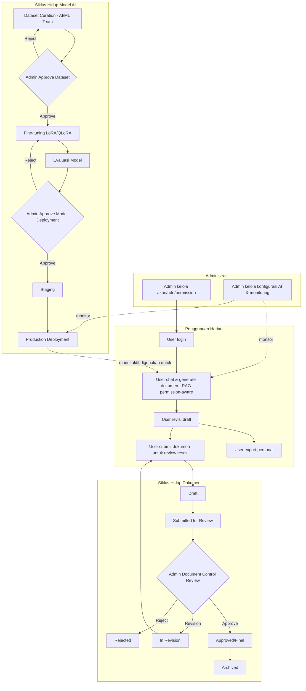
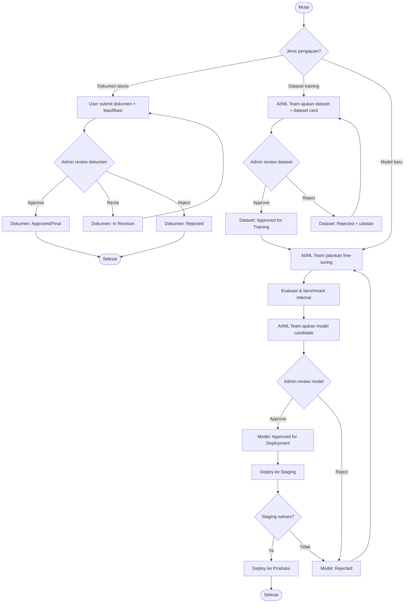

# Business Process — DocuGen AI

> Dokumen ini adalah **Document 1** dari 7 dokumen turunan Master Project Specification DocuGen AI. Dokumen ini berdiri sendiri (self-contained) namun WAJIB konsisten dengan `master_spec.md` sebagai single source of truth. Seluruh ID requirement (`BR-xxx`) di dokumen ini dirujuk oleh `Project_Requirements.md` dan tidak diduplikasi di dokumen lain.

---

## 1. Executive Summary

DocuGen AI adalah **Private Enterprise AI Application** dengan deployment tertutup (closed deployment, no public registration, admin-managed accounts only) yang menggabungkan dua kapabilitas inti dalam satu ekosistem: (A) *LLM Application Development* — conversational UI bergaya ChatGPT untuk generasi, pemahaman, editing, dan manajemen dokumen perusahaan berbasis RAG; dan (B) *LLM Model Development* — fine-tuning model open-weight (LoRA/QLoRA) agar model konsisten mengikuti gaya penulisan dan format dokumen baku perusahaan dalam Bahasa Indonesia formal.

Dokumen ini mendeskripsikan **proses bisnis** di balik aplikasi tersebut: siapa saja aktor yang terlibat (Administrator, Authorized User, AI/ML Team), bagaimana dokumen dihasilkan AI lalu di-review/approve oleh manusia sebelum menjadi dokumen resmi, bagaimana dataset training dan model baru harus melalui approval eksplisit sebelum dipakai, serta aturan tata kelola keamanan data yang melekat di setiap proses.

Prinsip bisnis paling fundamental yang membentuk seluruh proses di dokumen ini: **AI output bukan otomatis menjadi dokumen resmi perusahaan** — setiap dokumen bisnis penting wajib melalui human review sebelum disetujui dan dipublikasikan; dan **di MVP, fungsi Document Control dijalankan oleh Administrator** (role terpisah baru ada di Phase 2 bersamaan dengan Department-Based Access Control).

---

## 2. Business Background

Perusahaan saat ini tidak memiliki alat internal yang mengintegrasikan percakapan AI dengan proses pembuatan dan pengelolaan dokumen resmi. Proses pembuatan dokumen (SOP, memo, laporan, surat, kebijakan) masih dilakukan manual atau dengan bantuan tool AI publik yang berisiko dari sisi kebocoran data (dokumen internal terkirim ke pihak ketiga tanpa kontrol).

Kebutuhan bisnis utama:
- Mempercepat proses drafting dokumen tanpa mengorbankan kontrol kualitas dan kepatuhan format.
- Menjaga dokumen dan pengetahuan internal (SOP, kebijakan) tetap berada dalam infrastruktur perusahaan (self-hosted), bukan dikirim ke API eksternal pihak ketiga tanpa guardrail.
- Memastikan setiap dokumen yang keluar dari sistem sebagai "dokumen resmi" telah melalui proses review dan persetujuan manusia, bukan diterbitkan otomatis oleh AI.
- Menjaga pengetahuan perusahaan (SOP, kebijakan) tetap up-to-date melalui RAG, terpisah dari fine-tuning yang mengatur *gaya* dan *struktur* penulisan model (lihat §17 Business Rules).

Proyek ini bersifat **riil**, dibangun bertahap sesuai ketersediaan hardware (lihat `master_spec.md` §7), bukan sekadar blueprint portofolio.

---

## 3. Business Objectives

| No | Objective | Penjelasan |
|---|---|---|
| 1 | Mempercepat siklus pembuatan dokumen internal | Draft dokumen dihasilkan AI dalam hitungan menit, dipercepat dibanding penulisan manual penuh. |
| 2 | Menjaga kedaulatan data perusahaan | Model self-hosted sebagai default; data internal tidak dikirim ke API eksternal tanpa approval formal. |
| 3 | Menjamin kualitas & akuntabilitas dokumen resmi | Setiap dokumen bisnis penting wajib human review/approval sebelum berstatus resmi/final. |
| 4 | Membangun kapabilitas AI internal yang dapat ditingkatkan bertahap | Pipeline dataset → fine-tuning → evaluasi → deployment dirancang untuk tumbuh seiring hardware dan kebutuhan. |
| 5 | Menegakkan tata kelola akses berbasis role | RBAC di MVP (admin-managed account, tanpa registrasi publik), berkembang ke Department-Based + Resource-Level ACL di Phase 2. |
| 6 | Menjamin traceability dan auditabilitas | Seluruh akses sensitif Admin, perubahan dataset, dan keputusan approval tercatat di audit log. |

---

## 4. Stakeholder Identification

| Stakeholder | Peran dalam Proses Bisnis | Kepentingan Utama |
|---|---|---|
| **Administrator** | Mengelola user/role/permission, dataset, model, knowledge base, template; **merangkap fungsi Document Control di MVP** (review & approval dokumen, approval dataset training, approval deployment model) | Kontrol penuh atas kualitas, keamanan, dan kepatuhan sistem |
| **Authorized User** | Login dan menggunakan chat AI untuk generate/edit dokumen, upload dokumen, menggunakan template, mengakses knowledge base sesuai permission yang diberikan Admin | Produktivitas pembuatan dokumen dengan bantuan AI yang andal dan sesuai gaya perusahaan |
| **AI/ML Team** | Tim engineering internal (bukan role aplikasi): kurasi dataset, menjalankan fine-tuning, evaluasi model, mengajukan model untuk approval deployment | Model yang akurat, aman, dan sesuai kebutuhan dokumen generation perusahaan |
| **System/AI Model** | Aktor non-manusia: menghasilkan draft dokumen dan jawaban chat; **tidak memiliki otoritas approval apa pun** | N/A (aktor teknis, bukan pemangku kepentingan bisnis) |
| **Perusahaan (organisasi pemilik)** | Pemilik risiko bisnis dan kepatuhan atas seluruh dokumen resmi dan data yang diproses sistem | Reputasi, kepatuhan, keamanan data perusahaan |

---

## 5. Business Scope

### 5.1 Dalam Scope
- Proses percakapan AI (chat) untuk generasi, pemahaman, dan editing dokumen.
- Proses review dan approval dokumen AI-generated sebelum menjadi dokumen resmi.
- Proses manajemen dokumen (versioning, export DOCX/PDF, arsip).
- Proses manajemen dataset training (kurasi, klasifikasi, **approval eksplisit sebelum fine-tuning**).
- Proses approval model baru sebelum deployment ke produksi.
- Proses RBAC: pengelolaan akun, role, permission oleh Admin (admin-managed, tanpa self-registrasi).
- Proses keamanan & governance: audit log, klasifikasi dokumen, kontrol akses RAG yang permission-aware.

### 5.2 Luar Scope (MVP)
- Image generation (permanen out of scope, bukan hanya MVP).
- Voice interaction (out of scope MVP, dapat di-reassess Phase 2+).
- Department-Based Access Control dan Resource-Level Permission granular (Phase 2).
- Role Document Control terpisah dari Admin (Phase 2).
- Multi-tenant SaaS komersial ke pelanggan eksternal.
- Foundation model pretraining dari nol.

---

## 6. Business Requirements

ID requirement bersifat unik dan menjadi acuan `Project_Requirements.md` (Requirement Traceability Matrix). Tidak diduplikasi di dokumen lain.

| ID | Requirement | Deskripsi | Prioritas |
|---|---|---|---|
| BR-001 | Admin-managed account provisioning | Sistem hanya mengizinkan pembuatan akun oleh Administrator; tidak ada registrasi mandiri publik. | Must |
| BR-002 | RBAC dasar | Sistem membedakan hak akses Administrator vs Authorized User di seluruh fitur (MVP). | Must |
| BR-003 | Conversational document generation | Authorized User dapat menghasilkan draft dokumen melalui antarmuka chat berbasis prompt. | Must |
| BR-004 | Export dokumen | Sistem dapat mengekspor hasil akhir dokumen ke format DOCX dan PDF. | Must |
| BR-005 | Human review wajib sebelum status resmi | Dokumen bisnis penting hasil AI tidak boleh berstatus "resmi/final" tanpa review dan approval manusia. | Must |
| BR-006 | Document Control oleh Admin (MVP) | Fungsi review/approval dokumen dijalankan oleh Administrator di MVP; role terpisah di Phase 2. | Must |
| BR-007 | Klasifikasi dokumen | Setiap dokumen memiliki klasifikasi sensitivitas (Public/Internal/Confidential/Restricted). | Must |
| BR-008 | RAG permission-aware | Retrieval knowledge base wajib memfilter dokumen berdasarkan ACL sebelum masuk context AI. | Must |
| BR-009 | Approval dataset training eksplisit | Dataset tidak dapat dipakai untuk fine-tuning tanpa approval eksplisit dari Administrator/AI-ML Team lead. | Must |
| BR-010 | Approval model sebelum deployment produksi | Model hasil fine-tuning tidak dapat dideploy ke environment produksi tanpa approval eksplisit. | Must |
| BR-011 | Audit log akses sensitif | Seluruh akses sensitif Admin (dataset, model, dokumen confidential/restricted) tercatat di audit log tidak dapat dihapus pengguna biasa. | Must |
| BR-012 | Larangan default kirim data ke API eksternal | Secara default, data internal tidak dikirim ke API AI eksternal pihak ketiga; override butuh approval formal berjenjang. | Must |
| BR-013 | Versioning dan riwayat dokumen | Sistem menyimpan riwayat versi dokumen termasuk draft AI, revisi, dan versi yang diapprove. | Should |
| BR-014 | Template dokumen perusahaan | Authorized User dapat memilih template format dokumen baku perusahaan saat generate dokumen. | Should |
| BR-015 | Notifikasi status approval | Pengaju dokumen/dataset/model menerima notifikasi saat status approval berubah. | Should |
| BR-016 | Department-Based Access Control | **TBD (Phase 2)** — akses dibatasi berbasis departemen pengguna. | Could (Phase 2) |
| BR-017 | Resource-Level Permission | **TBD (Phase 2)** — izin granular per-resource dokumen/KB. | Could (Phase 2) |
| BR-018 | Role Document Control terpisah | **TBD (Phase 2)** — role dedicated menggantikan fungsi Admin saat ini. | Could (Phase 2) |

---

## 7. Business Process Overview

Secara garis besar, proses bisnis DocuGen AI terbagi menjadi lima domain proses yang saling berkaitan:

1. **Administrasi Sistem** (Admin Business Process) — pengelolaan akun, role, konfigurasi AI, monitoring.
2. **Penggunaan Harian oleh User** (User Business Process) — chat, generate, edit, upload, export dokumen.
3. **Siklus Hidup Dokumen** (Document Generation → Review/Approval → Management) — dari draft AI hingga dokumen resmi terarsip.
4. **Siklus Hidup Model AI** (Dataset Management → Training Approval → Deployment) — dari kurasi dataset hingga model live di produksi.
5. **Keamanan & Governance** — melekat pada keempat domain di atas, bukan proses terpisah yang berjalan sendiri.

---

## 8. Admin Business Process

**Actor:** Administrator.

**Input:** Permintaan pembuatan akun baru dari manajemen/HR, permintaan perubahan permission, kebutuhan konfigurasi sistem AI, laporan anomali dari monitoring.

**Activity:**
1. Membuat akun Authorized User baru (tidak ada self-registrasi — BR-001).
2. Menetapkan role (Administrator/Authorized User) dan permission akses modul (chat, document editor, KB tertentu).
3. Mengelola template dokumen baku perusahaan.
4. Mengelola konfigurasi AI (parameter model aktif, batas penggunaan, feature flag RAG).
5. Memantau usage analytics dan system monitoring (latensi, error rate inference).
6. Meninjau audit log secara periodik untuk mendeteksi anomali akses.
7. Menjalankan fungsi Document Control (lihat §11) dan approval dataset/model (lihat §13-§14) — **di MVP, seluruh fungsi ini melekat pada role Admin**.

**Decision Point:**
- Apakah permintaan akun/permission sesuai kebijakan perusahaan? → Approve (buat akun/ubah permission) atau Reject (minta klarifikasi ke pemohon).
- Apakah anomali di audit log memerlukan tindakan (suspend akun, investigasi)? → Eskalasi ke manajemen bila perlu.

**Output:** Akun user aktif dengan permission sesuai kebijakan, konfigurasi sistem AI yang berlaku, laporan monitoring/audit.

**Exception Handling:**
- Permintaan akun ganda/duplikat → ditolak, Admin mengarahkan ke akun existing.
- Admin non-aktif/cuti tanpa pengganti → eskalasi manual ke manajemen IT (gap operasional ini **TBD** — opsi: (a) Admin backup kedua, (b) SLA approval maksimum lalu auto-eskalasi; keputusan final menunggu kebijakan Phase 2 bersamaan dengan role Document Control terpisah).

---

## 9. User Business Process

**Actor:** Authorized User.

**Input:** Kredensial login yang dibuat Admin, kebutuhan dokumen (prompt/instruksi), dokumen existing untuk diedit/diupload, pertanyaan terkait knowledge base.

**Activity:**
1. Login menggunakan akun yang disediakan Admin (tidak bisa mendaftar sendiri).
2. Membuka sesi chat baru atau melanjutkan riwayat chat/dokumen sebelumnya.
3. Mengetik instruksi untuk generate dokumen, bertanya ke knowledge base (RAG), atau meminta AI mengedit dokumen yang diupload.
4. Memilih template dokumen baku bila relevan (BR-014).
5. Meninjau draft yang dihasilkan AI di area preview chat.
6. Melakukan revisi lanjutan via prompt tambahan, atau mengedit langsung di document editor.
7. Mengekspor dokumen final (DOCX/PDF) untuk kebutuhan pribadi/kerja, **atau** mengajukan dokumen ke proses review/approval resmi (lihat §11) bila dokumen tersebut akan menjadi dokumen bisnis resmi.

**Decision Point:**
- Apakah output dokumen hanya untuk kebutuhan pribadi/draft kerja (export langsung diperbolehkan) atau akan menjadi dokumen resmi perusahaan (wajib masuk proses review/approval, BR-005/BR-006)?
- Apakah user memiliki permission ke knowledge base/template yang diminta? Jika tidak → sistem menolak retrieval/akses (enforced di backend, bukan hanya UI, sesuai Security Baseline §16).

**Output:** Draft/dokumen final (personal) atau pengajuan dokumen resmi ke antrean review Admin.

**Exception Handling:**
- Permission tidak cukup untuk KB/template tertentu → sistem menampilkan pesan akses ditolak, tidak membocorkan konten yang dibatasi.
- AI menghasilkan output tidak relevan/halusinasi → user merevisi prompt; bila tetap gagal, user dapat eskalasi ke Admin sebagai laporan kualitas model (feedback loop ke AI/ML Team, lihat §13).
- Sesi chat terputus (network/timeout) → riwayat chat tersimpan otomatis, user dapat melanjutkan dari draft terakhir.

---

## 10. Document Generation Process

**Actor:** Authorized User (pemohon), System/AI Model (penghasil draft).

**Input:** Prompt/instruksi user, (opsional) dokumen referensi yang diupload, (opsional) konteks dari knowledge base (RAG) sesuai permission user, template perusahaan bila dipilih.

**Activity:**
1. User mengirim instruksi generasi dokumen melalui chat.
2. Sistem backend memvalidasi permission user terhadap sumber konteks (KB/template) yang diminta.
3. Jika relevan, sistem melakukan retrieval RAG permission-aware dari vector DB (hanya dokumen yang user berhak akses).
4. Model AI (hasil fine-tuning internal) menghasilkan draft dokumen mengikuti gaya/format baku perusahaan.
5. Draft ditampilkan di chat preview; user dapat meminta revisi iteratif melalui prompt lanjutan.
6. User menyimpan draft ke document editor/document management sebagai dokumen berstatus **Draft**.

**Decision Point:**
- Apakah hasil retrieval RAG menemukan konteks relevan? Jika tidak, AI tetap menghasilkan draft generik dan menandai tidak ada referensi internal ditemukan (menghindari halusinasi fakta).
- Apakah user puas dengan draft? Jika tidak → kembali ke langkah revisi (iterasi); jika puas → lanjut ke penyimpanan status Draft.

**Output:** Dokumen berstatus **Draft** tersimpan di sistem (lifecycle status dirujuk dari `PRD_Document_Control_SaaS.md`), siap diajukan ke proses review/approval (§11) bila akan menjadi dokumen resmi.

**Exception Handling:**
- Model gagal/timeout saat inference → sistem menampilkan error dan mengizinkan retry; tidak ada draft parsial yang disimpan sebagai final.
- RAG mengambil dokumen yang seharusnya di luar akses user (bug ACL) → dianggap insiden keamanan, wajib tercatat di audit log dan dieskalasi ke Admin (lihat §16).

---

## 11. Document Review and Approval Process

> **Catatan keputusan master spec:** Di MVP, fungsi Document Control dijalankan oleh **Administrator** (bukan role terpisah). Role Document Control sebagai role mandiri adalah **Phase 2** (lihat §6 Decision Log master_spec.md dan BR-006/BR-018). AI output **tidak pernah** otomatis menjadi dokumen resmi — tahap ini bersifat wajib (mandatory gate), bukan opsional.

**Actor:** Authorized User (pengaju), Administrator (merangkap Document Control — reviewer/approver).

**Input:** Dokumen berstatus **Draft** yang diajukan user dari proses §10, metadata klasifikasi sensitivitas yang diisi user saat pengajuan.

**Activity:**
1. User mengubah status dokumen dari Draft menjadi **Submitted for Review** dan mengisi klasifikasi (Public/Internal/Confidential/Restricted — BR-007).
2. Sistem menotifikasi Administrator atas pengajuan baru (BR-015).
3. Administrator membuka dokumen, membandingkan isi dengan kebijakan/format baku perusahaan dan konteks bisnis.
4. Administrator memberi keputusan: **Approve**, **Reject**, atau **Request Revision** (dengan komentar).
5. Jika Request Revision → dokumen kembali ke user dengan status **In Revision**; user merevisi dan mengajukan ulang (kembali ke langkah 1).
6. Jika Approve → dokumen berubah status menjadi **Approved/Final**, versi dikunci (read-only kecuali melalui proses revisi resmi baru).
7. Jika Reject → dokumen berstatus **Rejected**, tidak dapat dipublikasikan; alasan tercatat untuk pembelajaran user.

**Decision Point:**
- Apakah dokumen sesuai standar kualitas, format, dan kepatuhan perusahaan? → Approve.
- Apakah ada kesalahan minor yang dapat diperbaiki? → Request Revision.
- Apakah dokumen secara fundamental tidak sesuai kebutuhan/kebijakan? → Reject.

**Output:** Dokumen dengan status final sesuai lifecycle Document Control (status detail dirujuk dari `PRD_Document_Control_SaaS.md`), riwayat keputusan approval tercatat.

**Exception Handling:**
- Admin tidak merespons dalam SLA (misal 3 hari kerja — **TBD**, opsi: (a) auto-escalation ke manajemen, (b) reminder otomatis berulang) → status tetap "Submitted for Review" hingga diproses; sistem mengirim reminder.
- Dokumen Confidential/Restricted diajukan oleh user tanpa klasifikasi yang benar → sistem menolak submission dan meminta user mengisi klasifikasi terlebih dahulu.
- Terjadi konflik approval (dua versi draft diajukan bersamaan oleh user berbeda) → **TBD**, opsi: (a) sistem mengunci dokumen per sesi edit (locking), (b) version merge manual oleh Admin.

---

## 12. Document Management Process

**Actor:** Authorized User, Administrator.

**Input:** Dokumen di berbagai status lifecycle (Draft, In Revision, Approved/Final, Rejected, Archived), permintaan pencarian/riwayat dokumen.

**Activity:**
1. Sistem menyimpan setiap dokumen dengan metadata: pemilik, klasifikasi, status, riwayat versi, timestamp perubahan.
2. User dapat mencari/menyaring dokumen miliknya sesuai permission (riwayat chat & dokumen).
3. Admin dapat melihat seluruh dokumen sesuai kebutuhan audit/kontrol (dengan jejak audit log atas akses tersebut — BR-011).
4. Dokumen Approved/Final dapat diekspor ulang (DOCX/PDF) kapan saja tanpa mengubah status resmi.
5. Dokumen yang sudah tidak relevan dapat dipindahkan Admin ke status **Archived** (tidak dihapus permanen, demi audit trail).

**Decision Point:**
- Apakah dokumen masih aktif digunakan atau perlu diarsipkan? → Admin memutuskan archiving.
- Apakah user yang meminta akses dokumen berhak melihatnya (klasifikasi vs permission)? → sistem menegakkan di backend, menolak bila tidak berhak.

**Output:** Dokumen tersimpan rapi dengan status dan riwayat yang jelas; kemampuan audit penuh atas siapa mengakses/mengubah dokumen kapan.

**Exception Handling:**
- User mencoba mengakses dokumen Confidential/Restricted di luar permission → akses ditolak, percobaan tercatat di audit log sebagai potensi insiden.
- Dokumen Archived yang ternyata masih dibutuhkan → Admin dapat memulihkan (Restore) status menjadi aktif kembali dengan jejak audit.

---

## 13. Dataset Management Process

**Actor:** AI/ML Team (kurasi teknis), Administrator (approval — merangkap Document Control di MVP, lihat §Security Baseline poin 3 master_spec.md).

**Input:** Sumber dataset publik/synthetic (kondisi awal proyek — belum ada dokumen perusahaan riil tersedia), dan secara bertahap dokumen historis perusahaan yang sudah **Approved/Final** (bukan dokumen sembarang status, demi kualitas dan kepatuhan).

**Activity:**
1. AI/ML Team mengidentifikasi sumber data (dataset publik/synthetic di fase awal; dokumen internal approved di fase lanjut).
2. AI/ML Team melakukan kurasi, pembersihan, dan anotasi dataset (CPU-bound untuk dataset kecil-menengah, sesuai keterbatasan hardware lokal — lihat master_spec.md §7).
3. AI/ML Team mengklasifikasikan dataset (sumber, lisensi, sensitivitas) dan menyusun dataset card/dokumentasi.
4. AI/ML Team mengajukan dataset ke Administrator untuk **approval eksplisit** sebelum dataset dapat dipakai fine-tuning (BR-009) — **ini adalah mandatory gate, bukan rekomendasi**.
5. Administrator meninjau: asal data, lisensi, ada/tidaknya data pribadi/sensitif yang melanggar kebijakan, kesesuaian dengan tujuan fine-tuning (gaya/format, bukan knowledge dinamis — lihat §17 Business Rules).
6. Jika Approve → dataset berstatus **Approved for Training**, dapat dipakai AI/ML Team pada proses §14.
7. Jika Reject → dataset dikembalikan dengan catatan perbaikan (misal: hapus PII, perbaiki lisensi, kurangi bias).

**Decision Point:**
- Apakah dataset berisi data sensitif/pribadi yang melanggar kebijakan privasi? → Reject/minta sanitasi.
- Apakah dataset relevan untuk tujuan fine-tuning (gaya penulisan, bukan fakta dinamis perusahaan)? Jika dataset sebenarnya berisi knowledge yang sering berubah → diarahkan ke RAG knowledge base, bukan dataset training (aturan tegas §17).

**Output:** Dataset dengan status **Approved for Training** atau **Rejected** dengan catatan, tercatat lengkap untuk audit (siapa approve, kapan, versi dataset apa).

**Exception Handling:**
- Dataset ditemukan mengandung data confidential tanpa sanitasi → ditolak total, insiden dicatat, AI/ML Team wajib memperbaiki pipeline sumber data.
- Dataset dari dokumen internal yang statusnya belum Approved/Final (masih draft) → ditolak otomatis oleh proses, tidak masuk antrean review Admin (kualitas dataset bergantung pada dokumen yang sudah final).

---

## 14. Model Training Approval Process

**Actor:** AI/ML Team (eksekusi training), Administrator (approval final sebelum produksi).

**Input:** Dataset berstatus **Approved for Training** (dari §13), konfigurasi fine-tuning (LoRA/QLoRA, hyperparameter), hasil evaluasi/benchmark model kandidat.

**Activity:**
1. AI/ML Team menjalankan fine-tuning (LoRA/QLoRA) menggunakan dataset yang sudah approved — di Google Colab/Kaggle (free/low-cost tier) atau GPU rental sesuai kebutuhan skala (master_spec.md §7-§8).
2. AI/ML Team mengevaluasi model hasil fine-tuning terhadap benchmark internal (representative document-generation prompts) dan metrik kualitas (konsistensi format, Bahasa Indonesia formal, tidak ada regresi kapabilitas umum).
3. AI/ML Team menyusun laporan evaluasi (model card) dan mengajukan model candidate ke Administrator untuk **approval eksplisit sebelum deployment produksi** (BR-010) — **mandatory gate, model baru tidak boleh live tanpa approval ini**.
4. Administrator meninjau laporan evaluasi, risiko regresi, dan kepatuhan (apakah model dilatih hanya dari dataset yang approved).
5. Jika Approve → model berstatus **Approved for Deployment**, berlanjut ke proses §15.
6. Jika Reject → AI/ML Team melakukan iterasi (dataset tambahan, hyperparameter lain, atau model kandidat lain).

**Decision Point:**
- Apakah model menunjukkan perbaikan signifikan tanpa regresi kapabilitas inti? → Approve.
- Apakah model dilatih menggunakan dataset yang tidak melalui proses approval §13? → otomatis Reject (pelanggaran governance).

**Output:** Model berstatus **Approved for Deployment** atau **Rejected** dengan catatan evaluasi, tercatat di model registry untuk traceability.

**Exception Handling:**
- Model menunjukkan performa lebih buruk dari model produksi saat ini pada benchmark kritikal → Reject, model produksi lama tetap dipertahankan.
- Keterbatasan hardware lokal menghambat evaluasi penuh → eskalasi ke GPU rental sesuai kebijakan budget (master_spec.md §8.3), bukan melewatkan tahap evaluasi.

---

## 15. Model Deployment Process

**Actor:** Administrator (approval akhir & otorisasi rilis), AI/ML Team (eksekusi deployment teknis).

**Input:** Model berstatus **Approved for Deployment** (dari §14), infrastruktur serving produksi (GPU inference terpisah dari dev, sesuai master_spec.md §7).

**Activity:**
1. AI/ML Team menyiapkan model untuk serving (quantization/packaging sesuai kebutuhan infrastruktur produksi).
2. AI/ML Team melakukan deployment ke environment **staging** dahulu untuk smoke test.
3. Administrator melakukan final sign-off setelah staging dinyatakan sukses (tidak ada deployment langsung ke produksi tanpa staging-first).
4. AI/ML Team melakukan deployment ke environment **produksi**, model lama tetap tersedia sebagai fallback (rollback plan).
5. Sistem monitoring AI memantau performa model baru di produksi (latensi, error rate, kualitas output via feedback user).
6. Jika ditemukan masalah kritikal setelah live → rollback ke model versi sebelumnya, insiden dicatat dan dieskalasi ke AI/ML Team untuk investigasi.

**Decision Point:**
- Apakah staging berjalan tanpa masalah kritikal? → lanjut ke produksi.
- Apakah monitoring pasca-deployment menunjukkan anomali signifikan? → rollback segera.

**Output:** Model baru live di produksi dengan status tercatat di model registry, rollback plan siap, monitoring aktif.

**Exception Handling:**
- Staging gagal → deployment produksi dibatalkan, kembali ke proses §14 untuk perbaikan model.
- Insiden produksi pasca-deployment → rollback otomatis/manual (**TBD**, opsi: (a) auto-rollback berbasis threshold error rate, (b) rollback manual oleh Admin/AI-ML Team) dan post-mortem wajib didokumentasikan.

---

## 16. Security and Governance Process

Proses ini **melekat** (embedded) di seluruh proses §8-§15, bukan proses yang berjalan terpisah. Baseline mengikuti `master_spec.md` §9 secara penuh, tidak dimodifikasi:

| Aturan | Proses Terkait |
|---|---|
| Percakapan user tidak otomatis dipakai untuk training | §10 Document Generation, §13 Dataset Management |
| Dokumen upload tidak otomatis menjadi training data | §10, §13 |
| Dataset training butuh approval eksplisit | §13 (mandatory gate) |
| RAG retrieval wajib permission-aware (filter ACL sebelum masuk context) | §10 Document Generation |
| Dokumen sensitif wajib punya klasifikasi (Public/Internal/Confidential/Restricted) | §11 Document Review, §12 Document Management |
| Semua akses sensitif Admin tercatat di audit log | §8 Admin Process, §12 Document Management, §13-§15 |
| Data internal tidak dikirim ke API eksternal tanpa approval formal (default: deny) | §10, §13; override butuh approval berjenjang Admin + kebijakan perusahaan |
| Authorization ditegakkan di backend (API layer), bukan hanya UI/system prompt | Seluruh proses §8-§15 |

**Decision Point tambahan khusus governance:**
- Apakah sebuah permintaan memerlukan pengiriman data ke API eksternal (misal evaluasi model pihak ketiga)? → default **deny**; hanya diizinkan dengan approval formal tertulis dari Administrator dan sesuai kebijakan data governance perusahaan.

**Exception Handling:**
- Kebocoran/akses tidak sah terdeteksi di audit log → insiden keamanan, eskalasi segera ke manajemen, akun terkait dapat disuspend sementara investigasi.

---

## 17. Business Rules

1. **Fine-tuning vs RAG tidak boleh tertukar fungsinya**: fine-tuning mengubah *behavior*/gaya/struktur penulisan model dan bersifat statis sampai retraining; RAG menyuntikkan *knowledge* dinamis (SOP, kebijakan terkini) saat inference. Dokumen perusahaan yang terus berubah **wajib** masuk RAG, **tidak pernah** dipakai sebagai pengganti via fine-tuning. Ini aturan final, bukan rekomendasi (master_spec.md §3).
2. AI output **bukan otomatis dokumen resmi**. Semua dokumen bisnis penting wajib melalui human review/approval (§11) sebelum dianggap final.
3. Di MVP, fungsi Document Control dijalankan oleh Administrator (tidak ada role Document Control terpisah). Role ini terpisah di Phase 2.
4. Dataset tidak dapat dipakai fine-tuning tanpa status **Approved for Training** (§13).
5. Model tidak dapat dideploy ke produksi tanpa status **Approved for Deployment** (§14), dan wajib melewati staging sebelum produksi (§15).
6. Tidak ada registrasi akun mandiri — seluruh akun dibuat dan dikelola Administrator (BR-001).
7. RAG retrieval wajib memfilter berdasarkan permission dokumen sebelum masuk context model (tidak cukup hanya instruksi system prompt).
8. Data internal tidak boleh dikirim ke API AI eksternal pihak ketiga tanpa persetujuan kebijakan perusahaan secara formal (default: deny).
9. Setiap dokumen harus memiliki klasifikasi sensitivitas sebelum dapat diajukan untuk review (§11).
10. Seluruh akses sensitif Administrator (dataset, model, dokumen confidential/restricted) wajib tercatat di audit log tanpa kemungkinan dihapus oleh user biasa.
11. Dataset yang bersumber dari dokumen internal hanya dapat diambil dari dokumen berstatus **Approved/Final**, tidak dari draft.

---

## 18. Business Process Diagram (Mermaid)

---

## 19. BPMN/Mermaid Flowchart — Approval Flow Gabungan (Dokumen + Dataset + Model)

Diagram berikut menggabungkan ketiga jalur approval (dokumen, dataset, model) untuk menegaskan bahwa ketiganya adalah **gate wajib** yang dipegang Administrator di MVP.

---

## 20. Business Acceptance Criteria

| No | Kriteria Penerimaan | Terkait |
|---|---|---|
| 1 | Tidak ada mekanisme registrasi akun mandiri di aplikasi; seluruh akun hanya dapat dibuat oleh Administrator. | BR-001 |
| 2 | Dokumen dapat berstatus "resmi/final" **hanya** setelah melalui dan lolos proses review/approval Administrator; tidak ada jalur yang memungkinkan AI output langsung menjadi dokumen resmi tanpa gate ini. | BR-005, BR-006 |
| 3 | Setiap dataset yang digunakan untuk fine-tuning memiliki catatan status "Approved for Training" dengan identitas approver dan timestamp yang dapat diaudit. | BR-009 |
| 4 | Setiap model yang live di environment produksi memiliki catatan status "Approved for Deployment" dengan identitas approver, hasil evaluasi, dan riwayat staging yang dapat diaudit. | BR-010 |
| 5 | RAG retrieval tidak pernah mengembalikan konten dokumen yang berada di luar permission user yang bertanya (diverifikasi melalui test dengan akun permission berbeda). | BR-008 |
| 6 | Seluruh dokumen memiliki field klasifikasi sensitivitas yang wajib diisi sebelum dapat diajukan untuk review. | BR-007 |
| 7 | Audit log mencatat setiap akses Admin terhadap dokumen Confidential/Restricted, dataset, dan model registry, dan log tidak dapat dihapus oleh user non-superadmin. | BR-011 |
| 8 | Tidak ada panggilan ke API AI eksternal pihak ketiga dengan payload data internal tanpa approval formal yang tercatat. | BR-012 |
| 9 | Dokumen yang statusnya masih Draft tidak dapat dijadikan sumber dataset training. | Business Rule §17.11 |
| 10 | Model baru yang gagal staging tidak pernah mencapai environment produksi. | §15 Model Deployment |

---

## Catatan TBD (Ringkasan)

| Area | Opsi yang Dipertimbangkan | Keputusan Final |
|---|---|---|
| SLA approval dokumen oleh Admin (§11) | (a) Reminder otomatis berulang, (b) Auto-escalation ke manajemen setelah N hari | **TBD** — menunggu kebijakan operasional |
| Admin non-aktif tanpa pengganti (§8) | (a) Admin backup kedua, (b) Auto-escalation | **TBD** — kemungkinan selesai bersamaan Phase 2 (role Document Control terpisah) |
| Konflik approval dua versi dokumen bersamaan (§11) | (a) Document locking per sesi edit, (b) Version merge manual | **TBD** |
| Rollback model pasca-insiden produksi (§15) | (a) Auto-rollback berbasis threshold, (b) Rollback manual oleh Admin/AI-ML Team | **TBD** |
| Department-Based Access Control & Resource-Level Permission (BR-016, BR-017) | Implementasi Phase 2 sesuai Decision Log master_spec.md §4 | **TBD — Phase 2**, bukan MVP |
| Role Document Control terpisah dari Admin (BR-018) | Implementasi Phase 2 sesuai Decision Log master_spec.md §4 | **TBD — Phase 2**, bukan MVP |
